# NovelAIde 项目架构图

## 📐 完整架构总览

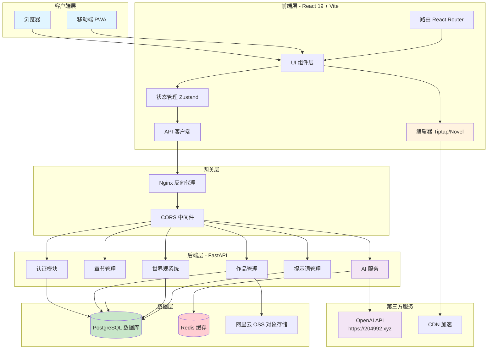

---

## 🏗️ 系统分层架构

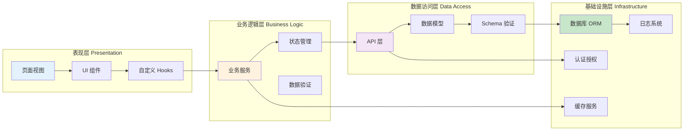

---

## 🎨 前端架构详解

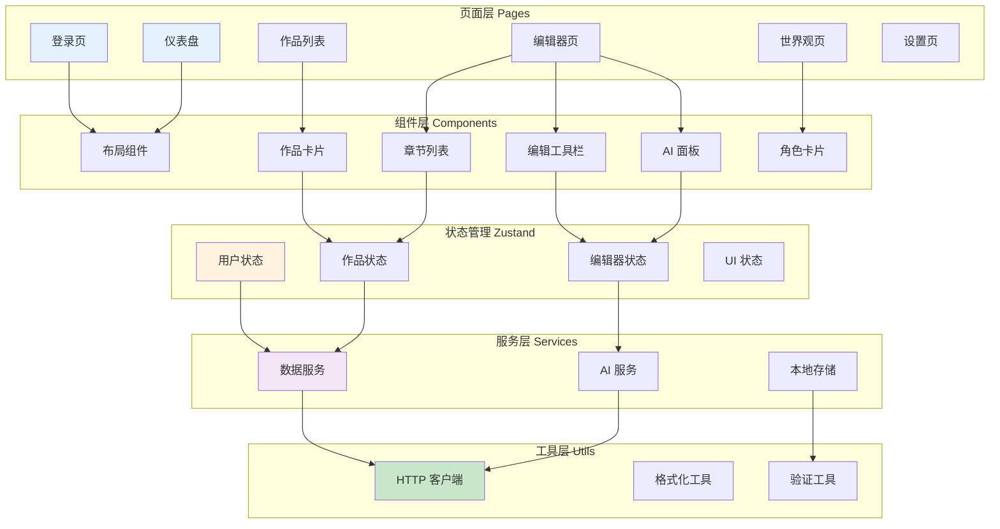

---

## ⚙️ 后端架构详解

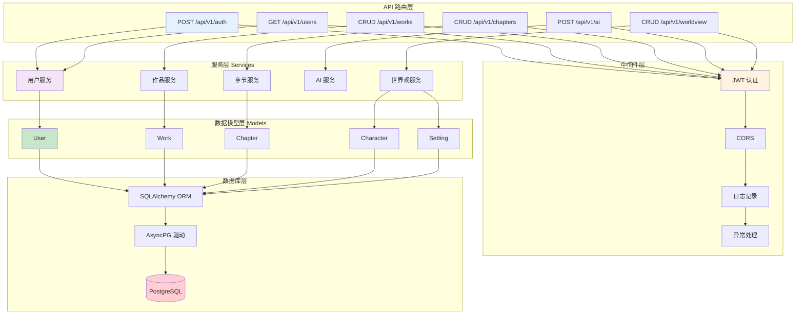

---

## 🗄️ 数据库 ER 图

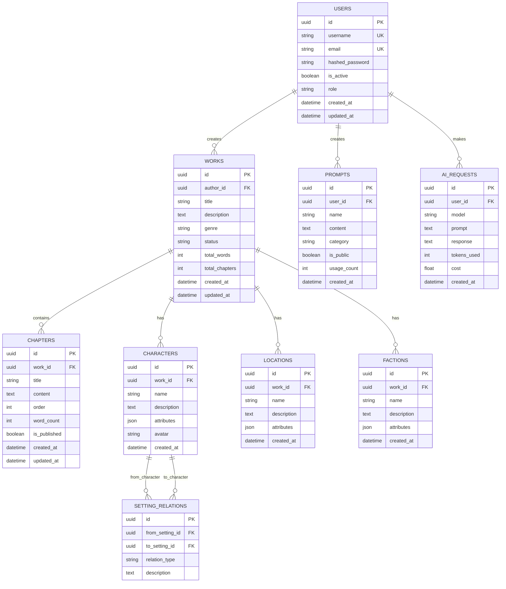

---

## 🔄 核心业务流程图

### 用户写作流程

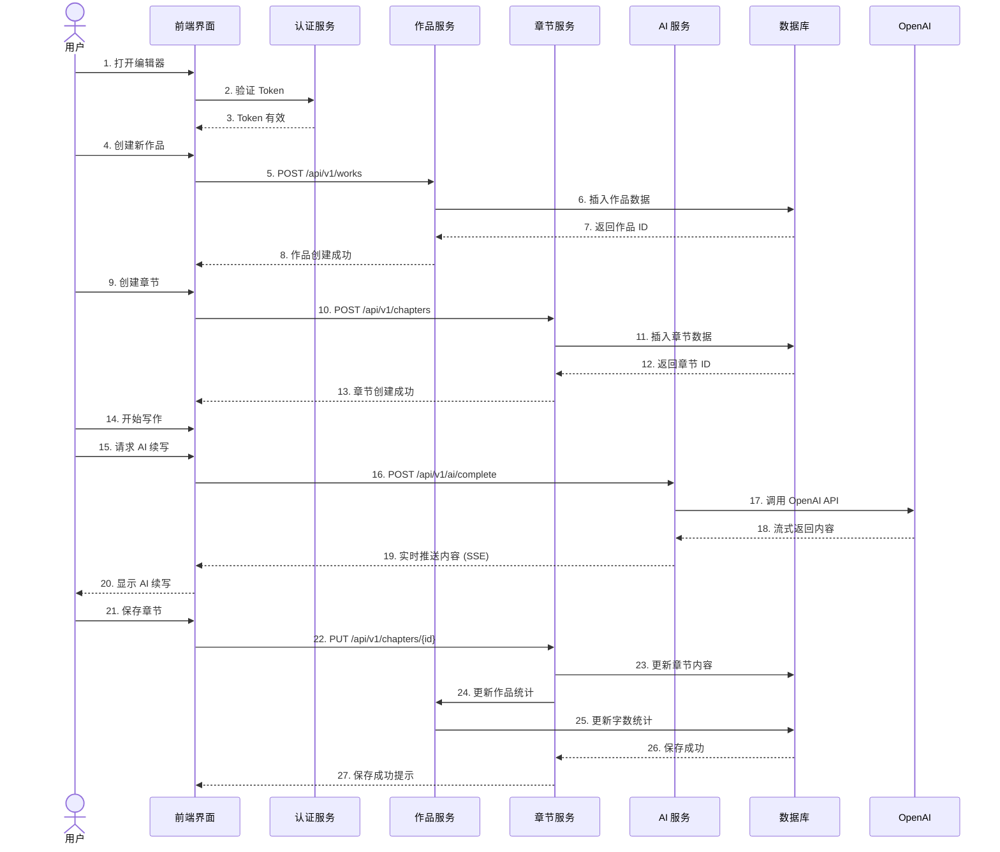

---

## 🤖 AI 服务流程

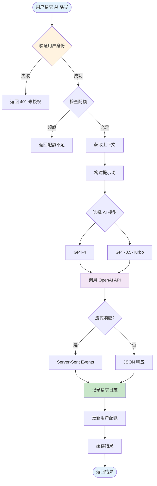

---

## 📡 API 接口架构

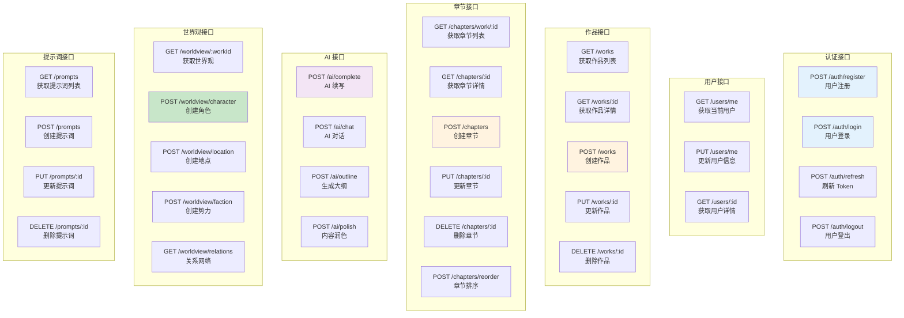

---

## 🔐 认证授权流程

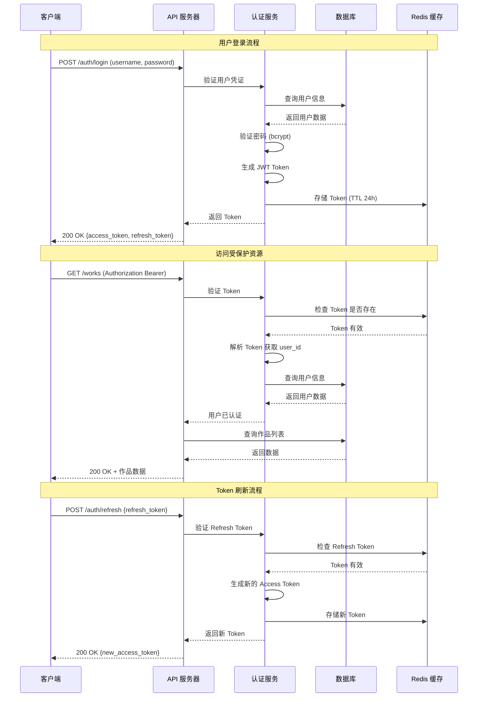

---

## 📦 部署架构

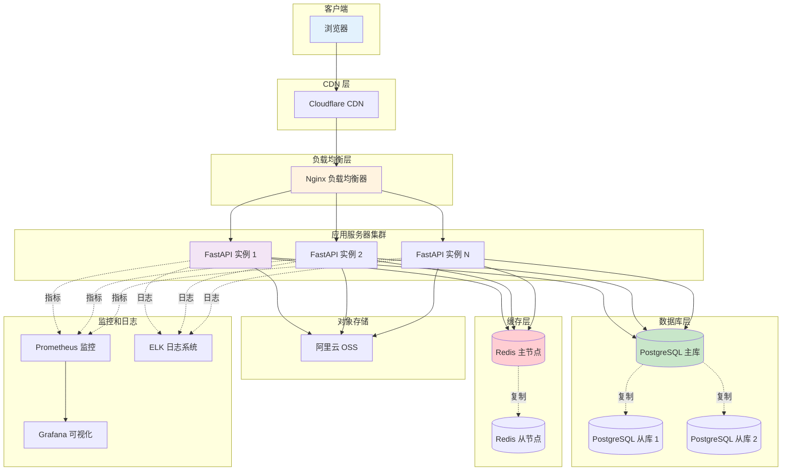

---

## 🔍 数据流向图

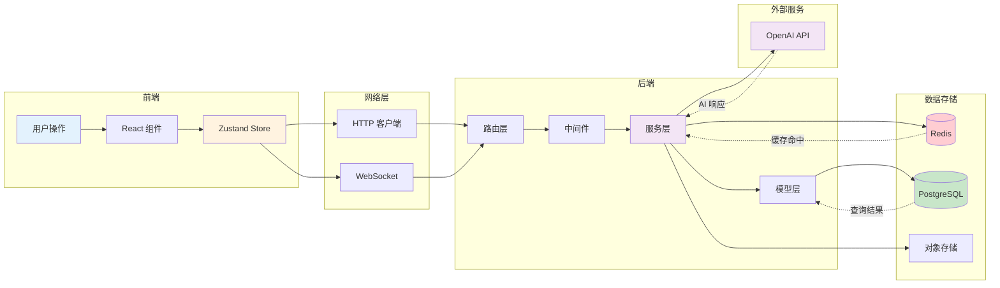

---

## 📊 技术栈总览

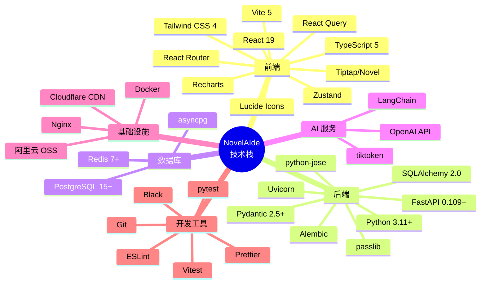

---

## 🎯 核心模块交互

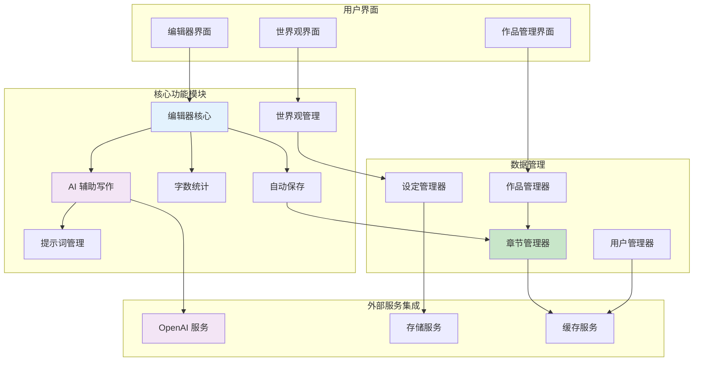

---

## 📝 总结

以上是 NovelAIde 项目的完整架构图，包括：

1. ✅ **系统整体架构** - 展示所有层次和组件
2. ✅ **前端架构** - React 组件和状态管理
3. ✅ **后端架构** - FastAPI 分层设计
4. ✅ **数据库设计** - ER 图和表关系
5. ✅ **业务流程** - 用户写作和 AI 服务流程
6. ✅ **认证授权** - JWT 完整流程
7. ✅ **部署架构** - 生产环境部署方案
8. ✅ **数据流向** - 数据在系统中的流动
9. ✅ **技术栈** - 所有使用的技术
10. ✅ **模块交互** - 核心功能模块关系

这些架构图可以帮助你：
- 📖 理解系统整体设计
- 🔍 定位具体功能的实现位置
- 🚀 规划新功能的开发
- 🤝 团队协作和技术交流
