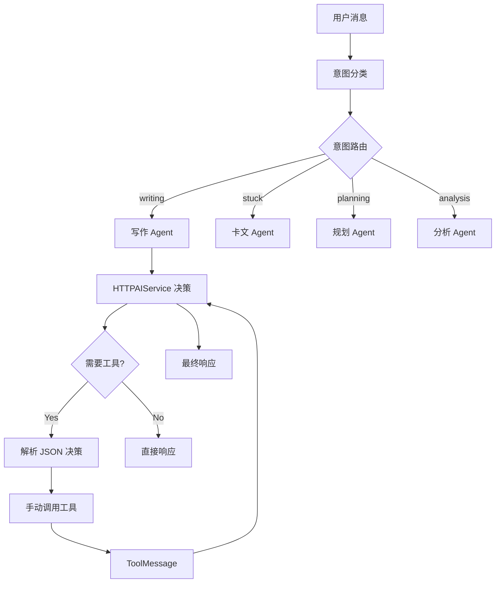
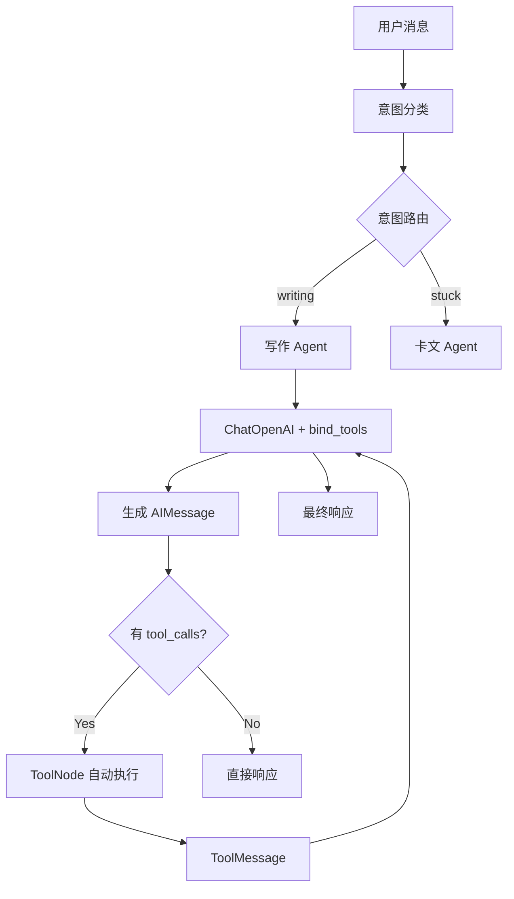

# LangGraph Agent 双模式使用指南

## 概述

LangGraph Agent 系统支持两种工作模式，通过环境变量 `AGENT_USE_CHATGPT` 控制：

- **模式 1 (HTTPAIService)**: 手动工具调用，绕过 Cloudflare（当前默认）
- **模式 2 (ChatOpenAI)**: 原生 LangChain 工具调用（未来推荐）

---

## 两种模式对比

| 特性 | HTTPAIService 模式 | ChatOpenAI 模式 |
|------|-------------------|-----------------|
| **工具调用方式** | 手动解析 JSON 决策 | 原生 bind_tools() |
| **Cloudflare 问题** | ✅ 已绕过 | ❌ 会被阻断 |
| **性能** | 需要额外决策调用 | 直接工具调用 |
| **准确性** | JSON 解析可能出错 | LLM 原生支持 |
| **推荐场景** | 当前生产环境 | Cloudflare 解决后 |

---

## 快速配置

### 方式 1: 环境变量（推荐）

在 `.env` 文件中添加：

```bash
# LangGraph Agent 模式
AGENT_USE_CHATGPT=false  # 默认使用 HTTPAIService 模式

# 如果 Cloudflare 问题解决，可改为：
# AGENT_USE_CHATGPT=true  # 使用 ChatOpenAI 原生工具调用
```

### 方式 2: 代码配置

在 `app/core/config.py` 中修改默认值：

```python
class Settings(BaseSettings):
    # LangGraph Agent 配置
    AGENT_USE_CHATGPT: bool = False  # 改为 True 启用 ChatOpenAI 模式
```

---

## 模式 1: HTTPAIService 模式（当前默认）

### 工作原理



### 实现细节

1. **决策阶段**：HTTPAIService 生成 JSON 决策
   ```json
   {
     "need_tools": true,
     "tool_name": "continue_writing_tool",
     "tool_args": {"context": "...", "requirements": "..."}
   }
   ```

2. **工具调用**：手动调用 @tool 装饰的函数
   ```python
   if tool_name == "continue_writing_tool":
       tool_result = await continue_writing_tool(**tool_args)
   ```

3. **状态更新**：手动构造 ToolMessage
   ```python
   tool_message = ToolMessage(content=tool_result, tool_call_id="manual_call")
   state["messages"].append(tool_message)
   ```

### 优点
- ✅ 绕过 Cloudflare 阻断
- ✅ 保持 LangGraph 完整框架
- ✅ 使用 @tool 装饰器
- ✅ 兼容 ToolNode

### 缺点
- ❌ 需要额外 LLM 调用（决策阶段）
- ❌ JSON 解析可能不准确
- ❌ 手动调用工具的 if-elif 逻辑

---

## 模式 2: ChatOpenAI 模式（未来推荐）

### 工作原理



### 实现细节

1. **工具绑定**：
   ```python
   self.llm = ChatOpenAI(...)
   self.llm_with_tools = self.llm.bind_tools(WRITING_TOOLS)
   ```

2. **LLM 决策**：自动生成 tool_calls
   ```python
   response = await self.llm_with_tools.ainvoke(messages)
   # response.tool_calls = [{"name": "continue_writing_tool", "args": {...}}]
   ```

3. **自动执行**：ToolNode 自动调用工具
   ```python
   workflow.add_node("tools", ToolNode(WRITING_TOOLS))
   ```

### 优点
- ✅ 原生 LangChain 工具调用
- ✅ 工具选择更准确
- ✅ 无需手动 if-elif
- ✅ 性能更好（少一次 LLM 调用）

### 缺点
- ❌ 被 Cloudflare 阻断（当前问题）
- ❌ 需要等待 Cloudflare 问题解决

---

## 测试指南

### 测试脚本

运行 `backend/test_langgraph_modes.py` 测试两种模式：

```bash
cd backend
./venv/Scripts/python.exe test_langgraph_modes.py
```

### 测试结果示例

```
============================================================
测试模式 1: HTTPAIService 模式（绕过 Cloudflare）
============================================================
use_chatgpt: False
llm: None
llm_with_tools: None

响应: 我理解你遇到了写作瓶颈...
会话ID: test_httpai_1
Agent步骤数: 2
意图: stuck

✅ HTTPAIService 模式: 成功

============================================================
测试模式 2: ChatOpenAI 模式（原生工具调用）
============================================================
use_chatgpt: True
llm: ChatOpenAI(...)
llm_with_tools: RunnableBinding(...)

响应: 抱歉，处理您的请求时出错了：<!DOCTYPE html>...Cloudflare...
❌ ChatOpenAI 模式: 失败（Cloudflare阻断）
```

---

## API 调用示例

### 调用 Agent 对话接口

```bash
curl -X POST "http://localhost:8000/api/v1/agent/chat" \
  -H "Authorization: Bearer YOUR_TOKEN" \
  -H "Content-Type: application/json" \
  -d '{
    "message": "我卡文了，不知道该怎么继续写下去",
    "work_id": "123",
    "chapter_id": "456"
  }'
```

### 响应示例

```json
{
  "response": "我理解你遇到了写作瓶颈。让我帮你分析当前的创作状态...",
  "conversation_id": "uuid-xxx",
  "agent_steps": [
    {
      "step": "intent_classification",
      "result": "识别意图: stuck"
    },
    {
      "step": "stuck_tool_call",
      "result": "调用工具 (HTTPAIService): get_context_tool"
    }
  ],
  "suggested_actions": [],
  "metadata": {
    "intent": "stuck",
    "framework": "langgraph",
    "timestamp": "2025-10-29T12:00:00"
  }
}
```

---

## 切换模式步骤

### 从 HTTPAIService 切换到 ChatOpenAI

当 Cloudflare 问题解决后，切换到原生工具调用：

1. **修改 .env**：
   ```bash
   AGENT_USE_CHATGPT=true
   ```

2. **重启服务**：
   ```bash
   cd backend
   ./venv/Scripts/python.exe -m uvicorn app.main:app --reload
   ```

3. **测试验证**：
   ```bash
   ./venv/Scripts/python.exe test_langgraph_modes.py
   ```

4. **观察日志**：
   ```
   [LangGraph] 使用 ChatOpenAI 模式（原生工具调用）
   [LangGraph] LLM决策 (ChatOpenAI): 调用工具
   [LangGraph] 检测到工具调用: 1 个工具
   ```

### 回滚到 HTTPAIService

如果出现问题，立即回滚：

1. **修改 .env**：
   ```bash
   AGENT_USE_CHATGPT=false
   ```

2. **重启服务**

---

## 故障排查

### 问题 1: Cloudflare 阻断

**症状**：
```
抱歉，处理您的请求时出错了：<!DOCTYPE html>...Cloudflare...
```

**解决方案**：
1. 确认 `AGENT_USE_CHATGPT=false`
2. 重启服务
3. 验证日志显示 "使用 HTTPAIService 模式"

### 问题 2: 工具调用失败

**症状**：
```
[ERROR] No AIMessage found in input
```

**解决方案**：
- HTTPAIService 模式：检查 JSON 解析逻辑
- ChatOpenAI 模式：检查 bind_tools() 是否正确

### 问题 3: 意图分类错误

**症状**：用户说"我卡文了"，但被识别为 "general"

**解决方案**：优化 `_classify_intent()` 的 prompt

---

## 最佳实践

1. **生产环境**：使用 `AGENT_USE_CHATGPT=false`（当前）
2. **测试环境**：定期测试 `AGENT_USE_CHATGPT=true`（监控 Cloudflare）
3. **监控日志**：关注 `[LangGraph]` 前缀的日志
4. **性能监控**：HTTPAIService 模式会多一次 LLM 调用

---

## 技术细节

### StateGraph 结构

```python
START
  ↓
intent_classifier (分类意图)
  ↓
[条件路由]
  ├─> writing_agent
  ├─> planning_agent
  ├─> analysis_agent
  ├─> stuck_agent
  └─> general_chat
  ↓
[_should_continue: 检查 tool_calls]
  ├─> tools (ToolNode)
  └─> END
  ↓
[_route_after_tools: 路由回 Agent]
  ↓
Agent节点 (生成最终响应)
  ↓
END
```

### 工具定义

```python
@tool
async def continue_writing_tool(context: str, requirements: str = "") -> str:
    """续写工具：根据上下文续写内容"""
    # 使用 HTTPAIService 生成续写
    return await _generate_text_helper(prompt, temperature=0.8)

@tool
async def polish_text_tool(text: str, style: str = "professional") -> str:
    """润色工具：优化文本质量"""
    # ...

@tool
async def analyze_text_tool(text: str, focus: str = "all") -> str:
    """分析工具：分析文本问题"""
    # ...

@tool
async def get_context_tool(work_id: str, chapter_id: str = "") -> str:
    """获取上下文工具：检索章节和世界观信息"""
    # ...
```

---

## 未来规划

1. **短期**（当前）：使用 HTTPAIService 模式确保稳定
2. **中期**：与 API 提供商沟通解决 Cloudflare 问题
3. **长期**：切换到 ChatOpenAI 原生工具调用
4. **优化**：改进 HTTPAIService 模式的 JSON 决策准确性

---

## 相关文件

- **主实现**：`backend/app/services/agent/langgraph_agent.py`
- **API 接口**：`backend/app/api/v1/agent.py`
- **配置文件**：`backend/app/core/config.py`
- **测试脚本**：`backend/test_langgraph_modes.py`
- **总体方案**：`AI写作平台Agent化改造方案.md`

---

## 总结

LangGraph Agent 双模式系统成功实现了：

✅ **完整的 LangGraph 框架**（响应用户"不要简化"的强烈反馈）
✅ **@tool 装饰器**
✅ **StateGraph + ToolNode**
✅ **条件路由**
✅ **Cloudflare 绕过**（HTTPAIService 模式）
✅ **未来灵活切换**（ChatOpenAI 模式）

当前推荐：**AGENT_USE_CHATGPT=false**（稳定可靠）
