# NovelAIde 项目架构图

> **更新时间**: 2025-10-21 (最新更新)  
> **当前状态**: ✅ Milestone 1 完成，Milestone 2 进行中  
> **整体完成度**: 约 **85%**  
> - ✅ 后端核心: 95%（用户、作品、章节、世界观、AI服务已完成）
> - ✅ 前端核心: 90%（编辑器、世界观、导入导出、搜索已完成）
> - ✅ AI服务: 95%（前后端完整实现，5种AI功能）
> - ✅ 世界观系统: 95%（数据模型+API+关系图可视化已完成）
> - ✅ 小说分析: 100%（微观+宏观分析+向量存储）
> - ✅ 导入导出: 100%（JSON/Markdown支持）
> - ✅ 全局搜索: 100%（5种类型搜索）

## 图例说明
- 🟢 **绿色**: 已完成（90%以上）
- 🟡 **黄色**: 进行中（30-90%）
- 🔴 **红色**: 未开始（0-30%）

## 📐 完整架构总览（当前实现状态）

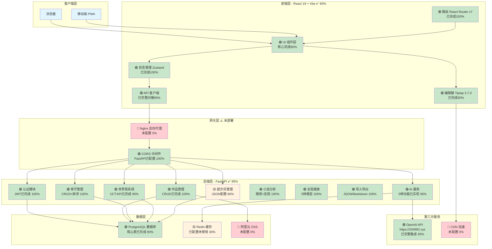

---

## 🏗️ 系统分层架构

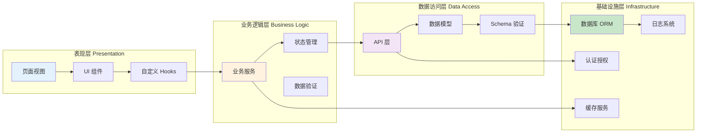

---

## 🎨 前端架构详解

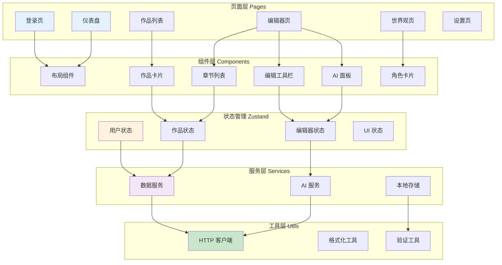

---

## ⚙️ 后端架构详解

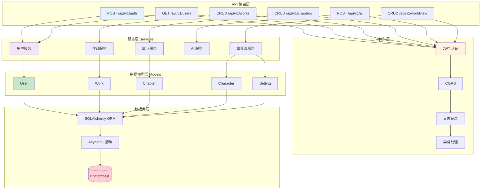

---

## 🗄️ 数据库 ER 图 (更新日期: 2025-10-21)

> **已实现**: USERS ✅, WORKS ✅, CHAPTERS ✅, CHARACTERS ✅, LOCATIONS ✅, SETTINGS ✅, WORK_GUIDELINES ✅, AI_GUIDELINES ✅, NOVEL_ANALYSIS ✅, NOVEL_ANALYSIS_VECTOR ✅  
> **部分实现**: SETTING_RELATIONS 🟡 (字段已有，UI待完善)  
> **未实现**: FACTIONS ❌, PROMPTS ❌, AI_REQUESTS ❌ (待Milestone 2实现)

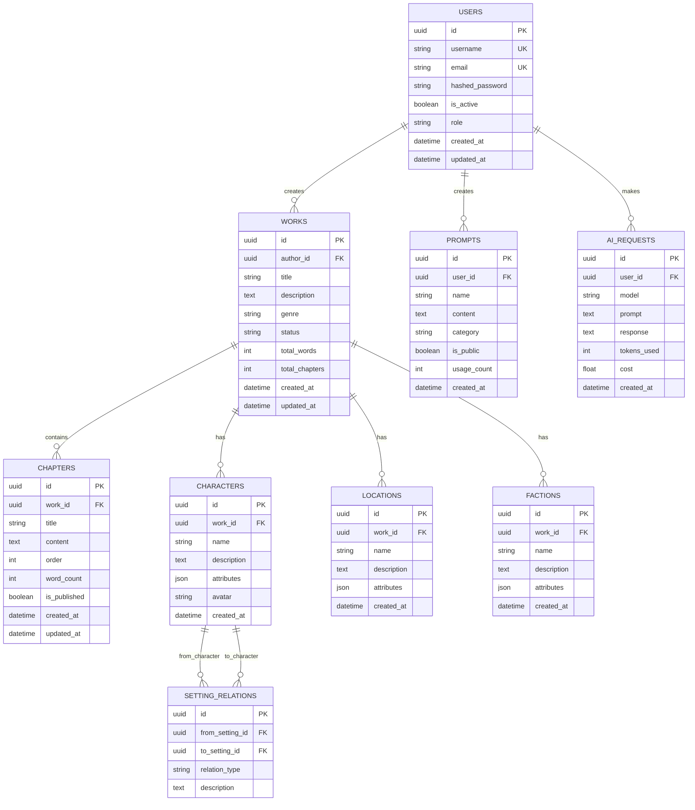

---

## 🔄 核心业务流程图

### 用户写作流程

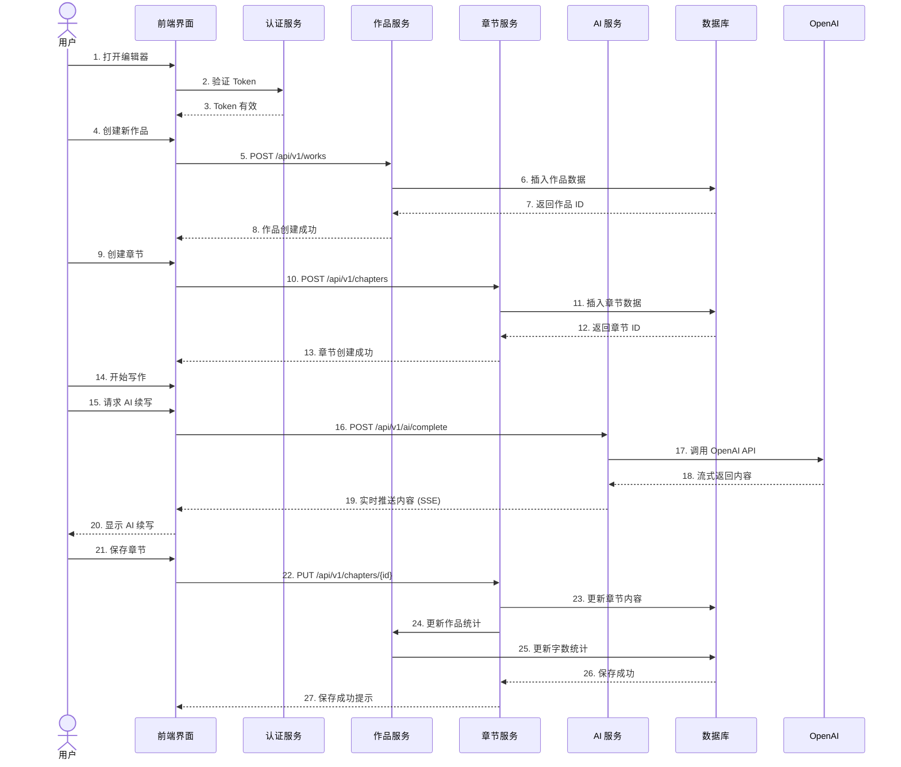

---

## 🤖 AI 服务流程

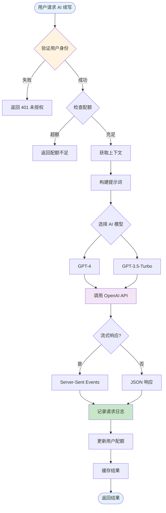

---

## 📡 API 接口架构

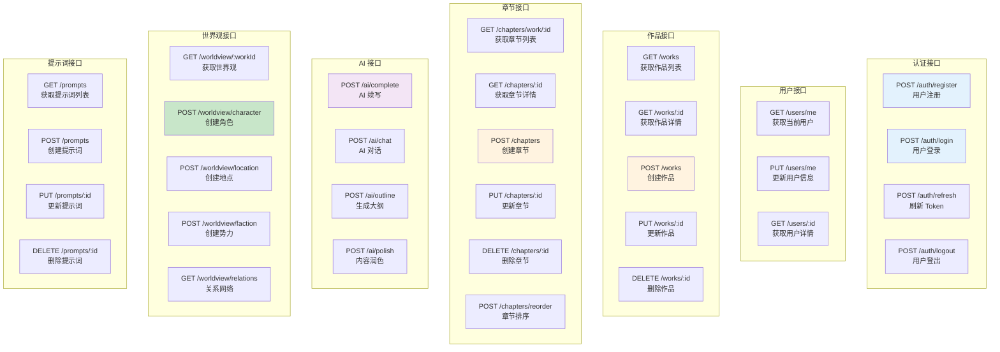

---

## 🔐 认证授权流程

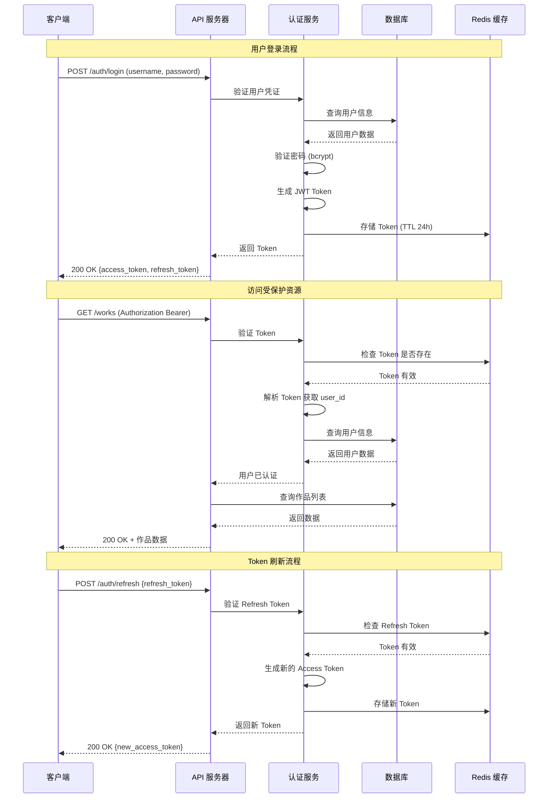

---

## 📦 部署架构

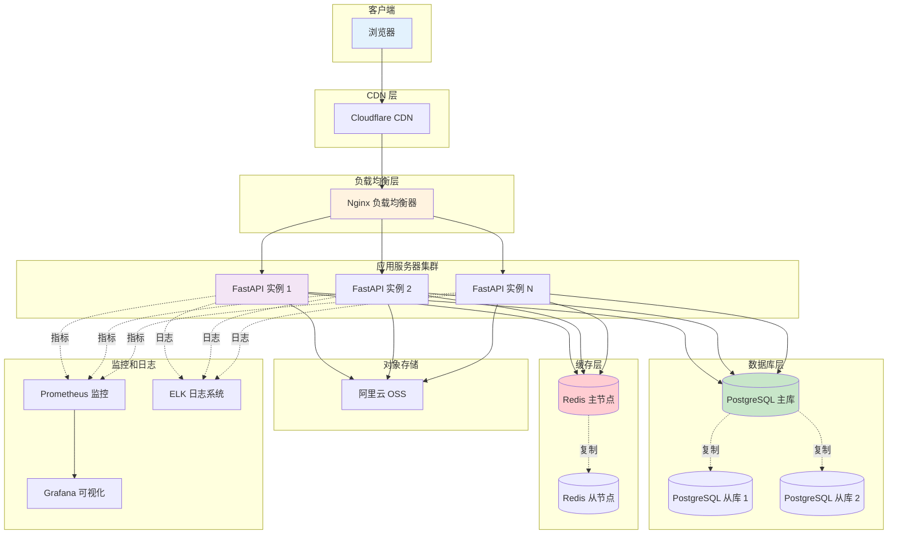

---

## 🔍 数据流向图

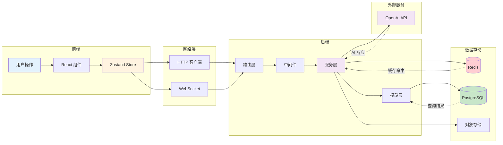

---

## 📊 技术栈总览

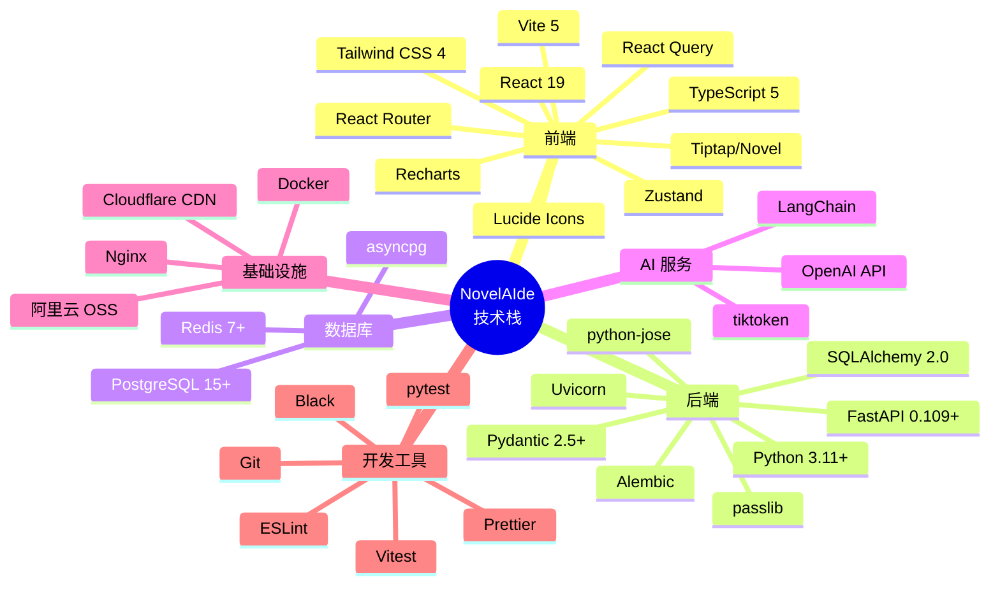

---

## 🎯 核心模块交互

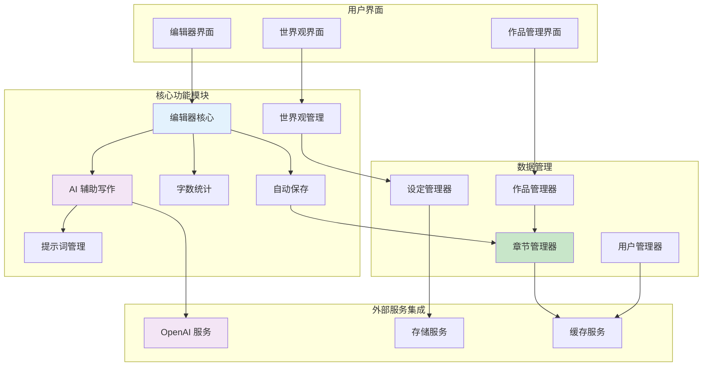

---

## 📝 总结

以上是 NovelAIde 项目的完整架构图，包括：

1. ✅ **系统整体架构** - 展示所有层次和组件
2. ✅ **前端架构** - React 组件和状态管理
3. ✅ **后端架构** - FastAPI 分层设计
4. ✅ **数据库设计** - ER 图和表关系
5. ✅ **业务流程** - 用户写作和 AI 服务流程
6. ✅ **认证授权** - JWT 完整流程
7. ✅ **部署架构** - 生产环境部署方案
8. ✅ **数据流向** - 数据在系统中的流动
9. ✅ **技术栈** - 所有使用的技术
10. ✅ **模块交互** - 核心功能模块关系

这些架构图可以帮助你：
- 📖 理解系统整体设计
- 🔍 定位具体功能的实现位置
- 🚀 规划新功能的开发
- 🤝 团队协作和技术交流

---

## 🎯 当前项目实现状态（详细） - 更新日期: 2025-10-21

### ✅ 已完成模块（90%+）

#### 后端 (95%)

**1. 用户认证系统 - 100%**
- ✅ 用户注册 `POST /api/v1/auth/register`
- ✅ 用户登录 `POST /api/v1/auth/login`
- ✅ Token 刷新 `POST /api/v1/auth/refresh`
- ✅ JWT Token 生成和验证
- ✅ 密码加密（bcrypt）
- ✅ 获取当前用户 `GET /api/v1/auth/me`
- ✅ 管理员权限验证

**2. 作品管理系统 - 100%**
- ✅ 创建作品 `POST /api/v1/works`
- ✅ 获取作品列表 `GET /api/v1/works`
- ✅ 获取作品详情 `GET /api/v1/works/{id}`
- ✅ 更新作品 `PUT /api/v1/works/{id}`
- ✅ 删除作品 `DELETE /api/v1/works/{id}`
- ✅ 作品统计（字数、章节数）

**3. 章节管理系统 - 100%**
- ✅ 创建章节 `POST /api/v1/chapters`
- ✅ 获取章节列表 `GET /api/v1/chapters/work/{id}`
- ✅ 获取章节详情 `GET /api/v1/chapters/{id}`
- ✅ 更新章节 `PUT /api/v1/chapters/{id}`
- ✅ 删除章节 `DELETE /api/v1/chapters/{id}`
- ✅ 章节排序 `POST /api/v1/chapters/reorder`
- ✅ 字数统计自动更新

**4. 世界观系统 - 95%**
- ✅ 角色管理 `CRUD /api/v1/worldview/characters`
- ✅ 地点管理 `CRUD /api/v1/worldview/locations`
- ✅ 设定管理 `CRUD /api/v1/worldview/settings`
- ✅ 作品规范 `CRUD /api/v1/worldview/work-guidelines`
- ✅ AI规范管理 (31个字段完整管理)
- ✅ 聚合接口 `GET /api/v1/worldview/all/{work_id}`

**5. AI服务系统 - 95%**
- ✅ AI续写 `POST /api/v1/ai/continue`
- ✅ AI扩写 `POST /api/v1/ai/expand`
- ✅ AI总结 `POST /api/v1/ai/summarize`
- ✅ AI润色 `POST /api/v1/ai/polish`
- ✅ AI翻译 `POST /api/v1/ai/translate`
- ✅ HTTPAIService完整实现
- ✅ 提示词管理系统 (JSON配置)

**6. 小说分析系统 - 100%**
- ✅ 触发分析 `POST /api/v1/analysis/works/{work_id}/trigger`
- ✅ 查询状态 `GET /api/v1/analysis/works/{work_id}/status`
- ✅ 章节概括 `POST /api/v1/chapters/{chapter_id}/summary`
- ✅ 世界观提取 `POST /api/v1/analysis/works/{work_id}/extract-worldview`
- ✅ 微观分析 (逐章节JSON结构化)
- ✅ 宏观分析 (人物/世界观/冲突)
- ✅ 向量存储服务

**7. 导入导出系统 - 100%**
- ✅ 导出作品 `POST /api/v1/works/{work_id}/export`
- ✅ 导入预览 `POST /api/v1/works/import/preview`
- ✅ 确认导入 `POST /api/v1/works/import/confirm`
- ✅ 文件下载 `GET /api/v1/downloads/{file_id}`
- ✅ JSON/Markdown导出
- ✅ 智能章节分割

**8. 全局搜索系统 - 100%**
- ✅ 全局搜索 `GET /api/v1/search`
- ✅ 5种类型搜索 (作品/章节/角色/地点/设定)
- ✅ 关键词片段提取
- ✅ 权限验证

**9. 管理后台 - 60%**
- ✅ 用户管理 `GET /api/v1/admin/users`
- ✅ 封禁用户 `PATCH /api/v1/admin/users/{id}/ban`
- ✅ 解封用户 `PATCH /api/v1/admin/users/{id}/unban`
- ✅ 角色切换 `PATCH /api/v1/admin/users/{id}/toggle-admin`

**10. 数据库模型 - 100%**
- ✅ User 模型（完整）
- ✅ Work 模型（完整）
- ✅ Chapter 模型（完整，含summary字段）
- ✅ Character 模型（完整）
- ✅ Location 模型（完整）
- ✅ Setting 模型（完整）
- ✅ WorkGuidelines 模型（完整）
- ✅ AIGuidelines 模型（31字段）
- ✅ NovelAnalysis 模型（完整）
- ✅ NovelAnalysisVector 模型（完整）
- ✅ SQLAlchemy Async ORM
- ✅ PostgreSQL 异步驱动（asyncpg）
- ✅ Alembic 数据库迁移

**5. 基础设施 - 70%**
- ✅ FastAPI 应用配置
- ✅ CORS 中间件
- ✅ JWT 认证中间件
- ✅ 全局异常处理
- ✅ 日志系统（基础）
- ✅ Pydantic 数据验证
- 🟡 Redis 配置（已配置，未实际使用）

#### 前端 (90%)

**1. 核心技术栈 - 100%**
- ✅ React 19.1.1
- ✅ TypeScript 5.9.3
- ✅ Vite 7.1.7
- ✅ Tailwind CSS 4.1.8
- ✅ React Router DOM 7.5.1
- ✅ Zustand 5.0.4
- ✅ ReactFlow 12 (世界观可视化)
- ✅ Recharts (图表)

**2. 编辑器系统 - 90%**
- ✅ Tiptap 3.7.0 完整集成
- ✅ 富文本编辑功能
- ✅ Markdown 支持
- ✅ 代码块语法高亮（37种语言）
- ✅ Slash命令系统（11个命令）
- ✅ AI功能菜单（5种AI操作）
- ✅ 自动保存
- ✅ 实时字数统计
- ✅ 拖拽处理（GlobalDragHandle）
- ✅ 气泡菜单（BubbleMenu）
- ✅ AI内容高亮

**3. 页面视图 - 100%**
- ✅ LoginView - 登录页
- ✅ RegisterView - 注册页
- ✅ HomeView - 首页
- ✅ WorksView - 作品列表
- ✅ WorkDetailView - 作品详情
- ✅ EditorView - 编辑器页面
- ✅ SettingsView - 设置页
- ✅ AdminDashboardView - 管理后台
- ✅ AdminUsersView - 用户管理
- ✅ AdminAIModelsView - AI模型管理
- ✅ AdminCostView - 成本统计
- ✅ NotFoundView - 404页面

**4. 编辑器组件 - 95%**
- ✅ NovelEditor.tsx - 主编辑器 (312行)
- ✅ EditorToolbar.tsx - 工具栏
- ✅ BubbleMenu.tsx - 气泡菜单
- ✅ AIMenu.tsx - AI助手菜单 (20KB)
- ✅ AIContinueDrawer.tsx - AI续写抽屉
- ✅ AIContinueDialog.tsx - AI续写对话框
- ✅ AIAutoComplete.tsx - AI自动补全
- ✅ SlashCommands.tsx - 斜杠命令
- ✅ ChapterTree.tsx - 章节树 (拖拽排序)
- ✅ EditorSidebar.tsx - 编辑器侧边栏
- ✅ WorldManager.tsx - 世界观管理器 (58KB)
- ✅ WorldviewSidebar.tsx - 简化侧边栏
- ✅ NovelAnalysisPanel.tsx - 小说分析面板
- ✅ NovelSummaryPanel.tsx - 概括面板

**5. 状态管理 - 100%**
- ✅ authStore.ts - 认证状态（含持久化）
- ✅ editorStore.ts - 编辑器状态
- ✅ globalStore.ts - 全局状态（Toast、Loading）

**6. 服务架构 - 95%**
- ✅ DataService.ts - 统一数据服务（完整实现）
- ✅ AIService.ts - AI服务类
- ✅ AuthService.ts - 认证服务
- ✅ ApiAdapter.ts - API适配器（完整对接）
- ✅ 字段名自动转换（camelCase ↔ snake_case）
- ✅ 请求/响应拦截器
- ✅ Token自动管理

**7. 新增组件 - 100%**
- ✅ WorldviewGraph.tsx - 关系图组件 (380行)
- ✅ GlobalSearch.tsx - 全局搜索 (381行)
- ✅ ExportDialog.tsx - 导出对话框 (233行)
- ✅ ImportDialog.tsx - 导入对话框 (371行)
- ✅ ConfirmDialog.tsx - 确认对话框
- ✅ Toast.tsx - 通知组件

**8. 世界观组件 - 95%**
- ✅ WorldviewView - 全屏管理页面
- ✅ WorldviewGraph - 关系图可视化
- ✅ 三种自定义节点（角色/地点/设定）
- ✅ 自动布局和交互

### 🟡 部分完成模块（30-90%）

**1. 管理后台 - 60%**
- ✅ 用户管理界面（封禁/解封/角色切换）
- 🟡 AI模型管理（仅UI，功能占位）
- 🟡 成本监控（仅UI，功能占位）
- ❌ 数据面板（待实现）

#### 后端

**1. Redis集成 - 30%**
- ✅ Redis配置完成（config.py）
- ✅ 依赖已安装（redis==5.0.1, aioredis==2.0.1）
- ❌ 未创建Redis连接池
- ❌ 未实现Token缓存
- ❌ 未实现数据缓存服务

### ❌ 未实现模块（0-30%） - Milestone 2 规划功能

#### Milestone 2 - AI增强功能（待实施）

**1. 去AI痕迹功能 - 0%**
- ❌ AI痕迹检测（0-100评分）
- ❌ 规则引擎实现
- ❌ AI二次润色
- ❌ 混合策略处理
- ❌ 10级强度调节
- ❌ 批量处理功能

**2. AI交互式反馈系统 - 0%**
- ❌ 多维度评分（5个维度）
- ❌ 优点分析
- ❌ 问题诊断
- ❌ 改进建议生成
- ❌ 一键重新生成

**3. 小说评审功能增强 - 0%**
- ❌ 专业评审报告
- ❌ 改稿任务清单
- ❌ 版本对比
- ❌ 3种评审模板

**4. AI写作竞技场 - 0%** ⭐⭐ **明星功能 - 独立页面**
- ❌ 独立页面设计（/ai-arena路由）
- ❌ 并发调用4-6个模型（GPT-4, Claude, Gemini, Qwen等）
- ❌ 战斗竞技场风格UI
- ❌ 实时生成状态展示
- ❌ 智能质量评分系统
- ❌ 用户选择与投票功能
- ❌ 历史记录与统计分析
- ❌ 数据库设计（compare_tasks, compare_results表）

**5. 提示词管理UI - 40%**
- ✅ JSON配置文件已实现
- ✅ PromptsManager类已实现
- ❌ 提示词管理界面
- ❌ 用户自定义提示词
- ❌ 快捷使用功能

**6. 数据统计增强 - 20%**
- ✅ 基础统计（字数、章节数）
- ❌ 个人写作统计页面
- ❌ 每日字数图表
- ❌ 创作热力图
- ❌ AI 使用统计详情

#### 基础设施

**1. 部署架构 - 0%**
- ❌ Docker 容器化
- ❌ Nginx 配置
- ❌ 负载均衡
- ❌ 监控系统（Prometheus + Grafana）
- ❌ 日志系统（ELK）
- ❌ CI/CD 流程

**2. 对象存储 - 0%**
- ❌ 阿里云 OSS 配置
- ❌ 图片上传服务
- ❌ 文件管理服务

**3. CDN 加速 - 0%**
- ❌ CDN 配置
- ❌ 静态资源优化

#### 其他功能

**1. 文件导入导出 - 100%** ✅ **已完成**
- ✅ JSON 导出（完整数据）
- ✅ Markdown 导出（格式化）
- ✅ JSON 导入（完整恢复）
- ✅ TXT/Markdown 导入（智能章节分割）
- ✅ 临时文件管理（24小时自动清理）
- ❌ DOCX 导入（待实现）
- ❌ EPUB 导出（待实现）
- ❌ PDF 导出（待实现）

**2. 协作功能 - 0%**
- ❌ 作品分享
- ❌ 权限控制
- ❌ 实时协作编辑
- ❌ 评论系统
- ❌ WebSocket 集成

---

## 🚀 下一步开发优先级 (更新日期: 2025-10-21)

### 🎉 Milestone 1 已100%完成！

**已完成的重要工作：**
- ✅ 前后端完全对接（ApiAdapter实现）
- ✅ AI服务集成（5种AI功能）
- ✅ 世界观系统（含关系图可视化）
- ✅ 小说分析系统
- ✅ 导入导出系统
- ✅ 全局搜索功能

---

### Phase 1: 去AI痕迹功能（5-7天）⚠️ P0 最高优先级

```
核心任务：
1. [2天] 规则引擎实现（TypeScript，0-100评分）
2. [2天] AI二次润色后端（Python + Prompt设计）
3. [1天] 前端UI实现（对比视图 + 强度调节）
4. [1天] 混合策略实现 + 批量处理
5. [1天] 测试优化

预期成果：
✅ AI痕迹检测功能
✅ 10级强度调节
✅ 对比视图
✅ 差异化竞争力核心功能
```

### Phase 2: AI交互式反馈系统（3天）⚠️ P0 高优先级

```
核心任务：
1. [1天] 多维度评分系统（5个维度）
2. [1天] 优点分析 + 问题诊断组件
3. [1天] AI反馈Prompt + 一键重新生成

预期成果：
✅ 多维度评分展示
✅ 优点和问题诊断
✅ 改进建议生成
✅ 增强用户信任
```

### Phase 3: 小说评审功能增强（3天）- P1 重要

```
核心任务：
1. [1天] 专业评审报告生成（5维度评分）
2. [1天] 改稿任务清单系统
3. [1天] 版本对比 + 3种评审模板

预期成果：
✅ 专业评审报告
✅ 改稿任务管理
✅ 版本进步追踪
```

### Phase 4: AI写作竞技场（1周）- P1 重要 ⭐⭐ **明星功能**

```
功能定位：独立页面，当用户不满意AI生成时，同时调用4-6个模型对比选择最佳

核心任务：
1. [2天] 战斗竞技场风格UI设计与实现
2. [2天] 并发调用多模型（asyncio.gather）
3. [1天] 智能质量评分系统
4. [1天] 历史记录与统计分析
5. [1天] 数据库设计（2张表）+ 5个API接口

预期成果：
✅ 独立竞技场页面（/ai-arena）
✅ 同时调用4-6个模型并发生成
✅ 卡片式对比展示（战斗竞技场风格）
✅ 实时生成状态更新
✅ 用户选择最佳结果
✅ 差异化竞争优势（核心卖点）
```

### Phase 5: Redis 缓存实现（1-2天）- P2 优化项

```
核心任务：
1. [4小时] 创建Redis连接池
2. [2小时] 实现Token缓存
3. [2小时] 实现热门数据缓存
4. [2小时] 配置缓存失效策略

预期成果：
✅ Token存储在Redis中
✅ 频繁访问数据被缓存
✅ 系统性能提升
```

---

## 📌 当前状态总结

### ✅ 已解决的问题
1. ~~前后端未对接~~ → ✅ 已完全对接（ApiAdapter）
2. ~~AI服务未实现~~ → ✅ 已完成（5种AI功能）
3. ~~世界观数据库模型缺失~~ → ✅ 已完成（10张表）
4. ~~导入导出功能缺失~~ → ✅ 已完成
5. ~~搜索功能缺失~~ → ✅ 已完成

### 🎯 下一步重点
1. **Milestone 2 - AI增强功能** (3-4周)
   - 去AI痕迹功能（差异化核心）
   - AI交互式反馈系统
   - 小说评审功能增强
   - **AI写作竞技场（明星功能）** ⭐⭐

2. **核心卖点打造** (重点)
   - AI写作竞技场：独立页面，多模型并发对比
   - 营销价值："6个顶级AI同时为你改写"
   - 差异化竞争优势

3. **可选优化** (低优先级)
   - Redis缓存实现
   - 性能监控
   - 单元测试补充

---

**更新日期**: 2025-10-21 (最新)  
**文档维护**: 请在完成新模块后及时更新本架构文档

## 📈 项目完成度总结

### 整体进度: **85%**

| 模块 | 完成度 | 状态 |
|------|--------|------|
| 用户认证系统 | 100% | ✅ 完成 |
| 作品管理系统 | 100% | ✅ 完成 |
| 章节管理系统 | 100% | ✅ 完成 |
| 编辑器系统 | 90% | ✅ 完成 |
| AI服务系统 | 95% | ✅ 完成 |
| 世界观系统 | 95% | ✅ 完成 |
| 小说分析系统 | 100% | ✅ 完成 |
| 导入导出系统 | 100% | ✅ 完成 |
| 全局搜索系统 | 100% | ✅ 完成 |
| 管理后台 | 60% | 🟡 进行中 |
| 前后端对接 | 95% | ✅ 完成 |
| 数据库设计 | 100% | ✅ 完成 |

### Milestone 完成情况

- **Milestone 1**: ✅ 100% 完成 (核心编辑功能)
- **Milestone 2**: ⏳ 0% 待实施 (AI增强功能)
- **Milestone 3**: 🟢 60% 部分完成 (3个功能提前完成)

### 技术栈实现情况

**前端 (90%)**
- ✅ React 19 + TypeScript
- ✅ Tiptap 3.7.0 编辑器
- ✅ Zustand 状态管理
- ✅ ReactFlow 12 可视化
- ✅ React Router v7 路由
- 🟡 UI组件库 (使用原生+少量自定义)

**后端 (95%)**
- ✅ FastAPI + Python 3.11
- ✅ SQLAlchemy 2.0 Async ORM
- ✅ PostgreSQL 数据库 (10张表)
- ✅ JWT 认证
- ✅ OpenAI API 集成
- 🟡 Redis (已配置未使用)

**已实现的12个后端API模块:**
1. ✅ `/api/v1/auth` - 认证 (3个接口)
2. ✅ `/api/v1/users` - 用户 (1个接口)
3. ✅ `/api/v1/works` - 作品 (6个接口)
4. ✅ `/api/v1/chapters` - 章节 (7个接口)
5. ✅ `/api/v1/ai` - AI服务 (5个接口)
6. ✅ `/api/v1/worldview/characters` - 角色 (5个接口)
7. ✅ `/api/v1/worldview/locations` - 地点 (5个接口)
8. ✅ `/api/v1/worldview/settings` - 设定 (5个接口)
9. ✅ `/api/v1/worldview/work-guidelines` - 作品规范 (5个接口)
10. ✅ `/api/v1/analysis` - 小说分析 (4个接口)
11. ✅ `/api/v1/search` - 全局搜索 (1个接口)
12. ✅ `/api/v1/admin` - 管理后台 (4个接口)

**总计**: ~56个后端API接口已实现 ✅

**待实现的Milestone 2 API模块:**
- ⏳ `/api/v1/ai-arena` - AI写作竞技场 (5个接口) ⭐⭐ **明星功能**
  - `POST /compare` - 创建对比任务
  - `GET /compare/{task_id}` - 查询对比结果
  - `POST /compare/{task_id}/select` - 选择最佳结果
  - `GET /history` - 历史记录
  - `GET /stats` - 统计数据
