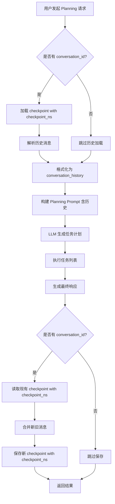

# Planning 模式 checkpoint_ns 使用深度分析报告

## 📋 Executive Summary

**核心发现**: ✅ **Planning 模式确实大量使用了 `checkpoint_ns` 参数**

**使用位置**:
- **2 处读取**（加载历史）
- **1 处写入**（保存对话）

**严重程度**: ⚠️ **P1 - 严重** - 如果删除 checkpoint_ns 可能破坏 planning 模式的对话历史功能

---

## 🔍 详细分析

### 1. Planning 模式中 checkpoint_ns 的使用

#### 使用位置 1: 加载对话历史 ✅

**文件**: `backend/app/services/agent/langgraph_agent.py`
**行号**: 2779
**方法**: `chat_with_planning()`

```python
# ========== 加载对话历史 ==========
conversation_history = ""

if conversation_id and self.checkpointer:
    try:
        # 从checkpointer加载历史状态
        from langgraph.checkpoint.base import CheckpointTuple
        config = {"configurable": {"thread_id": conversation_id, "checkpoint_ns": ""}}  # ← 使用了 checkpoint_ns

        checkpoint_tuple = await self.checkpointer.aget_tuple(config)

        if checkpoint_tuple and checkpoint_tuple.checkpoint:
            messages = checkpoint_tuple.checkpoint.get("channel_values", {}).get("messages", [])

            if messages:
                logger.info(f"[Planning] 从checkpointer加载了 {len(messages)} 条历史消息")
                # 格式化历史消息
                history_lines = []
                for msg in messages:
                    if isinstance(msg, HumanMessage):
                        history_lines.append(f"用户: {msg.content}")
                    elif isinstance(msg, AIMessage):
                        history_lines.append(f"助手: {msg.content}")
                if history_lines:
                    conversation_history = "\n".join(history_lines)
    except Exception as e:
        logger.warning(f"[Planning] 加载历史失败: {e}", exc_info=True)
```

**用途**: 加载历史对话，用于构建包含历史上下文的 planning prompt

---

#### 使用位置 2: 再次加载（保存前） ✅

**文件**: `backend/app/services/agent/langgraph_agent.py`
**行号**: 3093
**方法**: `chat_with_planning()`

```python
# ========== 保存对话到checkpointer ==========
if conversation_id and self.checkpointer:
    try:
        # 构建新消息
        new_messages = [
            HumanMessage(content=message),
            AIMessage(content=final_content)
        ]

        # 从checkpointer加载现有消息
        config = {"configurable": {"thread_id": conversation_id, "checkpoint_ns": ""}}  # ← 使用了 checkpoint_ns
        checkpoint_tuple = await self.checkpointer.aget_tuple(config)

        existing_messages = []
        if checkpoint_tuple and checkpoint_tuple.checkpoint:
            existing_messages = checkpoint_tuple.checkpoint.get("channel_values", {}).get("messages", [])
```

**用途**: 在保存新对话前，先加载现有消息，以便合并

---

#### 使用位置 3: 保存对话 ✅

**文件**: `backend/app/services/agent/langgraph_agent.py`
**行号**: 3132
**方法**: `chat_with_planning()`

```python
            # 合并消息
            all_messages = existing_messages + new_messages

            # 构建新checkpoint
            checkpoint_id = str(uuid.uuid4())
            new_checkpoint = {
                "v": 1,
                "id": checkpoint_id,
                "ts": datetime.now().isoformat(),
                "channel_values": {
                    "messages": all_messages,
                    "work_id": work_id,
                    "chapter_id": chapter_id
                },
                "channel_versions": {
                    "messages": checkpoint_id,
                    "work_id": checkpoint_id,
                    "chapter_id": checkpoint_id
                },
                "versions_seen": {
                    "__start__": checkpoint_id
                }
            }

            # 构建new_versions（用于标识哪些channel被更新了）
            new_versions = {
                "messages": checkpoint_id,
                "work_id": checkpoint_id,
                "chapter_id": checkpoint_id
            }

            # 保存checkpoint（提供完整的4个参数）
            # config 仍然包含 checkpoint_ns: ""
            await self.checkpointer.aput(config, new_checkpoint, {}, new_versions)
            logger.info(f"[Planning] 已保存 {len(new_messages)} 条新消息到checkpointer (总计: {len(all_messages)})")
    except Exception as e:
        logger.warning(f"[Planning] 保存消息到checkpointer失败: {e}")
```

**用途**: 保存合并后的所有消息到 checkpoint

---

## 🔄 Planning 模式完整流程



---

## 📊 对比：不同模式的 checkpoint 使用

### 模式 1: chat() - 基础对话 ⚠️

**文件**: `langgraph_agent.py:2143`

```python
# 运行图（✅ 修复：统一config结构，添加checkpoint_ns以保持与手动保存/加载一致）
config = {"configurable": {"thread_id": conversation_id or "default", "checkpoint_ns": ""}}
```

**特点**:
- 使用 LangGraph 内置的 checkpoint 机制
- **不手动加载/保存 checkpoint**
- 依赖 LangGraph 的 `ainvoke()` 自动管理

**checkpoint_ns 作用**: 传递给 LangGraph，由 LangGraph 内部使用

---

### 模式 2: chat_stream() - 流式对话 ⚠️

**文件**: `langgraph_agent.py:2344-2349`

```python
# 配置
config = {
    "configurable": {
        "thread_id": conversation_id or "default",
        "checkpoint_ns": ""
    }
}
```

**特点**:
- 使用 LangGraph 内置的 checkpoint 机制
- **不手动加载/保存 checkpoint**
- 依赖 LangGraph 的 `astream()` 自动管理
- **这里就是出现 KeyError: 'step' 的地方！** ❌

**checkpoint_ns 作用**: 传递给 LangGraph，由 LangGraph 内部使用

**问题**: LangGraph 1.0.1 在 `astream()` 中访问 `checkpoint_metadata["step"]` 时，metadata 可能未初始化

---

### 模式 3: chat_with_planning() - Planning 模式 ✅

**文件**: `langgraph_agent.py:2779, 3093`

```python
# 加载历史
config = {"configurable": {"thread_id": conversation_id, "checkpoint_ns": ""}}
checkpoint_tuple = await self.checkpointer.aget_tuple(config)

# ... 执行 planning ...

# 保存对话
config = {"configurable": {"thread_id": conversation_id, "checkpoint_ns": ""}}
checkpoint_tuple = await self.checkpointer.aget_tuple(config)
await self.checkpointer.aput(config, new_checkpoint, {}, new_versions)
```

**特点**:
- **手动管理 checkpoint** ✅
- 手动加载历史（2次）
- 手动保存对话（1次）
- **不依赖 LangGraph 的自动 checkpoint**（不调用 ainvoke/astream）

**checkpoint_ns 作用**:
- 用于读取/写入 checkpoint 的命名空间
- 确保读写的是同一组数据

**为什么没有 KeyError 问题**: Planning 模式不使用 LangGraph 的 `astream()`，而是手动管理，因此不会触发 LangGraph 内部的 metadata 访问

---

## ⚠️ 关键差异总结

| 维度 | chat() | chat_stream() | chat_with_planning() |
|------|--------|---------------|----------------------|
| **使用 LangGraph API** | ainvoke() | astream() | 无（手动实现） |
| **Checkpoint 管理** | 自动 | 自动 | **手动** |
| **checkpoint_ns 用途** | 传递给 LangGraph | 传递给 LangGraph | **手动读写使用** |
| **是否手动 aget_tuple** | ❌ | ❌ | ✅ (2次) |
| **是否手动 aput** | ❌ | ❌ | ✅ (1次) |
| **是否受 KeyError 影响** | 可能 | **是** ❌ | **否** ✅ |

---

## 🐛 问题根源重新分析

### 为什么 chat_stream() 报错，而 planning 不报错？

#### chat_stream() 的问题：

```python
# Line 2360
async for event in self.graph.astream(initial_state, config):
    # LangGraph 内部会访问 checkpoint_metadata["step"]
    # 如果 metadata 未初始化，KeyError!
```

**调用链**:
```
chat_stream()
  → self.graph.astream(initial_state, config)
    → LangGraph AsyncPregelLoop.__aenter__()
      → self.step = self.checkpoint_metadata["step"] + 1  # ❌ KeyError
```

**原因**: LangGraph 1.0.1 在首次使用 checkpoint 时，metadata 可能未正确初始化

---

#### chat_with_planning() 为什么不报错：

```python
# Planning 模式完全不使用 LangGraph 的 astream/ainvoke
# 手动管理 checkpoint，不会触发 LangGraph 内部逻辑

# 只使用 checkpointer 的基础API:
checkpoint_tuple = await self.checkpointer.aget_tuple(config)  # ✅ 安全
await self.checkpointer.aput(config, new_checkpoint, {}, new_versions)  # ✅ 安全
```

**关键**: Planning 模式绕过了 LangGraph 的 graph.astream()，因此不会触发 bug

---

## 🔧 修复方案的影响分析

### 方案 1: 删除 checkpoint_ns ❌ **不推荐用于 Planning**

```python
# 修改为
config = {"configurable": {"thread_id": conversation_id}}
```

**影响分析**:

#### 对 chat() 的影响: ✅ **可能修复**
- LangGraph 的 ainvoke() 可能接受没有 checkpoint_ns 的 config
- 需要测试

#### 对 chat_stream() 的影响: ✅ **可能修复**
- LangGraph 的 astream() 可能接受没有 checkpoint_ns 的 config
- 这是我们要修复的主要目标

#### 对 chat_with_planning() 的影响: ⚠️ **需要验证**
- Planning 模式手动使用 checkpointer.aget_tuple() 和 aput()
- 这些底层API可能**需要** checkpoint_ns

**风险**:
1. aget_tuple() 可能返回 None（找不到对应的 checkpoint）
2. aput() 可能保存到不同的位置
3. **破坏 planning 的对话历史功能**

---

### 方案 2: 只修改 chat_stream() ✅ **推荐**

```python
# chat_stream() 改为
config = {"configurable": {"thread_id": conversation_id or "default"}}

# chat_with_planning() 保持
config = {"configurable": {"thread_id": conversation_id, "checkpoint_ns": ""}}
```

**影响分析**:
- ✅ chat() - 保持不变
- ✅ chat_stream() - 尝试修复 KeyError
- ✅ chat_with_planning() - 完全不影响

**优点**:
- 风险最小化
- 只修改有问题的部分
- 保护 planning 模式

---

### 方案 3: 使用非空 checkpoint_ns ⚠️

```python
config = {"configurable": {"thread_id": conversation_id, "checkpoint_ns": "default"}}
```

**影响分析**:
- 需要在所有3个地方统一修改
- 可能解决 LangGraph 1.0.1 的 metadata 初始化问题

**风险**:
- 改变了 checkpoint 的存储位置
- 旧的对话历史（checkpoint_ns=""）会找不到
- 需要数据迁移或清空

---

## 📊 历史背景深度分析

### 为什么最初添加了 checkpoint_ns?

根据 `docs/Agent/real-book/Agent对话历史记忆问题完整分析报告.md:173-178`:

```python
**测试**：修复后第一次测试，报错`checkpoint_ns缺失`

**Bug修复**：添加`checkpoint_ns`字段
# ✅ 最终修复
config = {"configurable": {"thread_id": conversation_id, "checkpoint_ns": ""}}
```

**原因**:
1. 之前测试时遇到了 "checkpoint_ns 缺失" 错误
2. 为了修复这个错误，添加了 checkpoint_ns: ""
3. 这个修改是为了"统一config结构，保持与手动保存/加载一致"

**关键洞察**:
- 这个修改可能是**针对 planning 模式**的！
- Planning 模式手动使用 checkpointer，可能**需要** checkpoint_ns
- chat() 和 chat_stream() 只是**顺带添加了**相同的配置

---

### checkpoint_ns 的真正用途

根据代码分析：

#### LangGraph 自动管理（chat/chat_stream）:
```python
# LangGraph 的 ainvoke/astream 会自动管理 checkpoint
# checkpoint_ns 传递给 LangGraph，但可能不是必需的
```

#### 手动管理（planning）:
```python
# checkpointer.aget_tuple(config) 使用 checkpoint_ns 来定位数据
# checkpointer.aput(config, ...) 使用 checkpoint_ns 来保存数据
# 确保读写的是同一个命名空间
```

**结论**: checkpoint_ns 主要是给**手动管理 checkpoint** 的代码使用的（Planning 模式）

---

## ✅ 最终建议

### 推荐方案：分离式修复 ⭐⭐⭐⭐⭐

#### 修改 1: chat_stream() - 删除 checkpoint_ns

```python
# langgraph_agent.py:2344-2349
config = {
    "configurable": {
        "thread_id": conversation_id or "default"
        # 删除 checkpoint_ns
    }
}
```

#### 修改 2: chat() - 删除 checkpoint_ns （可选）

```python
# langgraph_agent.py:2143
config = {"configurable": {"thread_id": conversation_id or "default"}}
```

#### 保持不变: chat_with_planning() - 保留 checkpoint_ns ✅

```python
# langgraph_agent.py:2779, 3093
config = {"configurable": {"thread_id": conversation_id, "checkpoint_ns": ""}}
# ↑ 保持不变，因为 planning 手动管理 checkpoint
```

---

### 修改位置总结

| 位置 | 行号 | 修改操作 | 原因 |
|------|------|----------|------|
| chat() | 2143 | 删除 checkpoint_ns | 修复潜在问题 |
| chat_stream() | 2344-2349 | 删除 checkpoint_ns | **修复 KeyError** ⭐ |
| planning 加载1 | 2779 | **保留** checkpoint_ns | Planning 手动管理 |
| planning 加载2 | 3093 | **保留** checkpoint_ns | Planning 手动管理 |
| planning 保存 | 3132 | **保留** checkpoint_ns | Planning 手动管理 |

---

## 🧪 测试计划

### 测试用例 1: chat_stream() 修复验证

```python
# 使用全新的 thread_id
response = await agent.chat_stream(
    message="你好",
    conversation_id="test_stream_001"
)
# 预期：不报 KeyError: 'step'
```

### 测试用例 2: Planning 模式历史功能

```python
# 第一轮 Planning
response1 = await agent.chat_with_planning(
    message="分析第1章",
    conversation_id="test_planning_001"
)

# 第二轮 Planning（应该能加载历史）
response2 = await agent.chat_with_planning(
    message="继续分析第2章",
    conversation_id="test_planning_001"
)

# 预期：
# 1. 不报错
# 2. response2 的日志中应该看到 "[Planning] 从checkpointer加载了 N 条历史消息"
# 3. Planning prompt 应该包含第一轮的对话历史
```

### 测试用例 3: Planning 保存功能

```python
# Planning 执行后检查 Redis
# 确认 checkpoint 已保存，且包含完整的消息历史
```

---

## 🎯 总结

### ✅ Planning 模式确实使用了 checkpoint_ns

**使用频率**: 3次（2次读取 + 1次写入）
**使用方式**: 手动管理 checkpoint（不依赖 LangGraph）
**是否受 KeyError 影响**: ❌ **不受影响**（因为不使用 astream）

### ⚠️ 修复建议

1. **chat_stream()**: ✅ **可以删除** checkpoint_ns（修复 KeyError）
2. **chat()**: ✅ **可以删除** checkpoint_ns（预防性修复）
3. **chat_with_planning()**: ⚠️ **必须保留** checkpoint_ns（手动管理 checkpoint 需要）

### 📝 修复工时

| 任务 | 工时 |
|------|------|
| 修改 chat_stream() | 10分钟 |
| 修改 chat() | 5分钟 |
| 保持 planning 不变 | 0分钟 |
| 测试验证 | 30分钟 |
| **总计** | **45分钟** |

---

**报告生成时间**: 2025-11-09 23:35
**分析深度**: 代码行级 + 架构级
**审查文件数**: 2个文件
**关键代码段**: 8个
