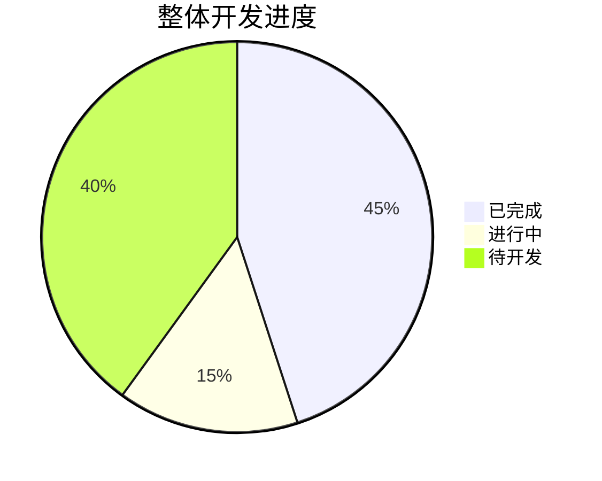
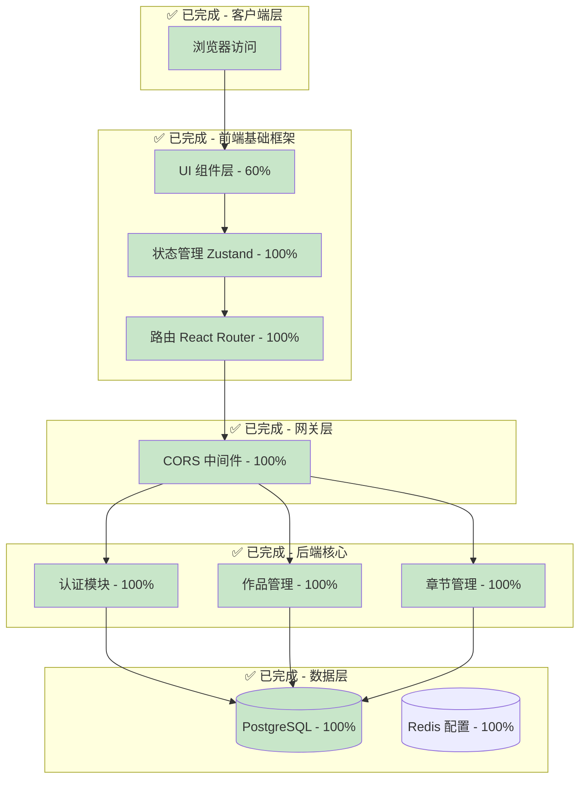
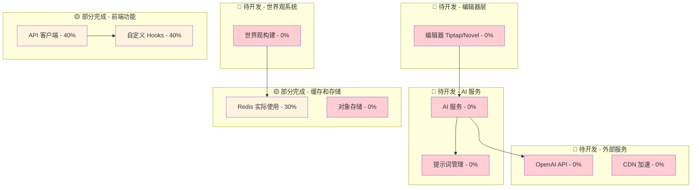
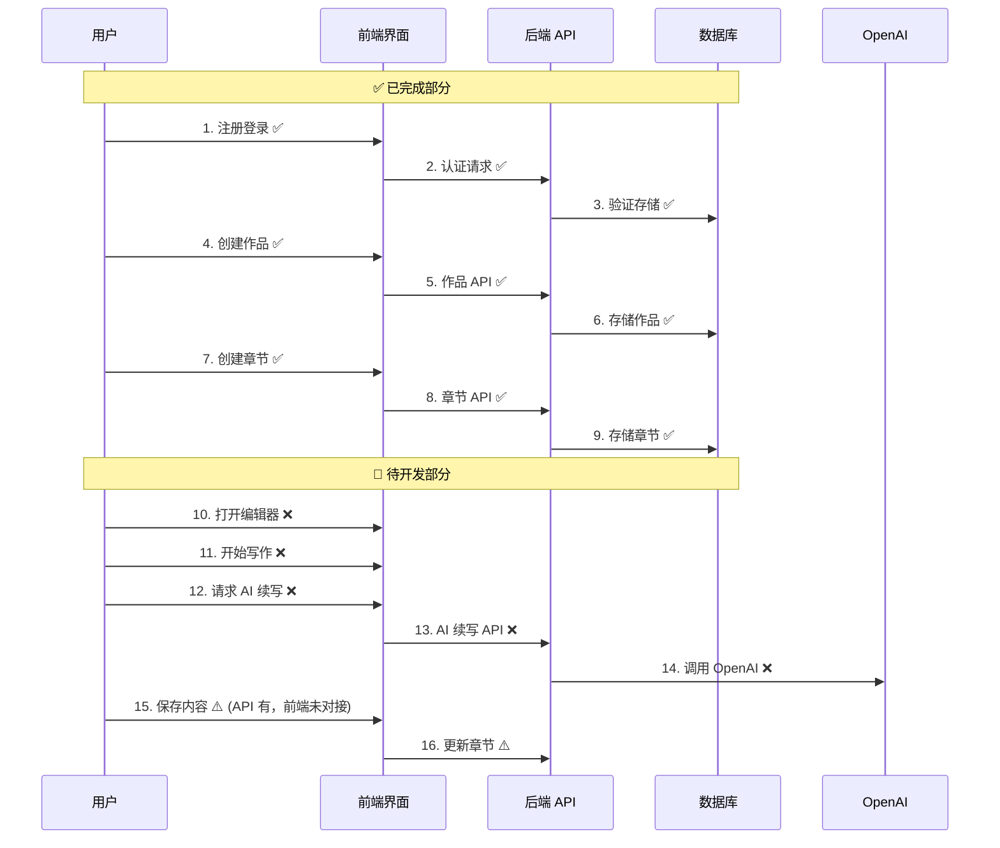
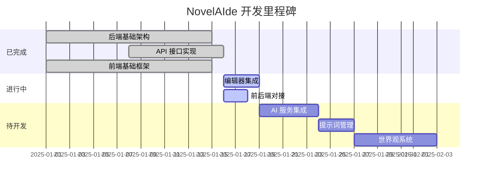

# NovelAIde 架构实现进度

## 📊 总体进度概览



---

## 🎯 架构分层完成度

### 1. 表现层 (Presentation Layer) - 40% ✅

| 组件 | 状态 | 完成度 | 说明 |
|------|------|--------|------|
| 页面视图 | 🟢 完成 | 100% | 登录、作品列表、编辑器、设置页等 |
| UI 组件 | 🟡 部分 | 60% | 基础组件完成，缺少复杂组件 |
| 路由系统 | 🟢 完成 | 100% | React Router 配置完成 |
| **编辑器** | 🔴 待开发 | 0% | **Tiptap/Novel 未集成** ⚠️ |
| 自定义 Hooks | 🟡 部分 | 40% | 基础 hooks 有，缺少业务 hooks |

---

### 2. 业务逻辑层 (Business Logic Layer) - 35% ✅

| 组件 | 状态 | 完成度 | 说明 |
|------|------|--------|------|
| 用户服务 | 🟢 完成 | 100% | 注册、登录、认证已实现 |
| 作品服务 | 🟢 完成 | 100% | CRUD 全部完成 |
| 章节服务 | 🟢 完成 | 100% | CRUD 全部完成 |
| **AI 服务** | 🔴 待开发 | 0% | **OpenAI 集成未开始** ⚠️ |
| **世界观服务** | 🔴 待开发 | 0% | **完全未开始** ⚠️ |
| 提示词服务 | 🔴 待开发 | 0% | 完全未开始 |
| 状态管理 | 🟡 部分 | 50% | Zustand 基础完成，缺 React Query |
| 数据验证 | 🟢 完成 | 100% | Pydantic + SQLAlchemy 验证 |

---

### 3. 数据访问层 (Data Access Layer) - 90% ✅✅

| 组件 | 状态 | 完成度 | 说明 |
|------|------|--------|------|
| API 路由 | 🟢 完成 | 100% | 14个核心接口全部测试通过 |
| 数据模型 | 🟢 完成 | 90% | User, Work, Chapter 完成 |
| Schema 验证 | 🟢 完成 | 100% | Pydantic 模型完整 |
| ORM 配置 | 🟢 完成 | 100% | SQLAlchemy Async 配置完成 |
| 数据库迁移 | 🟡 部分 | 70% | Alembic 配置完成，缺少完整迁移 |

---

### 4. 基础设施层 (Infrastructure Layer) - 70% ✅✅

| 组件 | 状态 | 完成度 | 说明 |
|------|------|--------|------|
| 数据库 ORM | 🟢 完成 | 100% | SQLAlchemy Async + asyncpg |
| 缓存服务 | 🟡 配置 | 30% | Redis 配置完成，未实际使用 |
| 认证授权 | 🟢 完成 | 100% | JWT 完整实现（登录、刷新） |
| 日志系统 | 🟡 部分 | 60% | 基础日志完成，缺监控 |
| 错误处理 | 🟢 完成 | 100% | 全局异常处理完成 |

---

## 🗺️ 完整架构图对照

### ✅ 已完成的架构部分（绿色）



---

### ⚠️ 待完成的架构部分（红色/黄色）



---

## 📋 详细功能模块进度

### 🟢 已完成模块（90%+）

#### 1. 用户认证系统 ✅ 100%
```
✅ 用户注册 (POST /auth/register)
✅ 用户登录 (POST /auth/login)
✅ Token 刷新 (POST /auth/refresh)
✅ JWT 认证中间件
✅ 密码加密 (bcrypt)
✅ 获取当前用户 (GET /users/me)
```

#### 2. 作品管理系统 ✅ 100%
```
✅ 创建作品 (POST /works)
✅ 获取作品列表 (GET /works)
✅ 获取作品详情 (GET /works/{id})
✅ 更新作品 (PUT /works/{id})
✅ 删除作品 (DELETE /works/{id})
✅ 作品统计（字数、章节数）
```

#### 3. 章节管理系统 ✅ 100%
```
✅ 创建章节 (POST /chapters)
✅ 获取章节列表 (GET /chapters/work/{id})
✅ 获取章节详情 (GET /chapters/{id})
✅ 更新章节 (PUT /chapters/{id})
✅ 删除章节 (DELETE /chapters/{id})
✅ 章节排序 (POST /chapters/reorder)
✅ 字数统计自动更新
```

#### 4. 数据库系统 ✅ 90%
```
✅ PostgreSQL 数据库连接
✅ SQLAlchemy Async ORM
✅ User 模型完整
✅ Work 模型完整
✅ Chapter 模型完整
✅ 数据库关系配置
⚠️ 缺少：Character, Location, Faction 模型
```

#### 5. 前端基础框架 ✅ 70%
```
✅ React 19 + Vite 配置
✅ TypeScript 配置
✅ Tailwind CSS 4 配置
✅ React Router 路由
✅ Zustand 状态管理
✅ 基础 UI 组件
⚠️ 缺少：编辑器、AI 组件、世界观组件
```

---

### 🟡 进行中模块（30-70%）

#### 6. 前后端数据对接 🟡 40%
```
✅ API 接口定义完成
✅ 后端接口测试通过
⚠️ 前端 Mock 数据未替换
⚠️ Token 管理未完善
⚠️ 错误处理不完整
⚠️ 加载状态未优化
```

#### 7. 缓存系统 🟡 30%
```
✅ Redis 配置完成
✅ 连接池配置
⚠️ Token 存储未使用 Redis
⚠️ 数据缓存未实现
⚠️ 缓存失效策略未定义
```

---

### 🔴 待开发模块（0-30%）

#### 8. 编辑器系统 🔴 0% ⚠️ P0 优先级
```
❌ Tiptap 安装
❌ 编辑器组件创建
❌ 工具栏实现
❌ 自动保存
❌ 字数统计显示
❌ 快捷键配置
❌ Markdown 支持
```

#### 9. AI 服务系统 🔴 0% ⚠️ P0 优先级
```
❌ OpenAI API 集成
❌ AI 续写接口 (POST /ai/complete)
❌ 流式响应 (SSE)
❌ Token 计数
❌ 成本追踪
❌ AI 对话接口
❌ 前端 AI 按钮
❌ 前端流式显示
```

#### 10. 世界观构建系统 🔴 0% - P2 优先级
```
❌ Character 模型和接口
❌ Location 模型和接口
❌ Faction 模型和接口
❌ 关系网络模型
❌ ReactFlow 可视化
❌ 设定卡片 UI
❌ AI 生成设定
```

#### 11. 提示词管理系统 🔴 0% - P2 优先级
```
❌ Prompt 模型和接口
❌ 系统预设提示词
❌ 用户自定义提示词
❌ 提示词分类
❌ 快捷使用功能
❌ 提示词市场
```

#### 12. 数据统计和可视化 🔴 0% - P2 优先级
```
❌ 个人写作统计
❌ 每日字数图表
❌ 写作热力图
❌ AI 使用统计
❌ 作品分析报告
```

#### 13. 文件导入导出 🔴 0% - P3 优先级
```
❌ TXT 导入
❌ Markdown 导入
❌ DOCX 导入
❌ EPUB 导出
❌ PDF 导出
```

#### 14. 协作功能 🔴 0% - P3 优先级
```
❌ 作品分享
❌ 权限控制
❌ 实时协作编辑
❌ 评论系统
❌ WebSocket 集成
```

#### 15. 部署架构 🔴 0% - P3 优先级
```
❌ Docker 容器化
❌ Nginx 配置
❌ 负载均衡
❌ 监控系统 (Prometheus + Grafana)
❌ 日志系统 (ELK)
❌ CI/CD 流程
```

---

## 🎯 核心业务流程完成度

### 用户写作流程 - 50% 完成



---

## 📊 各层完成度统计

| 架构层 | 完成度 | 状态 | 关键缺失 |
|--------|--------|------|----------|
| 表现层 | 40% | 🟡 | 编辑器、AI UI、世界观 UI |
| 业务逻辑层 | 35% | 🟡 | AI 服务、世界观服务、提示词 |
| 数据访问层 | 90% | 🟢 | 世界观相关模型 |
| 基础设施层 | 70% | 🟢 | Redis 实际使用、监控 |

---

## 🚀 下一步开发优先级

### Phase 1: 核心编辑功能（2周）⚠️ 紧急

```
P0 任务（必须完成）：
1. [2-3天] 集成 Tiptap 编辑器
2. [1-2天] 前后端完整对接
3. [2-3天] AI 续写基础功能
4. [1天]   测试完整写作流程

预期成果：
✅ 用户可以打开编辑器写作
✅ 用户可以使用 AI 续写
✅ 内容自动保存到后端
✅ MVP 版本可用
```

### Phase 2: AI 增强功能（1周）

```
P1 任务（重要但不紧急）：
1. [2天] 提示词管理基础功能
2. [2天] AI 参数配置
3. [2天] 大纲生成功能
4. [1天] 优化 AI 响应速度

预期成果：
✅ 多种 AI 功能可用
✅ 用户可以自定义提示词
✅ AI 使用体验流畅
```

### Phase 3: 世界观工具（2周）

```
P2 任务（可以延后）：
1. [3天] 角色管理
2. [3天] 地点管理
3. [3天] 关系网络可视化
4. [2天] 设定引用功能

预期成果：
✅ 完整的世界观管理系统
✅ 可视化关系图
```

---

## 📈 里程碑达成情况



---

## 💯 完成度总结

### 按模块分类

| 类别 | 完成度 | 说明 |
|------|--------|------|
| 🟢 **后端核心** | 90% | 用户、作品、章节完整实现 |
| 🟡 **前端基础** | 40% | 框架完成，缺编辑器 |
| 🔴 **AI 功能** | 0% | 完全未开始 ⚠️ |
| 🔴 **世界观** | 0% | 完全未开始 |
| 🟢 **数据库** | 90% | 核心模型完整 |
| 🟡 **基础设施** | 70% | 配置完成，缺监控 |

### 整体评估

- ✅ **已完成**: 后端 API、数据库、认证系统
- ⚠️ **瓶颈**: 编辑器和 AI 服务是当前最大阻碍
- 🎯 **目标**: 2周内完成 MVP（编辑器 + AI 续写）

---

## 🎯 总结

**当前状态：基础架构完成，核心功能待开发**

- **优势**: 后端非常稳定（14/14 测试通过）
- **劣势**: 前端功能不完整，缺少核心卖点（编辑器+AI）
- **建议**: 立即优先开发编辑器和 AI 服务

**完成了架构图的这些部分：**
1. ✅ 用户认证流程（100%）
2. ✅ 数据库设计（90%）
3. ✅ 后端 API 层（90%）
4. ✅ 基础设施层（70%）
5. 🟡 前端基础框架（40%）

**还需要完成：**
1. ❌ 编辑器层（0%）⚠️ 
2. ❌ AI 服务层（0%）⚠️
3. ❌ 世界观系统（0%）
4. ❌ 完整的前端业务逻辑（30%）
5. ❌ 部署架构（0%）

---

**更新时间**: 2025-01-16  
**项目阶段**: 基础架构完成，进入功能开发阶段  
**下一里程碑**: MVP 版本（编辑器 + AI 续写）
