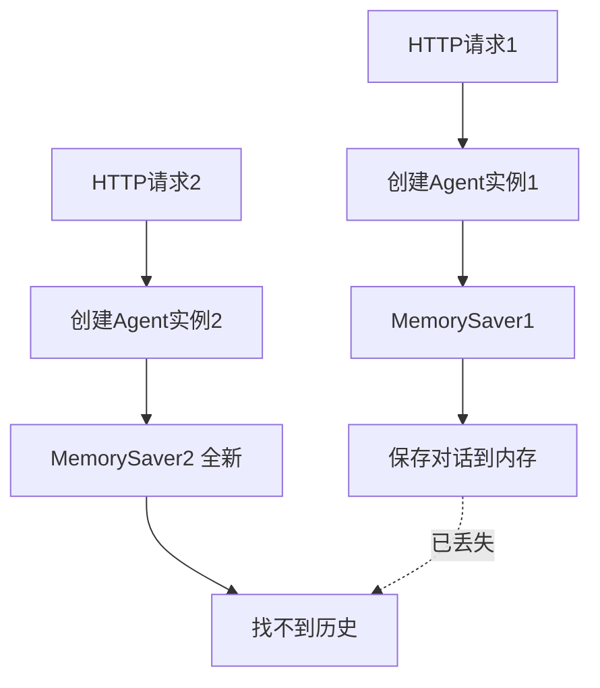
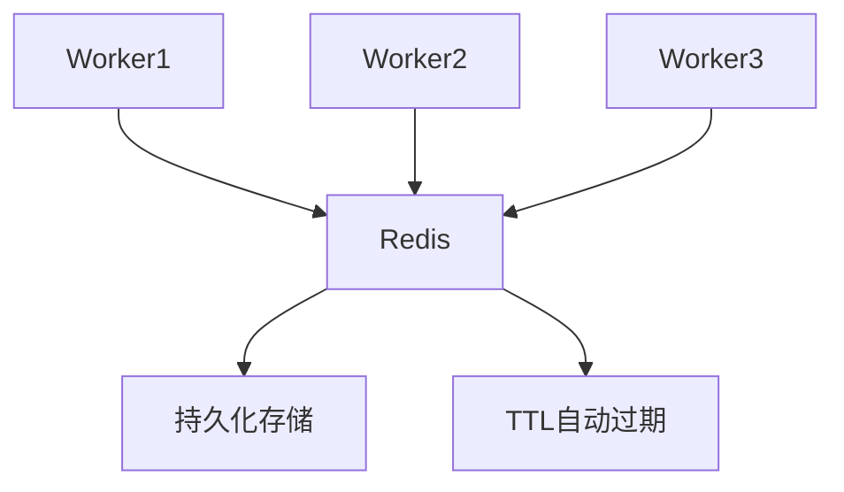

# Agent对话历史记忆问题 - 完整分析报告

> **文档创建时间**：2025-11-04
> **状态**：问题已部分解决，存在生产环境隐患，待优化
> **优先级**：P0（核心功能，但有严重的生产问题）

---

## 📋 目录

1. [问题发现过程](#问题发现过程)
2. [根本原因分析](#根本原因分析)
3. [已完成的修复](#已完成的修复)
4. [代码Review发现的问题](#代码review发现的问题)
5. [下一步优化方案](#下一步优化方案)
6. [相关代码位置](#相关代码位置)
7. [测试验证计划](#测试验证计划)

---

## 🔍 问题发现过程

### 初始问题描述

**现象**：Agent无法记住对话历史

**用户反馈**（INFO.md日志）：
```
2025-11-04 19:45:20 - 用户: 我刚才和你说了什么？
2025-11-04 19:45:40 - AI: 抱歉，我无法访问对话历史记录...
```

**测试证明**：
- 第1轮：operator.add工作正常（消息数量：2→4→6）✅
- 第2轮：AI无法记住之前的对话内容 ❌

### 问题追踪路径

#### 第一阶段：怀疑GeneralChatAction
**发现**：`GeneralChatAction`只传入当前消息，没有传入历史

```python
# backend/app/services/agent/actions/general_chat_action.py:104-108
# ❌ 错误代码
async for chunk, _ in self.ai_service._stream_chat(
    messages=[{"role": "user", "content": prompt}],  # 只有当前消息
    ...
)
```

**修复**：传入完整对话历史
```python
# ✅ 修复后
chat_messages = []
chat_messages.append({"role": "system", "content": system_prompt})
for msg in messages:
    if isinstance(msg, HumanMessage):
        chat_messages.append({"role": "user", "content": msg.content})
    elif isinstance(msg, AIMessage):
        chat_messages.append({"role": "assistant", "content": msg.content})

async for chunk, _ in self.ai_service._stream_chat(
    messages=chat_messages,  # 完整历史
    ...
)
```

**结果**：修复后测试，问题依然存在！

#### 第二阶段：发现真正的路由
**关键发现**：用户走的不是`chat()`方法，而是`chat_with_planning()`！

**日志证据**：
```
2025-11-04 19:45:03 - [Planning] 开始规划: 我刚才说了什么？
```

**分析**：
- `chat()`使用LangGraph，自动管理历史 ✅
- `chat_with_planning()`不使用LangGraph，手动管理历史 ❌
- **GeneralChatAction修复不会被执行**（因为不走LangGraph流程）

#### 第三阶段：修复chat_with_planning
**问题1**：规划生成时没有传入历史

```python
# ❌ 问题代码（第1503-1509行）
plan_prompt = f"""你是专业的AI写作助手。用户请求如下：

用户请求：{message}  # 只有当前消息
...
"""
```

**修复1**：加载历史并包含在prompt中
```python
# ✅ 修复后（第1500-1538行）
# 从checkpointer加载历史
config = {"configurable": {"thread_id": conversation_id, "checkpoint_ns": ""}}
checkpoint_tuple = await self.checkpointer.aget_tuple(config)
messages = checkpoint_tuple.checkpoint.get("channel_values", {}).get("messages", [])

# 格式化历史
history_lines = []
for msg in messages:
    if isinstance(msg, HumanMessage):
        history_lines.append(f"用户: {msg.content}")
    elif isinstance(msg, AIMessage):
        history_lines.append(f"助手: {msg.content}")
conversation_history = "\n".join(history_lines)

# 包含在prompt中
plan_prompt = f"""你是专业的AI写作助手。【对话历史】
{conversation_history}

用户请求：{message}
...
"""
```

**问题2**：执行完后没有保存新消息

```python
# ❌ 问题：返回结果时没有保存
return {
    "response": final_content,
    ...
}
```

**修复2**：保存新消息到checkpointer（第1768-1821行）
```python
# ✅ 修复后
new_messages = [
    HumanMessage(content=message),
    AIMessage(content=final_content)
]

# 加载现有消息
checkpoint_tuple = await self.checkpointer.aget_tuple(config)
existing_messages = checkpoint_tuple.checkpoint.get("channel_values", {}).get("messages", [])

# 合并消息
all_messages = existing_messages + new_messages

# 保存checkpoint
checkpoint_id = str(uuid.uuid4())
new_checkpoint = {
    "v": 1,
    "id": checkpoint_id,
    "ts": datetime.now().isoformat(),
    "channel_values": {
        "messages": all_messages,
        ...
    },
    "channel_versions": {
        "messages": checkpoint_id,
        ...
    },
    "versions_seen": {
        "__start__": checkpoint_id
    }
}

new_versions = {
    "messages": checkpoint_id,
    ...
}

await self.checkpointer.aput(config, new_checkpoint, {}, new_versions)
```

**测试**：修复后第一次测试，报错`checkpoint_ns缺失`

**Bug修复**：添加`checkpoint_ns`字段
```python
# ✅ 最终修复
config = {"configurable": {"thread_id": conversation_id, "checkpoint_ns": ""}}
```

**测试**：修复后第二次测试，依然没有记忆！

#### 第四阶段：发现根本原因 🎯

**关键发现**：每次请求都创建新的Agent实例！

**代码证据**（`backend/app/api/v1/agent.py:268`）：
```python
# ❌ 每次都创建新实例
agent_graph = WritingAgentGraph(ai_service, use_chatgpt=settings.AGENT_USE_CHATGPT)
```

**Agent初始化**（`backend/app/services/agent/langgraph_agent.py:519`）：
```python
# ❌ 每次都创建新的MemorySaver
self.checkpointer = MemorySaver()  # 内存存储，每次初始化都清空
```

**逻辑链**：
```
第1次请求 → 创建Agent1 → MemorySaver1 → 保存历史 ✓
第2次请求 → 创建Agent2 → MemorySaver2（全新空白）→ 加载失败 ✗
```

**结论**：历史确实被保存了，但保存在第一个Agent实例的MemorySaver中，第二次请求创建了新Agent，新的MemorySaver是空的！

---

## 💡 根本原因分析

### 架构设计问题



### 问题本质

1. **Agent实例不共享** → 每次请求创建新实例
2. **MemorySaver基于内存** → 不同实例间无法共享
3. **没有持久化机制** → 实例销毁，数据丢失

---

## ✅ 已完成的修复

### 修复1：GeneralChatAction传入完整历史

**文件**：`backend/app/services/agent/actions/general_chat_action.py`

**修改位置**：第87-119行

**修改内容**：
```python
# 1. 提取所有消息历史
messages = state.get("messages", [])

# 2. 转换消息格式
chat_messages = []
chat_messages.append({"role": "system", "content": system_prompt})

for msg in messages:
    if isinstance(msg, HumanMessage):
        chat_messages.append({"role": "user", "content": msg.content})
    elif isinstance(msg, AIMessage):
        chat_messages.append({"role": "assistant", "content": msg.content})

# 3. 传入完整历史
async for chunk, _ in self.ai_service._stream_chat(
    messages=chat_messages,
    ...
)
```

**状态**：✅ 已完成，但不会被执行（因为用户走Planning流程）

---

### 修复2：chat_with_planning加载和保存历史

**文件**：`backend/app/services/agent/langgraph_agent.py`

**修改1**：添加uuid导入（第22行）
```python
import uuid
```

**修改2**：加载历史（第1500-1538行）
```python
# 从checkpointer加载历史
conversation_history = ""
if conversation_id and self.checkpointer:
    try:
        config = {"configurable": {"thread_id": conversation_id, "checkpoint_ns": ""}}
        checkpoint_tuple = await self.checkpointer.aget_tuple(config)

        if checkpoint_tuple and checkpoint_tuple.checkpoint:
            messages = checkpoint_tuple.checkpoint.get("channel_values", {}).get("messages", [])
            if messages:
                # 格式化历史
                history_lines = []
                for msg in messages:
                    if isinstance(msg, HumanMessage):
                        history_lines.append(f"用户: {msg.content}")
                    elif isinstance(msg, AIMessage):
                        history_lines.append(f"助手: {msg.content}")
                conversation_history = "\n".join(history_lines)
    except Exception as e:
        logger.warning(f"[Planning] 加载历史失败: {e}")

# 包含历史在规划prompt中
history_section = ""
if conversation_history:
    history_section = f"""
【对话历史】
{conversation_history}

"""

plan_prompt = f"""你是专业的AI写作助手。{history_section}用户请求如下：
...
"""
```

**修改3**：保存新消息（第1768-1821行）
```python
if conversation_id and self.checkpointer:
    try:
        # 构建新消息
        new_messages = [
            HumanMessage(content=message),
            AIMessage(content=final_content)
        ]

        # 加载现有消息
        config = {"configurable": {"thread_id": conversation_id, "checkpoint_ns": ""}}
        checkpoint_tuple = await self.checkpointer.aget_tuple(config)

        existing_messages = []
        if checkpoint_tuple and checkpoint_tuple.checkpoint:
            existing_messages = checkpoint_tuple.checkpoint.get("channel_values", {}).get("messages", [])

        # 合并消息
        all_messages = existing_messages + new_messages

        # 构建checkpoint
        checkpoint_id = str(uuid.uuid4())
        new_checkpoint = {
            "v": 1,
            "id": checkpoint_id,
            "ts": datetime.now().isoformat(),
            "channel_values": {
                "messages": all_messages,
                "work_id": work_id,
                "chapter_id": chapter_id
            },
            "channel_versions": {
                "messages": checkpoint_id,
                "work_id": checkpoint_id,
                "chapter_id": checkpoint_id
            },
            "versions_seen": {
                "__start__": checkpoint_id
            }
        }

        new_versions = {
            "messages": checkpoint_id,
            "work_id": checkpoint_id,
            "chapter_id": checkpoint_id
        }

        # 保存checkpoint（提供完整的4个参数）
        await self.checkpointer.aput(config, new_checkpoint, {}, new_versions)
        logger.info(f"[Planning] 已保存 {len(new_messages)} 条新消息到checkpointer (总计: {len(all_messages)})")
    except Exception as e:
        logger.warning(f"[Planning] 保存消息到checkpointer失败: {e}")
```

**状态**：✅ 已完成

---

### 修复3：全局共享Agent实例

**文件**：`backend/app/api/v1/agent.py`

**修改位置**：第45-62行，第287行

**修改内容**：
```python
# 全局Agent实例（跨请求共享）
_global_agent_graph = None

def get_agent_graph() -> WritingAgentGraph:
    """
    获取全局共享的Agent实例

    使用全局单例模式，确保MemorySaver在请求间共享，
    从而实现对话历史的持久化
    """
    global _global_agent_graph
    if _global_agent_graph is None:
        ai_service = HTTPAIService()
        _global_agent_graph = WritingAgentGraph(ai_service, use_chatgpt=settings.AGENT_USE_CHATGPT)
        logger.info("[Global Agent] 创建全局Agent实例，MemorySaver将在请求间共享")
    return _global_agent_graph

# API端点中使用
agent_graph = get_agent_graph()  # 不再每次创建新实例
```

**状态**：✅ 已完成

---

## 🚨 代码Review发现的问题

### 问题1：内存泄漏 🔴 致命

**位置**：`MemorySaver`的实现机制

**问题描述**：
```python
# MemorySaver使用内存存储
self.storage = defaultdict(lambda: defaultdict(dict))
```

**影响**：
- 所有用户的所有会话都存在内存中
- **永远不会清理**
- 随着用户增多，内存会持续增长直到OOM

**严重性评估**：
```
10个用户 × 10个会话 × 10条消息 = 还好
100个用户 × 50个会话 × 100条消息 = 危险
1000个用户 × 100个会话 × 1000条消息 = 💥 OOM崩溃
```

**真实场景模拟**：
```python
# 每条消息约1KB（包含内容+元数据）
1000用户 × 100会话 × 1000消息 × 1KB = 100GB内存！
```

---

### 问题2：数据不持久化 🔴 严重

**问题描述**：
- MemorySaver是内存存储
- 服务重启 → 所有历史丢失
- 部署更新 → 所有历史丢失
- 进程崩溃 → 所有历史丢失

**用户体验影响**：
```
场景1：服务维护重启
用户：昨天我们聊了什么？
AI：抱歉，我没有记录...

场景2：紧急修复部署
用户：刚才说的那个方案...
AI：什么方案？（刚重启）

场景3：凌晨服务崩溃重启
用户早上：继续昨晚的讨论...
AI：我们昨晚聊了什么？
```

**生产环境不可接受！**

---

### 问题3：多进程不兼容 ⚠️ 中等

**问题描述**：
- 如果使用多worker进程（如 `gunicorn -w 4` 或 `uvicorn --workers 4`）
- 每个进程有独立的全局变量
- 每个进程有独立的MemorySaver
- 用户请求可能被负载均衡到不同进程

**场景模拟**：
```
请求1 → Worker1 → MemorySaver1 → 保存对话A
请求2 → Worker2 → MemorySaver2 → 找不到对话A
请求3 → Worker1 → MemorySaver1 → 能找到对话A
请求4 → Worker3 → MemorySaver3 → 又找不到了
```

**用户体验**：对话记忆"时有时无"，非常混乱！

---

### 问题4：没有TTL机制 ⚠️ 中等

**问题描述**：
- 对话历史永久保存
- 即使用户几个月没访问
- 内存一直被占用

**建议**：
- 应该有过期机制（如7天）
- 自动清理过期数据

---

### 问题5：线程安全性 ⚠️ 轻微

**问题描述**：
- MemorySaver的`self.storage`是普通dict
- 在异步环境下，多个协程可能同时修改
- 虽然Python的GIL提供了一定保护，但不是完全线程安全

**现状**：
- 使用asyncio单线程事件循环，问题不大
- 但如果未来改用多线程，会有风险

---

## 💡 下一步优化方案

### 🎯 目标

1. **持久化**：服务重启不丢失数据
2. **多进程共享**：所有worker访问同一份数据
3. **自动清理**：过期数据自动删除
4. **生产级**：可靠、高性能

---

### 方案A：使用Redis作为Checkpointer（推荐）

#### 架构设计



#### 实现方案

**步骤1：创建RedisCheckpointer**

文件位置：`backend/app/services/agent/redis_checkpointer.py`

```python
"""
Redis-based Checkpointer for LangGraph

使用Redis作为checkpoint存储，解决：
1. 持久化问题（服务重启不丢失）
2. 多进程共享问题（所有worker访问同一Redis）
3. 内存泄漏问题（TTL自动过期）
"""

from typing import Optional, Iterator, Any
from redis import Redis
from langgraph.checkpoint.base import BaseCheckpointSaver, Checkpoint, CheckpointMetadata
from langgraph.checkpoint import SerializerProtocol
import pickle
import logging

logger = logging.getLogger(__name__)


class RedisCheckpointer(BaseCheckpointSaver):
    """
    基于Redis的Checkpoint存储

    特性：
    - 持久化：数据存储在Redis中，服务重启不丢失
    - 多进程共享：所有worker访问同一个Redis实例
    - 自动过期：支持TTL，过期自动清理
    - 高性能：Redis内存存储，读写快速
    """

    def __init__(
        self,
        redis_client: Redis,
        key_prefix: str = "langgraph:checkpoint",
        ttl: Optional[int] = None,
        serde: Optional[SerializerProtocol] = None
    ):
        """
        初始化Redis Checkpointer

        Args:
            redis_client: Redis客户端实例
            key_prefix: Redis key前缀
            ttl: 过期时间（秒），None表示永不过期
        """
        super().__init__(serde=serde)
        self.redis = redis_client
        self.key_prefix = key_prefix
        self.ttl = ttl

        logger.info(f"[RedisCheckpointer] 初始化完成，prefix={key_prefix}, ttl={ttl}s")

    def _make_key(self, thread_id: str, checkpoint_ns: str, checkpoint_id: str) -> str:
        """生成Redis key"""
        return f"{self.key_prefix}:{thread_id}:{checkpoint_ns}:{checkpoint_id}"

    def _make_list_key(self, thread_id: str, checkpoint_ns: str) -> str:
        """生成checkpoint列表的key"""
        return f"{self.key_prefix}:list:{thread_id}:{checkpoint_ns}"

    def put(
        self,
        config: dict,
        checkpoint: Checkpoint,
        metadata: CheckpointMetadata,
        new_versions: dict
    ) -> dict:
        """
        保存checkpoint到Redis

        Args:
            config: 配置（包含thread_id和checkpoint_ns）
            checkpoint: 要保存的checkpoint
            metadata: 元数据
            new_versions: 新版本信息

        Returns:
            更新后的config
        """
        thread_id = config["configurable"]["thread_id"]
        checkpoint_ns = config["configurable"].get("checkpoint_ns", "")
        checkpoint_id = checkpoint["id"]

        # 序列化checkpoint和metadata
        checkpoint_data = pickle.dumps(checkpoint)
        metadata_data = pickle.dumps(metadata)

        # 生成key
        key = self._make_key(thread_id, checkpoint_ns, checkpoint_id)
        list_key = self._make_list_key(thread_id, checkpoint_ns)

        # 保存到Redis
        data = {
            "checkpoint": checkpoint_data,
            "metadata": metadata_data,
            "parent_id": config["configurable"].get("checkpoint_id")
        }

        self.redis.hset(key, mapping=data)

        # 设置TTL
        if self.ttl:
            self.redis.expire(key, self.ttl)

        # 添加到checkpoint列表（用于查询历史）
        self.redis.zadd(list_key, {checkpoint_id: float(checkpoint["ts"])})
        if self.ttl:
            self.redis.expire(list_key, self.ttl)

        logger.debug(f"[RedisCheckpointer] 保存checkpoint: {key}")

        return {
            "configurable": {
                "thread_id": thread_id,
                "checkpoint_ns": checkpoint_ns,
                "checkpoint_id": checkpoint_id
            }
        }

    async def aput(
        self,
        config: dict,
        checkpoint: Checkpoint,
        metadata: CheckpointMetadata,
        new_versions: dict
    ) -> dict:
        """异步版本的put"""
        return self.put(config, checkpoint, metadata, new_versions)

    def get_tuple(self, config: dict) -> Optional[tuple]:
        """
        从Redis获取checkpoint

        Args:
            config: 配置（包含thread_id, checkpoint_ns, 可选的checkpoint_id）

        Returns:
            (checkpoint, metadata, parent_config) 或 None
        """
        thread_id = config["configurable"]["thread_id"]
        checkpoint_ns = config["configurable"].get("checkpoint_ns", "")
        checkpoint_id = config["configurable"].get("checkpoint_id")

        # 如果没有指定checkpoint_id，获取最新的
        if not checkpoint_id:
            list_key = self._make_list_key(thread_id, checkpoint_ns)
            latest = self.redis.zrange(list_key, -1, -1)
            if not latest:
                logger.debug(f"[RedisCheckpointer] 未找到checkpoint: thread_id={thread_id}")
                return None
            checkpoint_id = latest[0].decode()

        # 获取checkpoint数据
        key = self._make_key(thread_id, checkpoint_ns, checkpoint_id)
        data = self.redis.hgetall(key)

        if not data:
            logger.debug(f"[RedisCheckpointer] 未找到checkpoint: {key}")
            return None

        # 反序列化
        checkpoint = pickle.loads(data[b"checkpoint"])
        metadata = pickle.loads(data[b"metadata"])
        parent_id = data.get(b"parent_id")

        # 构建parent_config
        parent_config = None
        if parent_id:
            parent_config = {
                "configurable": {
                    "thread_id": thread_id,
                    "checkpoint_ns": checkpoint_ns,
                    "checkpoint_id": parent_id.decode()
                }
            }

        logger.debug(f"[RedisCheckpointer] 加载checkpoint: {key}")

        return (checkpoint, metadata, parent_config)

    async def aget_tuple(self, config: dict) -> Optional[tuple]:
        """异步版本的get_tuple"""
        return self.get_tuple(config)

    def list(self, config: dict) -> Iterator[tuple]:
        """列出指定thread的所有checkpoint"""
        thread_id = config["configurable"]["thread_id"]
        checkpoint_ns = config["configurable"].get("checkpoint_ns", "")

        list_key = self._make_list_key(thread_id, checkpoint_ns)
        checkpoint_ids = self.redis.zrange(list_key, 0, -1, desc=True)

        for checkpoint_id in checkpoint_ids:
            checkpoint_id = checkpoint_id.decode()
            checkpoint_config = {
                "configurable": {
                    "thread_id": thread_id,
                    "checkpoint_ns": checkpoint_ns,
                    "checkpoint_id": checkpoint_id
                }
            }
            result = self.get_tuple(checkpoint_config)
            if result:
                yield result

    async def alist(self, config: dict) -> Iterator[tuple]:
        """异步版本的list"""
        return self.list(config)
```

**步骤2：修改Agent初始化使用RedisCheckpointer**

文件位置：`backend/app/services/agent/langgraph_agent.py`

```python
def __init__(self, ai_service: HTTPAIService, use_chatgpt: bool = False, redis_client=None):
    """
    初始化 Agent

    Args:
        ai_service: HTTPAIService 实例
        use_chatgpt: 是否使用 ChatOpenAI
        redis_client: Redis客户端（用于持久化checkpoint）
    """
    self.ai_service = ai_service
    self.use_chatgpt = use_chatgpt

    set_global_ai_service(ai_service)

    if use_chatgpt:
        logger.info("[LangGraph] 使用 ChatOpenAI 模式")
        self._init_chatgpt_mode()
    else:
        logger.info("[LangGraph] 使用 HTTPAIService 模式")
        self.llm = None
        self.llm_with_tools = None

    # 创建 Checkpointer（优先使用Redis）
    if redis_client:
        try:
            from app.services.agent.redis_checkpointer import RedisCheckpointer
            self.checkpointer = RedisCheckpointer(
                redis_client=redis_client,
                key_prefix="langgraph:agent:checkpoint",
                ttl=7 * 24 * 3600  # 7天过期
            )
            logger.info("[LangGraph] ✅ 使用 RedisCheckpointer（持久化+多进程共享）")
        except Exception as e:
            logger.error(f"[LangGraph] ❌ RedisCheckpointer 初始化失败: {e}")
            self.checkpointer = MemorySaver()
            logger.warning("[LangGraph] ⚠️ 降级使用 MemorySaver（仅内存）")
    else:
        self.checkpointer = MemorySaver()
        logger.warning("[LangGraph] ⚠️ 使用 MemorySaver（仅内存，不推荐生产环境）")

    self.graph = self._build_graph()
```

**步骤3：修改API端点传入Redis客户端**

文件位置：`backend/app/api/v1/agent.py`

```python
def get_agent_graph() -> WritingAgentGraph:
    """获取全局共享的Agent实例"""
    global _global_agent_graph
    if _global_agent_graph is None:
        ai_service = HTTPAIService()

        # 创建Redis客户端
        redis_client = get_redis_client()

        # 创建Agent实例（使用Redis checkpointer）
        _global_agent_graph = WritingAgentGraph(
            ai_service,
            use_chatgpt=settings.AGENT_USE_CHATGPT,
            redis_client=redis_client  # 传入Redis客户端
        )
        logger.info("[Global Agent] 创建全局Agent实例（使用Redis持久化）")
    return _global_agent_graph
```

#### 优点

✅ **持久化**：数据存储在Redis，服务重启不丢失
✅ **多进程共享**：所有worker访问同一个Redis
✅ **自动清理**：TTL机制，7天后自动过期
✅ **高性能**：Redis内存存储，读写快速
✅ **生产级**：成熟可靠

#### 缺点

⚠️ 需要额外依赖Redis
⚠️ 需要开发RedisCheckpointer（约1-2小时）

#### 实施时间

预计：**1-2小时**

---

### 方案B：使用数据库持久化（备选）

#### 实现思路

创建`database_checkpointer.py`，使用PostgreSQL存储checkpoint

#### 优点

✅ 无需额外服务（已有数据库）
✅ 数据可查询、可备份

#### 缺点

❌ 性能较Redis差
❌ 需要设计表结构
❌ 清理逻辑更复杂

#### 实施时间

预计：**2-3小时**

---

### 方案C：改进MemorySaver（临时）

#### 实现思路

1. 添加LRU缓存机制
2. 添加定期清理任务
3. 添加内存监控

#### 优点

✅ 无需额外依赖
✅ 修改简单

#### 缺点

❌ 仍然不持久化
❌ 仍然不支持多进程
❌ 只是"减轻"问题，不是"解决"问题

#### 适用场景

**仅适合开发/测试环境**

---

## 📂 相关代码位置

### 已修改的文件

1. **`backend/app/services/agent/actions/general_chat_action.py`**
   - 第87-119行：修改为传入完整对话历史
   - 状态：✅ 已完成

2. **`backend/app/services/agent/langgraph_agent.py`**
   - 第22行：添加uuid导入
   - 第1500-1538行：加载历史消息并包含在规划prompt中
   - 第1768-1821行：保存新消息到checkpointer
   - 状态：✅ 已完成

3. **`backend/app/api/v1/agent.py`**
   - 第45-62行：添加全局Agent实例函数
   - 第287行：使用全局Agent实例
   - 状态：✅ 已完成

### 待创建的文件

1. **`backend/app/services/agent/redis_checkpointer.py`**
   - 实现RedisCheckpointer类
   - 状态：⏳ 待开发

### 关键类和方法

#### WritingAgentGraph
- **位置**：`backend/app/services/agent/langgraph_agent.py:495`
- **关键属性**：
  - `self.checkpointer`：Checkpoint存储器
  - `self.graph`：LangGraph状态图
- **关键方法**：
  - `chat()`：使用LangGraph的对话方法
  - `chat_with_planning()`：Planning+Execution模式

#### MemorySaver
- **来源**：`langgraph.checkpoint.memory.MemorySaver`
- **问题**：
  - 基于内存存储
  - 不持久化
  - 不支持多进程

#### CheckpointTuple
- **来源**：`langgraph.checkpoint.base.CheckpointTuple`
- **结构**：`(checkpoint, metadata, parent_config)`

---

## 🧪 测试验证计划

### 测试1：功能验证（当前方案）

**目标**：验证Agent是否能记住对话

**步骤**：
```python
# 第1轮对话
POST /api/v1/agent/chat/stream
{
    "message": "我叫小明，我今年25岁",
    "conversation_id": "test-001"
}
预期响应：你好小明！...

# 第2轮对话（相同conversation_id）
POST /api/v1/agent/chat/stream
{
    "message": "我叫什么名字？",
    "conversation_id": "test-001"
}
预期响应：你叫小明 ✅
```

**当前状态**：⏳ 待测试

---

### 测试2：服务重启后的持久化（Redis方案）

**前提**：实现RedisCheckpointer

**步骤**：
1. 第1轮对话，保存历史
2. 重启服务
3. 第2轮对话，检查是否还能记住

**预期结果**：
- MemorySaver：❌ 历史丢失
- RedisCheckpointer：✅ 历史保留

---

### 测试3：多进程共享（Redis方案）

**前提**：实现RedisCheckpointer

**步骤**：
1. 启动多worker：`uvicorn --workers 4`
2. 连续发送请求（可能路由到不同worker）
3. 检查历史是否一致

**预期结果**：
- MemorySaver：❌ 历史不一致
- RedisCheckpointer：✅ 历史一致

---

### 测试4：内存泄漏监控

**步骤**：
1. 模拟1000个用户，每人100条消息
2. 监控内存使用情况
3. 等待TTL过期（7天后）
4. 检查内存是否被释放

**预期结果**：
- MemorySaver：❌ 内存持续增长
- RedisCheckpointer：✅ 过期自动清理

---

## 📊 决策矩阵

### 环境适用性

| 方案 | 开发环境 | 测试环境 | 生产环境 |
|------|---------|---------|---------|
| 当前方案（MemorySaver） | ✅ 可用 | ⚠️ 勉强 | ❌ 不可用 |
| Redis方案 | ✅ 推荐 | ✅ 推荐 | ✅ 必须 |
| 数据库方案 | ✅ 可用 | ✅ 可用 | ✅ 可用 |
| 改进MemorySaver | ✅ 可用 | ❌ 不推荐 | ❌ 不可用 |

### 问题解决情况

| 问题 | 当前方案 | Redis方案 | 数据库方案 | 改进MemorySaver |
|------|---------|----------|-----------|----------------|
| 持久化 | ❌ | ✅ | ✅ | ❌ |
| 多进程共享 | ❌ | ✅ | ✅ | ❌ |
| 内存泄漏 | ❌ | ✅ | ✅ | ⚠️ 部分 |
| 自动清理 | ❌ | ✅ | ⚠️ 需开发 | ⚠️ 需开发 |
| 性能 | ⭐⭐⭐⭐⭐ | ⭐⭐⭐⭐⭐ | ⭐⭐⭐ | ⭐⭐⭐⭐⭐ |

### 开发成本

| 方案 | 开发时间 | 维护成本 | 依赖 |
|------|---------|---------|------|
| 当前方案 | 0小时 | 低 | 无 |
| **Redis方案** | **1-2小时** | **低** | **Redis** |
| 数据库方案 | 2-3小时 | 中 | PostgreSQL |
| 改进MemorySaver | 0.5-1小时 | 中 | 无 |

---

## 🎯 推荐方案

### 短期（立即）

**使用当前方案进行功能测试**

**理由**：
- 功能逻辑已正确实现
- 可以验证Agent记忆功能
- 快速反馈，发现其他问题

**适用场景**：
- 开发环境
- 功能演示
- 单元测试

---

### 中期（本周内）

**实现Redis Checkpointer方案**

**理由**：
- 解决所有生产问题
- 开发成本可控（1-2小时）
- 技术成熟可靠

**优先级**：**P0 - 必须完成**

---

### 长期（优化）

**监控和优化**

1. 添加监控指标
   - checkpoint数量
   - 内存使用
   - Redis命中率

2. 性能优化
   - 序列化优化（考虑使用msgpack替代pickle）
   - 批量操作支持

3. 功能增强
   - checkpoint版本管理
   - 历史回溯功能

---

## 📝 待办事项清单

### 立即执行（本会话）

- [x] 编写完整的问题分析文档
- [ ] 提交当前代码到GitHub
- [ ] 运行功能测试，验证Agent记忆

### 下次会话执行

- [ ] 实现RedisCheckpointer类
- [ ] 修改Agent初始化逻辑
- [ ] 添加单元测试
- [ ] 进行完整的集成测试
- [ ] 更新部署文档

### 后续优化

- [ ] 添加监控和告警
- [ ] 性能压测
- [ ] 文档完善
- [ ] 用户体验优化

---

## 🔗 相关文档

- [LangGraph官方文档](https://langchain-ai.github.io/langgraph/)
- [LangGraph Checkpointer文档](https://langchain-ai.github.io/langgraph/concepts/persistence/)
- [Redis Python客户端文档](https://redis-py.readthedocs.io/)
- `docs/Agent/tasks/11_实际问题分析和解决方案.md` - operator.add问题分析

---

## 📞 联系和反馈

如有问题或建议，请：
1. 查看本文档
2. 查看相关代码注释
3. 运行测试验证
4. 提交Issue或联系开发团队

---

**最后更新**：2025-11-04
**维护者**：AI Writer 开发团队
**版本**：v1.0
