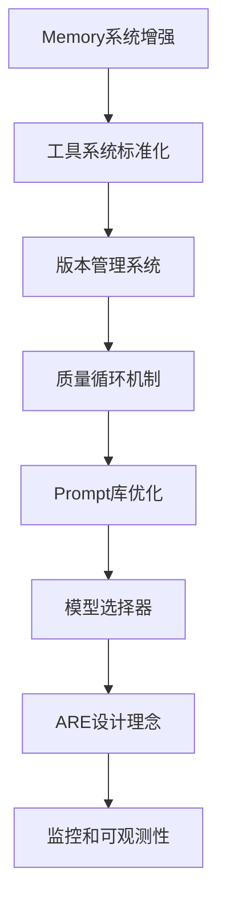

# Agent 增强改造 - 技术架构设计

> **版本**: v1.0
> **创建日期**: 2025-10-31

---

## 📋 目录

- [1. 整体架构](#1-整体架构)
- [2. 改造策略](#2-改造策略)
- [3. 模块关系](#3-模块关系)
- [4. 数据流](#4-数据流)
- [5. 技术栈](#5-技术栈)

---

## 1. 整体架构

### 1.1 架构全景图

```
┌─────────────────────────────────────────────────────────────────┐
│                         用户请求层                               │
│  /api/v1/agent/chat | /api/v1/agent/plan | /api/v1/agent/...   │
└─────────────────────────────────────────────────────────────────┘
                              ↓
┌─────────────────────────────────────────────────────────────────┐
│                      LangGraph 工作流层                          │
│  ┌───────────────────────────────────────────────────────────┐ │
│  │  WritingAgentGraph                                        │ │
│  │  ┌──────────────┬──────────────┬──────────────────────┐  │ │
│  │  │Intent Detect │Planning Node │Writing Node          │  │ │
│  │  │(意图识别)    │(规划节点)    │(写作节点)            │  │ │
│  │  └──────────────┴──────────────┴──────────────────────┘  │ │
│  │  ┌──────────────┬──────────────┬──────────────────────┐  │ │
│  │  │Reflection    │Quality Loop  │Version Control       │  │ │
│  │  │(反思节点)    │(质量循环)[新]│(版本管理)[新]        │  │ │
│  │  └──────────────┴──────────────┴──────────────────────┘  │ │
│  │  ┌──────────────────────────────────────────────────────┐ │
│  │  │HITL Node (人机协同)                                  │ │
│  │  └──────────────────────────────────────────────────────┘ │
│  └───────────────────────────────────────────────────────────┘ │
└─────────────────────────────────────────────────────────────────┘
                              ↓
┌─────────────────────────────────────────────────────────────────┐
│                       Agent 角色层                               │
│  ┌───────────┬───────────┬───────────┬───────────────────────┐ │
│  │ Planning  │ Writing   │Reflection │ Parallel              │ │
│  │ Agent     │ Agent     │ Agent     │ Executor              │ │
│  │           │ (增强)    │ (增强)    │                       │ │
│  └───────────┴───────────┴───────────┴───────────────────────┘ │
└─────────────────────────────────────────────────────────────────┘
                              ↓
┌─────────────────────────────────────────────────────────────────┐
│                       核心服务层                                 │
│  ┌─────────────────┬─────────────────┬─────────────────────┐   │
│  │ Memory Manager  │ Tool Registry   │ Version Control     │   │
│  │ (增强)          │ (标准化)        │ (新增)              │   │
│  └─────────────────┴─────────────────┴─────────────────────┘   │
│  ┌─────────────────┬─────────────────┬─────────────────────┐   │
│  │ Quality         │ Prompt          │ Model               │   │
│  │ Evaluator(新增) │ Library(新增)   │ Selector(新增)      │   │
│  └─────────────────┴─────────────────┴─────────────────────┘   │
└─────────────────────────────────────────────────────────────────┘
                              ↓
┌─────────────────────────────────────────────────────────────────┐
│                       基础设施层                                 │
│  ┌──────────┬──────────┬──────────┬──────────┬──────────────┐  │
│  │PostgreSQL│  Redis   │  Vector  │   LLM    │ Monitoring   │  │
│  │   DB     │  Cache   │  Store   │   API    │ (Prometheus) │  │
│  └──────────┴──────────┴──────────┴──────────┴──────────────┘  │
└─────────────────────────────────────────────────────────────────┘
```

### 1.2 架构分层说明

#### Layer 1: 用户请求层

**职责**：接收用户请求，路由到对应的Agent处理

**组件**：
- `backend/app/api/v1/agent.py` - Agent API端点

**关键功能**：
- 请求验证
- 参数解析
- 流式响应（SSE）
- 错误处理

#### Layer 2: LangGraph 工作流层

**职责**：定义Agent的执行流程和状态转换

**组件**：
- `langgraph_agent.py` - LangGraph工作流定义

**关键节点**：
- Intent Detection（意图识别）
- Planning Node（规划节点）
- Writing Node（写作节点）
- Reflection Node（反思节点）
- Quality Loop Node（质量循环）[新增]
- Version Control Node（版本管理）[新增]
- HITL Node（人机协同）

#### Layer 3: Agent 角色层

**职责**：各个专业Agent的具体实现

**组件**：
- `agents/planning_agent.py` - 规划Agent
- `agents/writing_agent.py` - 写作Agent（增强）
- `agents/reflection_agent.py` - 反思Agent（增强）
- `agents/parallel_executor.py` - 并行执行器

#### Layer 4: 核心服务层

**职责**：提供Agent所需的核心能力

**组件**：
- `memory/enhanced_memory_manager.py` - 增强的记忆管理
- `tools/tool_registry.py` - 工具注册表（标准化）
- `version_control.py` - 版本控制服务 [新增]
- `quality_evaluator.py` - 质量评估服务 [新增]
- `prompt_library.py` - Prompt库 [新增]
- `model_selector.py` - 模型选择器 [新增]

#### Layer 5: 基础设施层

**职责**：提供数据存储、缓存、LLM调用等基础能力

**组件**：
- PostgreSQL - 持久化存储
- Redis - 缓存和会话状态
- Vector Store - 向量检索
- LLM API - 模型调用
- Monitoring - 监控和日志

---

## 2. 改造策略

### 2.1 文件改造映射

```
现有文件                         改造方式              新增文件
─────────────────────────────────────────────────────────────────
langgraph_agent.py         →    增加新节点             (无)
                                添加质量循环
                                添加版本控制节点

agents/writing_agent.py    →    增强功能               (无)
                                使用新Prompt
                                集成质量循环

agents/reflection_agent.py →    增强功能               (无)
                                添加评估能力
                                集成质量循环

memory/memory_manager.py   →    增强功能               memory_strategy.py
                                添加智能遗忘            (遗忘策略)
                                添加状态快照            enhanced_memory_manager.py
                                                        (增强的管理器)

tools/tool_registry.py     →    标准化接口             tool_types.py
                                添加类型验证            (类型定义)
                                                        writing_tools.py
                                                        (重构的工具)

(无)                       →    新建                   version_control.py
                                                        (版本管理服务)

(无)                       →    新建                   quality_evaluator.py
                                                        (质量评估服务)

(无)                       →    新建                   prompt_library.py
                                                        (Prompt库)

(无)                       →    新建                   model_selector.py
                                                        (模型选择器)
```

### 2.2 改造优先级

#### P0 - 核心基础（必须完成）

1. ✅ Memory 系统增强
2. ✅ 工具系统标准化
3. ✅ 版本管理系统
4. ✅ 质量循环机制

#### P1 - 高价值功能（强烈建议）

5. ✅ Prompt 库优化
6. ✅ 模型选择器

#### P2 - 架构优化（时间允许）

7. ✅ ARE 设计理念
8. ✅ 批量生成优化
9. ✅ 监控和可观测性

### 2.3 依赖关系



**说明**：
- Memory 和 工具系统是基础，必须先完成
- 版本管理依赖工具系统
- 质量循环依赖版本管理（需要记录评估历史）
- Prompt库可独立开发，但与质量循环配合更佳
- 模型选择器依赖Prompt库（不同复杂度的Prompt选择不同模型）

---

## 3. 模块关系

### 3.1 核心模块交互图

```
┌─────────────────────────────────────────────────────────────┐
│                     LangGraph Agent                         │
│                                                             │
│  ┌─────────────────────────────────────────────────────┐   │
│  │              Writing Node                           │   │
│  │  ┌──────────────────────────────────────────────┐   │   │
│  │  │ 1. 读取 Memory (上下文)                       │   │   │
│  │  │    ↓                                         │   │   │
│  │  │ 2. 选择 Model (模型选择器)                    │   │   │
│  │  │    ↓                                         │   │   │
│  │  │ 3. 获取 Prompt (Prompt库)                    │   │   │
│  │  │    ↓                                         │   │   │
│  │  │ 4. 调用 Tool (写作工具)                       │   │   │
│  │  │    ↓                                          │   │   │
│  │  │ 5. 生成内容                                  │   │   │
│  │  │    ↓                                          │   │   │
│  │  │ 6. 评估质量 (Quality Evaluator)              │   │   │
│  │  │    ↓                                          │   │   │
│  │  │ 7. 质量循环 (未通过则重试)                   │   │   │
│  │  │    ↓                                          │   │   │
│  │  │ 8. 保存版本 (Version Control)                │   │   │
│  │  │    ↓                                          │   │   │
│  │  │ 9. 更新 Memory                               │   │   │
│  │  └──────────────────────────────────────────────┘   │   │
│  └─────────────────────────────────────────────────────┘   │
└─────────────────────────────────────────────────────────────┘
```

### 3.2 模块依赖关系

```
Memory Manager ──────┐
                     ├──→ Writing Node
Tool Registry ───────┤
                     │
Prompt Library ──────┤
                     │
Model Selector ──────┘

Quality Evaluator ───→ Quality Loop ───→ Writing Node
                                          (反馈循环)

Version Control ─────→ Writing Node
                       (保存历史)
```

### 3.3 数据流向

#### 3.3.1 写作流程数据流

```
用户请求
   ↓
[Intent Detection]
   ↓
检索 Memory (获取上下文)
   ↓
选择 Model (根据任务复杂度)
   ↓
获取 Prompt (从Prompt库)
   ↓
调用 Tool (写作工具)
   ↓
生成初稿
   ↓
评估质量 (Quality Evaluator)
   ↓
质量 >= 8分? ─No─→ 优化Prompt,重新生成 (最多3次)
   ↓ Yes
创建版本 (Version Control)
   ↓
更新 Memory
   ↓
返回用户
```

#### 3.3.2 版本管理数据流

```
内容修改请求
   ↓
[Version Control]
   ↓
创建 Patch (补丁)
   ↓
应用 Patch 到当前版本
   ↓
生成新 Version
   ↓
保存到 Redis + PostgreSQL
   ↓
返回新版本ID
```

#### 3.3.3 质量循环数据流

```
生成的内容
   ↓
[Quality Evaluator]
   ↓
评估各维度 (content/length/coherence)
   ↓
计算总分
   ↓
总分 >= 8? ─No─→ [生成改进建议]
   ↓ Yes              ↓
返回通过          [优化生成参数]
                      ↓
                  [重新生成] (迭代+1)
                      ↓
                  迭代 >= 3? ─No─→ 继续循环
                      ↓ Yes
                  返回最佳结果
```

---

## 4. 数据流

### 4.1 Memory 数据流

```
用户交互
   ↓
[MemoryManager.add_memory()]
   ↓
分层存储:
  ├─ 短期记忆 (Redis List, 最近10条)
  ├─ 中期记忆 (Redis List, 最近100条, 按重要度)
  └─ 长期记忆 (Redis String, 压缩摘要)
   ↓
应用智能遗忘策略
   ↓
[SmartForgetStrategy.calculate_importance()]
   ↓
重要度 = 初始重要度 × 时间衰减 × 访问频率
   ↓
重要度 < 阈值? ─Yes─→ 移除或归档
   ↓ No
保留在相应层级
```

### 4.2 工具调用数据流

```
Agent 决策调用工具
   ↓
[ToolRegistry.call_tool(tool_id, params)]
   ↓
验证输入 (Pydantic Schema)
   ↓
执行工具 (executor)
   ↓
验证输出 (Pydantic Schema)
   ↓
记录统计 (usage_count, success_rate, duration)
   ↓
返回结果给 Agent
```

### 4.3 LLM 调用数据流（带模型选择）

```
Agent 需要调用 LLM
   ↓
[ModelSelector.select_model(task_type, context_length)]
   ↓
判断任务复杂度:
  ├─ Simple → DeepSeek (低成本)
  ├─ Medium → GPT-3.5 (均衡)
  └─ Complex → GPT-4 (高质量)
   ↓
[HTTPAIService.stream_chat(model, messages)]
   ↓
流式返回结果
   ↓
记录成本 (tokens, cost)
   ↓
返回给 Agent
```

---

## 5. 技术栈

### 5.1 核心框架

| 组件 | 技术栈 | 版本 | 用途 |
|------|--------|------|------|
| **Web框架** | FastAPI | 0.104+ | API服务 |
| **Agent框架** | LangGraph | 0.2+ | Agent工作流 |
| **LLM SDK** | LangChain | 0.3+ | LLM调用 |
| **异步** | asyncio | Python 3.11+ | 异步编程 |

### 5.2 数据存储

| 组件 | 技术栈 | 版本 | 用途 |
|------|--------|------|------|
| **关系数据库** | PostgreSQL | 14+ | 持久化存储 |
| **ORM** | SQLAlchemy | 2.0+ | 数据库操作 |
| **缓存** | Redis | 7.0+ | 会话状态、Memory |
| **向量数据库** | ChromaDB/Qdrant | - | RAG检索 |

### 5.3 LLM 提供商

| 提供商 | 模型 | 用途 |
|--------|------|------|
| **OpenAI** | GPT-4, GPT-3.5-turbo | 复杂和中等任务 |
| **DeepSeek** | deepseek-chat | 简单任务 |
| **Anthropic** | Claude-3 | 备用/特殊任务 |

### 5.4 开发工具

| 工具 | 用途 |
|------|------|
| **pytest** | 单元测试 |
| **black** | 代码格式化 |
| **mypy** | 类型检查 |
| **alembic** | 数据库迁移 |

### 5.5 监控和日志

| 组件 | 技术栈 | 用途 |
|------|--------|------|
| **日志** | Python logging | 应用日志 |
| **监控** | Prometheus (可选) | 性能监控 |
| **追踪** | 自定义 | 成本追踪 |

---

## 6. 配置管理

### 6.1 环境变量

```python
# backend/app/core/config.py

class Settings(BaseSettings):
    # Agent 增强功能开关
    ENABLE_ENHANCED_MEMORY: bool = True
    ENABLE_QUALITY_LOOP: bool = True
    ENABLE_VERSION_CONTROL: bool = True
    ENABLE_MODEL_SELECTION: bool = True
    ENABLE_SMART_PROMPTS: bool = True

    # Memory 配置
    MEMORY_SHORT_TERM_SIZE: int = 10
    MEMORY_MEDIUM_TERM_SIZE: int = 100
    MEMORY_FORGET_THRESHOLD: float = 0.1

    # 质量循环配置
    QUALITY_LOOP_MAX_ITERATIONS: int = 3
    QUALITY_LOOP_PASS_THRESHOLD: float = 8.0

    # 模型选择配置
    MODEL_SIMPLE_TASK: str = "deepseek-chat"
    MODEL_MEDIUM_TASK: str = "gpt-3.5-turbo"
    MODEL_COMPLEX_TASK: str = "gpt-4"

    # 成本控制
    ENABLE_COST_TRACKING: bool = True
    DAILY_COST_LIMIT_PER_USER: float = 10.0  # 元

    class Config:
        env_file = ".env"
```

### 6.2 功能开关

所有新功能都支持动态开关，通过环境变量或配置文件控制：

```bash
# .env

# 关闭所有增强功能（回滚到旧版本）
ENABLE_ENHANCED_MEMORY=false
ENABLE_QUALITY_LOOP=false
ENABLE_VERSION_CONTROL=false
ENABLE_MODEL_SELECTION=false
ENABLE_SMART_PROMPTS=false
```

---

## 7. 安全性和性能

### 7.1 安全性考虑

1. **输入验证**
   - 所有用户输入通过 Pydantic 验证
   - SQL 注入防护（SQLAlchemy参数化查询）
   - XSS 防护（输出转义）

2. **访问控制**
   - JWT 认证
   - 用户隔离（user_id命名空间）
   - API 限流

3. **数据安全**
   - Redis 密码保护
   - PostgreSQL 加密连接
   - 敏感数据加密存储

### 7.2 性能优化

1. **异步处理**
   - 所有 I/O 操作异步化
   - 并发处理用户请求

2. **缓存策略**
   - Memory 热数据 Redis 缓存
   - Prompt 模板缓存
   - 用户偏好缓存

3. **数据库优化**
   - 索引优化
   - 连接池管理
   - 分页查询

4. **LLM 调用优化**
   - 流式响应减少等待时间
   - 模型分级降低成本
   - 请求合并（batching）

---

## 8. 总结

### 8.1 架构特点

✅ **分层清晰**：5层架构，职责明确
✅ **松耦合**：模块间通过接口交互
✅ **可扩展**：新增功能不影响现有模块
✅ **可测试**：每层可独立测试
✅ **可观测**：完整的日志和监控

### 8.2 技术亮点

⭐ **LangGraph 工作流**：灵活的图编排
⭐ **标准化工具系统**：类型安全，易扩展
⭐ **智能模型选择**：成本优化 40-50%
⭐ **质量循环机制**：自动提升内容质量
⭐ **版本管理系统**：完整的变更历史

### 8.3 下一步

请阅读各核心模块的详细设计文档：
- `03_Memory系统设计.md`
- `04_工具系统设计.md`
- `05_版本管理设计.md`
- `06_质量循环设计.md`
- `07_Prompt库设计.md`
- `08_模型选择器设计.md`

---

**文档完成** ✅
