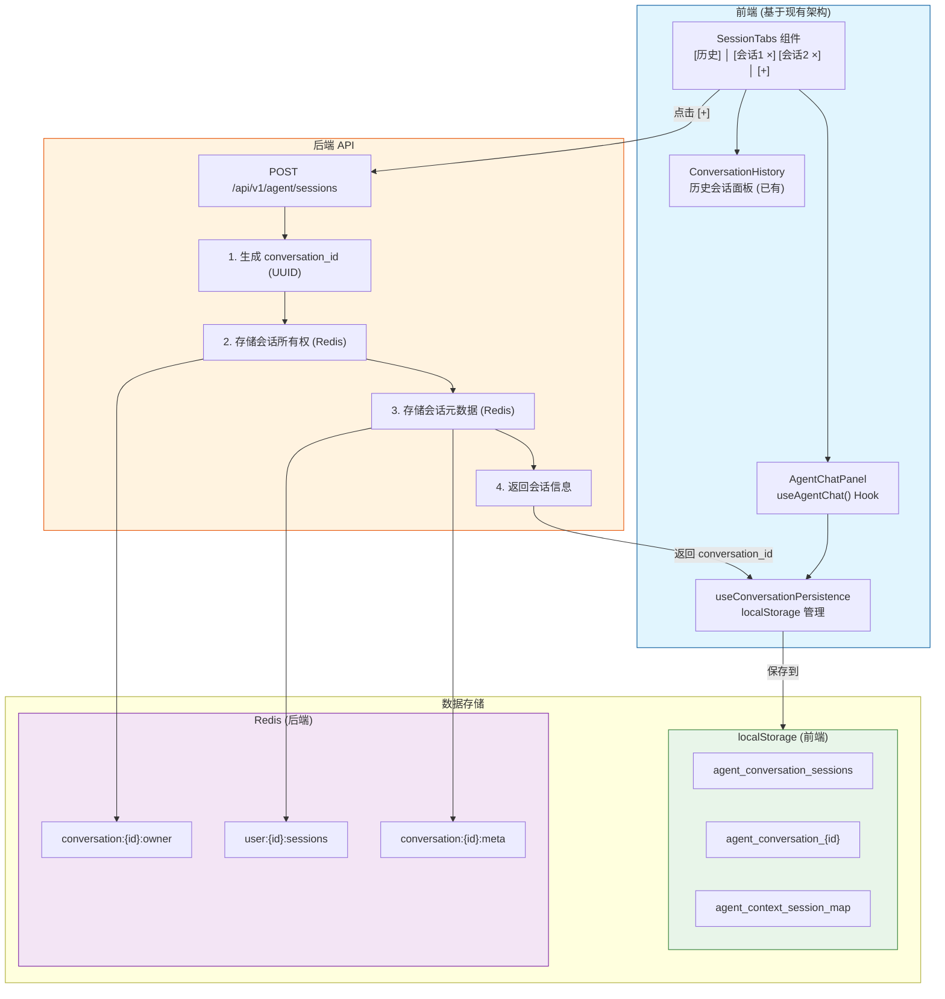
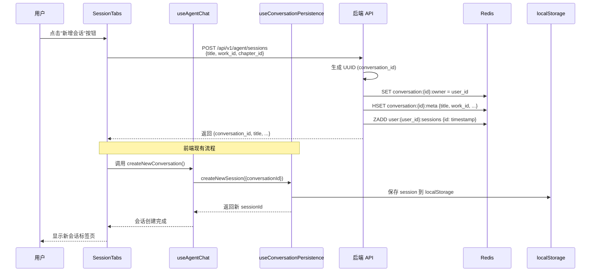

# 新增会话接口开发文档

> 文档版本: v2.0
> 创建日期: 2025-12-01
> 更新日期: 2025-12-01
> 负责模块: 后端
> 关联功能: Agent多会话标签页
> 前端对接: [02前端多会话标签页.md](./02前端多会话标签页.md)
> **实现方案**: 方案A - 扩展现有架构

---

## 0. 方案说明

### 0.1 前端现有架构

前端已有完整的会话管理机制，本后端接口需要与之对接：

| 现有模块 | 文件位置 | 功能 |
|----------|----------|------|
| `useConversationPersistence` | `src/hooks/useConversationPersistence.ts` | 会话持久化（localStorage） |
| `useAgentChat` | `src/hooks/useAgentChat.ts` | 聊天状态管理 |
| `ConversationHistory` | `src/components/agent/ConversationHistory.tsx` | 历史会话面板 |

### 0.2 localStorage 存储结构（前端现有）

```
agent_conversation_sessions          -> ["session_xxx", "session_yyy", ...]
agent_conversation_session_xxx       -> { id, conversationId, messages, title, ... }
agent_context_session_map            -> { "chapter_123": "session_xxx", ... }
```

### 0.3 后端接口定位

后端接口主要用于：
1. **统一生成 conversation_id** - 保证全局唯一性
2. **会话所有权验证** - 跨设备/跨浏览器场景
3. **服务端会话元数据存储** - Redis 缓存，支持快速访问
4. **备份恢复** - 当 localStorage 丢失时可从后端恢复

---

## 1. 功能概述

### 1.1 需求背景

用户在编辑器页面使用AI智能助手时，希望能够：
- 点击"新增会话"按钮创建新的对话会话
- 在多个会话之间通过标签页切换
- 每个会话独立，互不干扰

### 1.2 功能目标

后端提供**创建新会话**的接口，实现：
- 统一生成会话ID（conversation_id）
- 记录会话所有权（用户鉴权）
- 存储会话元数据（标题、关联作品等）
- 为前端标签页功能提供数据支持
- **与前端现有 useConversationPersistence 协同工作**

### 1.3 整体方案



#### 流程说明（与前端现有架构协同）



---

## 2. 接口设计

### 2.1 创建新会话

#### 基本信息

| 项目 | 说明 |
|------|------|
| 接口路径 | `POST /api/v1/agent/sessions` |
| 认证方式 | Bearer Token (JWT) |
| Content-Type | application/json |
| 幂等性支持 | 可选 `Idempotency-Key` 请求头 |

#### 请求头

| 请求头 | 必填 | 说明 |
|--------|------|------|
| Authorization | 是 | Bearer Token (JWT) |
| Content-Type | 是 | application/json |
| Idempotency-Key | 否 | 幂等性键（UUID格式），用于防止重复创建。相同的 Key 在1小时内返回相同结果 |

#### 请求参数

```json
{
    "title": "新对话",           // 可选，会话标题，默认"新对话"
    "work_id": "uuid-xxx",       // 可选，关联的作品ID
    "chapter_id": "uuid-xxx"     // 可选，关联的章节ID
}
```

| 参数 | 类型 | 必填 | 说明 |
|------|------|------|------|
| title | string | 否 | 会话标题，默认"新对话"，最大长度100字符 |
| work_id | string | 否 | 关联的作品ID (UUID格式) |
| chapter_id | string | 否 | 关联的章节ID (UUID格式) |

#### 响应参数

**成功响应 (201 Created)**

```json
{
    "session_id": "550e8400-e29b-41d4-a716-446655440000",
    "conversation_id": "550e8400-e29b-41d4-a716-446655440000",
    "title": "新对话",
    "work_id": "uuid-xxx",
    "chapter_id": "uuid-xxx",
    "created_at": "2025-12-01T10:30:00.000Z",
    "expires_at": "2026-01-01T10:30:00.000Z"
}
```

| 参数 | 类型 | 说明 |
|------|------|------|
| session_id | string | 会话ID，用于前端标签页管理 |
| conversation_id | string | 对话ID，用于Agent对话接口（与session_id相同） |
| title | string | 会话标题 |
| work_id | string \| null | 关联的作品ID |
| chapter_id | string \| null | 关联的章节ID |
| created_at | string | 创建时间 (ISO 8601格式) |
| expires_at | string | 过期时间 (30天后) |

> **字段说明**: `session_id` 和 `conversation_id` 值相同，分别用于前端会话管理和后端对话追踪。保留两个字段是为了语义清晰和前端对接方便。

**错误响应**

| HTTP状态码 | 说明 |
|------------|------|
| 401 | 未登录或Token过期 |
| 422 | 参数验证失败 |
| 500 | 服务器内部错误 |

```json
{
    "detail": "错误描述信息"
}
```

---

### 2.2 获取用户会话列表 (可选扩展)

> 注：此接口为可选扩展，当前版本可不实现（前端使用localStorage管理）

#### 基本信息

| 项目 | 说明 |
|------|------|
| 接口路径 | `GET /api/v1/agent/sessions` |
| 认证方式 | Bearer Token (JWT) |

#### 请求参数 (Query)

| 参数 | 类型 | 必填 | 说明 |
|------|------|------|------|
| work_id | string | 否 | 按作品ID筛选 |
| limit | int | 否 | 返回数量限制，默认20，最大100 |
| offset | int | 否 | 分页偏移量，默认0 |

#### 响应参数

```json
{
    "total": 5,
    "sessions": [
        {
            "conversation_id": "uuid-1",
            "title": "讨论第三章剧情",
            "work_id": "work-uuid",
            "created_at": "2025-12-01T10:30:00.000Z",
            "updated_at": "2025-12-01T11:00:00.000Z"
        }
    ]
}
```

---

### 2.3 归档会话 (v2.0 对接前端)

> 对接前端文档：当用户关闭标签页时，会话归档到历史记录

| 项目 | 说明 |
|------|------|
| 接口路径 | `POST /api/v1/agent/sessions/{session_id}/archive` |
| 认证方式 | Bearer Token (JWT) |

#### 响应参数

```json
{
    "success": true,
    "archived_at": "2025-12-01T11:00:00.000Z"
}
```

---

### 2.4 获取历史会话列表 (v2.0 对接前端)

> 对接前端文档：历史面板需要获取已归档的会话列表

| 项目 | 说明 |
|------|------|
| 接口路径 | `GET /api/v1/agent/sessions/history` |
| 认证方式 | Bearer Token (JWT) |

#### 请求参数 (Query)

| 参数 | 类型 | 必填 | 说明 |
|------|------|------|------|
| work_id | string | 否 | 按作品ID筛选 |
| limit | int | 否 | 返回数量限制，默认20，最大50 |

#### 响应参数

```json
{
    "history": [
        {
            "id": "uuid-1",
            "conversation_id": "uuid-1",
            "title": "讨论第三章剧情",
            "message_count": 15,
            "last_message": "好的，我会按照这个思路继续...",
            "work_id": "work-uuid",
            "chapter_id": "chapter-uuid",
            "created_at": "2025-12-01T10:30:00.000Z",
            "archived_at": "2025-12-01T11:00:00.000Z"
        }
    ]
}
```

---

### 2.5 恢复历史会话 (v2.0 对接前端)

> 对接前端文档：从历史记录恢复会话到标签页

| 项目 | 说明 |
|------|------|
| 接口路径 | `POST /api/v1/agent/sessions/{session_id}/restore` |
| 认证方式 | Bearer Token (JWT) |

#### 响应参数

```json
{
    "session_id": "uuid-1",
    "conversation_id": "uuid-1",
    "title": "讨论第三章剧情",
    "messages": [
        {
            "role": "user",
            "content": "帮我设计第三章的剧情",
            "timestamp": "2025-12-01T10:30:00.000Z"
        },
        {
            "role": "assistant",
            "content": "好的，我来帮你设计...",
            "timestamp": "2025-12-01T10:31:00.000Z"
        }
    ],
    "work_id": "work-uuid",
    "chapter_id": "chapter-uuid",
    "created_at": "2025-12-01T10:30:00.000Z"
}
```

> ⚠️ **重要**：消息角色统一使用 `user` 和 `assistant`（OpenAI 风格），而非 `agent`。前端无需额外转换。

---

### 2.6 删除会话 (可选扩展)

| 项目 | 说明 |
|------|------|
| 接口路径 | `DELETE /api/v1/agent/sessions/{session_id}` |
| 认证方式 | Bearer Token (JWT) |

#### 响应参数

```json
{
    "success": true,
    "message": "会话已删除"
}
```

---

## 3. 数据模型

### 3.1 架构设计决策

#### 为什么选择 Redis 而非数据库？

本功能使用 **Redis** 存储会话数据，不创建新的数据库表。这是基于以下考虑：

| 考虑因素 | Redis | PostgreSQL |
|----------|-------|------------|
| 读写性能 | ~50ms | ~100ms |
| 数据生命周期 | 临时/会话级 | 永久/业务级 |
| 自动清理 | TTL 原生支持 | 需要定时任务 |
| LangGraph 集成 | AsyncRedisSaver 原生支持 | 需自定义实现 |
| 数据重要性 | 可重建（前端有备份） | 不可丢失 |

**设计原则**：Agent 对话是**可重建的临时数据**，前端 localStorage 有完整备份。

#### 三层持久化架构

```
┌─────────────────────────────────────────────────────┐
│          前端 localStorage (第一层)                  │
│  - 会话消息完整备份                                  │
│  - 离线可用，快速恢复                                │
│  - 容量：20个会话，~400KB                           │
└─────────────────────────────────────────────────────┘
                          │
                          ▼
┌─────────────────────────────────────────────────────┐
│          Redis 缓存层 (第二层)                       │
│  - 会话元数据: TTL=30天                             │
│  - LangGraph Checkpoint: TTL=7天 (refresh_on_read) │
│  - 跨请求共享，高性能                               │
└─────────────────────────────────────────────────────┘
                          │
                          ▼
┌─────────────────────────────────────────────────────┐
│          PostgreSQL 持久层 (第三层)                  │
│  - UserSession: 认证会话                            │
│  - HumanizeSession: 去痕迹会话                      │
│  - 长期记忆: 用户偏好、关键实体                     │
└─────────────────────────────────────────────────────┘
```

#### 🆕 数据源优先级策略（与前端协同）

> **重要**：前端和后端需要遵循相同的数据源优先级策略，避免数据不一致

| 场景 | 优先级 | 说明 |
|------|--------|------|
| **加载当前会话** | localStorage > 后端 | 前端 localStorage 是主要存储，后端只做备份 |
| **恢复历史会话** | 后端 restore API > localStorage | 后端可能包含多设备同步的消息 |
| **localStorage 被清理** | 后端 restore API | 从后端恢复数据，写入 localStorage |

**前端实现参考**：见前端文档 4.8 节 `sessionDataStrategy.ts`

**后端 restore 接口职责**：
1. 从 Redis 或 LangGraph Checkpoint 恢复会话数据
2. 如果 Checkpoint 已过期但元数据还在，返回元数据（messages 为空数组）
3. 前端收到空 messages 后，可尝试从 localStorage 恢复

#### TTL 策略说明

| 数据类型 | TTL | 说明 |
|----------|-----|------|
| 会话所有权 (owner) | 30天 | 用于权限验证 |
| 会话元数据 (meta) | 30天 | 用于会话列表显示 |
| LangGraph Checkpoint | 7天 | 对话内容，refresh_on_read 自动续期 |
| 前端 localStorage | 无限 | 完整会话备份，手动/自动清理 |

> **设计考量**：元数据比对话内容保留更久，当 Checkpoint 过期后，用户仍可看到会话列表，点击后从前端 localStorage 恢复对话内容。

#### 故障恢复机制

1. **Redis 故障**：自动降级到 MemorySaver（同进程内保留）
2. **服务重启**：从前端 localStorage 恢复会话
3. **跨设备**：当前架构**不支持**跨设备同步（见后续扩展）

### 3.2 Redis存储结构

#### TTL 常量定义

```python
# 参考项目规范：backend/app/services/agent/memory/enhanced_memory_manager.py
SESSION_TTL = 86400 * 30  # 30天 (2592000秒)
IDEMPOTENT_TTL = 3600     # 幂等性缓存 1小时
```

#### 会话所有权 (已有)

```
Key:    conversation:{conversation_id}:owner
Value:  user_id (string)
TTL:    30天 (SESSION_TTL)
```

#### 会话元数据 (新增)

```
Key:    conversation:{conversation_id}:meta
Type:   Hash
Fields:
    - title:      会话标题
    - work_id:    关联作品ID
    - chapter_id: 关联章节ID
    - created_at: 创建时间 (ISO格式)
    - updated_at: 更新时间 (ISO格式)
TTL:    30天 (SESSION_TTL)
```

#### 用户会话列表 (新增)

```
Key:    user:{user_id}:sessions
Type:   Sorted Set
Score:  创建时间戳 (用于排序)
Member: conversation_id
TTL:    无（不设置整体 TTL，避免刷新问题）
```

> **TTL 策略说明**:
> - `owner` 和 `meta` 使用相同的 TTL，保证同步过期
> - `sessions` 列表不设置 TTL，通过定期清理无效成员来维护
> - 避免"幽灵会话"问题：列表中存在 ID 但元数据已过期

### 3.3 数据一致性保证

#### 原子性操作

使用 Redis Pipeline 保证三个 Key 的原子性写入（参考 `enhanced_memory_manager.py` 模式）：

```python
# 使用 Pipeline 确保原子性
pipe = redis_client.pipeline()
pipe.set(f"conversation:{cid}:owner", user_id, ex=SESSION_TTL)
pipe.hset(f"conversation:{cid}:meta", mapping=meta_data)
pipe.expire(f"conversation:{cid}:meta", SESSION_TTL)
pipe.zadd(f"user:{user_id}:sessions", {cid: timestamp})
pipe.execute()  # 原子执行
```

#### 幽灵会话清理

获取会话列表时，自动清理无效的会话 ID：

```python
# 检查元数据是否存在，不存在则从列表中移除
if not meta:
    await redis_client.zrem(f"user:{user_id}:sessions", cid)
    continue
```

### 3.4 Pydantic数据模型

```python
# app/api/v1/agent.py 中新增

from pydantic import BaseModel, Field, UUID4, field_validator
from typing import Optional, List
from datetime import datetime
import html
import re


def sanitize_title(title: str) -> str:
    """清理标题中的潜在XSS内容"""
    if not title:
        return "新对话"
    title = html.escape(title)
    title = re.sub(r'[\x00-\x1f\x7f-\x9f]', '', title)
    return title.strip()[:100] or "新对话"


class CreateSessionRequest(BaseModel):
    """创建会话请求"""
    title: Optional[str] = Field(
        default="新对话",
        max_length=100,
        description="会话标题"
    )
    work_id: Optional[UUID4] = Field(
        default=None,
        description="关联的作品ID (UUID格式)"
    )
    chapter_id: Optional[UUID4] = Field(
        default=None,
        description="关联的章节ID (UUID格式)"
    )

    @field_validator('title')
    @classmethod
    def validate_title(cls, v):
        return sanitize_title(v) if v else "新对话"


class SessionResponse(BaseModel):
    """会话响应（对接前端 sessionStore）"""
    session_id: str = Field(..., description="会话ID，前端标签页管理用")
    conversation_id: str = Field(..., description="对话ID，后端对话追踪用")
    title: str = Field(..., description="会话标题")
    work_id: Optional[str] = Field(None, description="关联的作品ID")
    chapter_id: Optional[str] = Field(None, description="关联的章节ID")
    created_at: str = Field(..., description="创建时间")
    expires_at: str = Field(..., description="过期时间")


# ==================== v2.0 新增：历史会话相关模型 ====================

class HistorySessionItem(BaseModel):
    """历史会话项（对接前端 HistoryPanel）"""
    id: str = Field(..., description="会话ID")
    conversation_id: str = Field(..., description="对话ID")
    title: str = Field(..., description="会话标题")
    message_count: int = Field(..., description="消息数量")
    last_message: Optional[str] = Field(None, description="最后一条消息预览（前50字符）")
    work_id: Optional[str] = Field(None, description="关联的作品ID")
    chapter_id: Optional[str] = Field(None, description="关联的章节ID")
    created_at: str = Field(..., description="创建时间")
    archived_at: str = Field(..., description="归档时间")


class HistoryListResponse(BaseModel):
    """历史会话列表响应"""
    history: List[HistorySessionItem] = Field(
        default_factory=list,
        description="历史会话列表"
    )


class MessageItem(BaseModel):
    """消息项"""
    role: str = Field(..., description="角色: user | assistant")  # 🆕 统一使用 assistant
    content: str = Field(..., description="消息内容")
    timestamp: str = Field(..., description="时间戳")


class RestoreSessionResponse(BaseModel):
    """恢复会话响应（对接前端 restoreSession）"""
    session_id: str = Field(..., description="会话ID")
    conversation_id: str = Field(..., description="对话ID")
    title: str = Field(..., description="会话标题")
    messages: List[MessageItem] = Field(default_factory=list, description="消息列表")
    work_id: Optional[str] = Field(None, description="关联的作品ID")
    chapter_id: Optional[str] = Field(None, description="关联的章节ID")
    created_at: str = Field(..., description="创建时间")


class SessionListItem(BaseModel):
    """会话列表项"""
    session_id: str = Field(..., description="会话ID")
    conversation_id: str = Field(..., description="对话ID")
    title: str = Field(..., description="会话标题")
    work_id: Optional[str] = Field(None, description="关联的作品ID")
    chapter_id: Optional[str] = Field(None, description="关联的章节ID")
    created_at: str = Field(..., description="创建时间")
    updated_at: str = Field(..., description="更新时间")


class SessionListResponse(BaseModel):
    """会话列表响应"""
    total: int = Field(..., description="总数")
    sessions: list[SessionListItem] = Field(
        default_factory=list,
        description="会话列表"
    )
```

---

## 4. 实现步骤

### 4.1 开发任务清单

| 序号 | 任务 | 预计耗时 | 优先级 |
|------|------|----------|--------|
| 1 | 添加Pydantic数据模型 | 10分钟 | P0 |
| 2 | 实现创建会话接口 | 20分钟 | P0 |
| 3 | 编写单元测试 | 15分钟 | P0 |
| 4 | 接口文档更新 | 10分钟 | P1 |
| 5 | (可选) 获取会话列表接口 | 20分钟 | P2 |
| 6 | (可选) 删除会话接口 | 15分钟 | P2 |

### 4.2 文件修改清单

```
backend/app/api/v1/agent.py
├── 新增 CreateSessionRequest 数据模型
├── 新增 SessionResponse 数据模型
└── 新增 create_session 接口函数

backend/tests/api/v1/test_agent.py (如存在)
└── 新增 test_create_session 测试用例
```

---

## 5. 代码实现示例

### 5.1 创建会话接口

```python
# 在 backend/app/api/v1/agent.py 中添加

from datetime import datetime, timedelta, timezone
from typing import Optional
from pydantic import UUID4, field_validator
import uuid
import json
import re
import html

from fastapi import Header, status
from app.api.middleware.rate_limiter import rate_limit, get_user_identifier


# ==================== 常量定义 ====================
# 参考: backend/app/services/agent/memory/enhanced_memory_manager.py

SESSION_TTL = 86400 * 30      # 30天
IDEMPOTENT_TTL = 3600         # 幂等性缓存 1小时
MAX_SESSIONS_PER_USER = 50    # 每用户最多50个会话


# ==================== 工具函数 ====================

def sanitize_title(title: str) -> str:
    """清理标题中的潜在XSS内容"""
    if not title:
        return "新对话"
    # 1. HTML转义
    title = html.escape(title)
    # 2. 移除控制字符
    title = re.sub(r'[\x00-\x1f\x7f-\x9f]', '', title)
    # 3. 去除首尾空白
    title = title.strip()
    # 4. 限制长度
    return title[:100] if title else "新对话"


# ==================== 数据模型 ====================

class CreateSessionRequest(BaseModel):
    """创建会话请求"""
    title: Optional[str] = Field(
        default="新对话",
        max_length=100,
        description="会话标题"
    )
    work_id: Optional[UUID4] = Field(
        default=None,
        description="关联的作品ID (UUID格式)"
    )
    chapter_id: Optional[UUID4] = Field(
        default=None,
        description="关联的章节ID (UUID格式)"
    )

    @field_validator('title')
    @classmethod
    def validate_title(cls, v):
        """验证并清理标题"""
        return sanitize_title(v) if v else "新对话"


class SessionResponse(BaseModel):
    """会话响应（对接前端 sessionStore）"""
    session_id: str              # 前端标签页管理用
    conversation_id: str         # 后端对话追踪用（与session_id相同）
    title: str
    work_id: Optional[str] = None
    chapter_id: Optional[str] = None
    created_at: str
    expires_at: str


# ==================== 接口实现 ====================

@router.post(
    "/sessions",
    response_model=SessionResponse,
    status_code=status.HTTP_201_CREATED
)
@rate_limit(
    max_requests=30,          # 每分钟最多30次
    window_seconds=60,
    identifier_func=get_user_identifier
)
async def create_session(
    request: CreateSessionRequest,
    current_user: User = Depends(get_current_active_user),
    idempotency_key: Optional[str] = Header(None, alias="Idempotency-Key")
):
    """
    创建新的对话会话

    功能:
    - 生成唯一的会话ID (conversation_id)
    - 支持幂等性（通过 Idempotency-Key 请求头）
    - 使用 Pipeline 原子性写入多个 Redis Key
    - 限制每用户最多50个会话
    - 速率限制：每分钟最多30次

    Args:
        request: 创建会话请求
        current_user: 当前登录用户
        idempotency_key: 幂等性键（可选）

    Returns:
        SessionResponse: 会话信息
    """
    user_id = str(current_user.id)

    # ========== 获取 Redis 客户端 ==========
    # 注意：项目中有两种 Redis 客户端
    # 1. 异步 RedisClient 类 (app.core.redis) - 用于简单的 get/set
    # 2. 同步 get_redis_client() (本文件) - 用于 Pipeline 等复杂操作
    from app.core.redis import redis_client as RedisClient  # 异步类
    redis_sync = get_redis_client()  # 同步客户端，用于 Pipeline

    # ========== 幂等性检查（使用异步客户端） ==========
    if idempotency_key:
        cache_key = f"idempotent:session:{user_id}:{idempotency_key}"
        cached_result = await RedisClient.get(cache_key)
        if cached_result:
            logger.info(f"[Create Session] Idempotent hit: {idempotency_key}")
            return SessionResponse(**cached_result)

    # ========== 会话数量限制检查（使用同步客户端） ==========
    session_count = redis_sync.zcard(f"user:{user_id}:sessions")
    if session_count and session_count >= MAX_SESSIONS_PER_USER:
        logger.warning(f"[Create Session] User {user_id} reached session limit: {session_count}")
        raise HTTPException(
            status_code=status.HTTP_400_BAD_REQUEST,
            detail=f"会话数量已达上限({MAX_SESSIONS_PER_USER}个)，请删除旧会话后再创建"
        )

    # 生成会话ID
    conversation_id = str(uuid.uuid4())

    # 计算时间 (使用UTC时区)
    now = datetime.now(timezone.utc)
    expires_at = now + timedelta(days=30)

    logger.info(f"[Create Session] User: {user_id}, Conversation: {conversation_id}")

    # 准备元数据 (UUID 转字符串)
    meta_data = {
        "title": request.title or "新对话",
        "work_id": str(request.work_id) if request.work_id else "",
        "chapter_id": str(request.chapter_id) if request.chapter_id else "",
        "created_at": now.isoformat(),
        "updated_at": now.isoformat()
    }

    try:
        # ========== 使用同步 Pipeline 原子性写入 ==========
        # 参考: backend/app/api/v1/agent.py 中的分支管理代码
        pipe = redis_sync.pipeline()

        # 1. 存储会话所有权 (带 TTL)
        pipe.set(
            f"conversation:{conversation_id}:owner",
            user_id,
            ex=SESSION_TTL
        )

        # 2. 存储会话元数据 (Hash)
        pipe.hset(
            f"conversation:{conversation_id}:meta",
            mapping=meta_data
        )
        pipe.expire(
            f"conversation:{conversation_id}:meta",
            SESSION_TTL
        )

        # 3. 添加到用户会话列表 (不设置 TTL，避免刷新问题)
        pipe.zadd(
            f"user:{user_id}:sessions",
            {conversation_id: now.timestamp()}
        )

        # 原子执行所有操作（同步）
        pipe.execute()

        logger.info(f"[Create Session] Success - Conversation: {conversation_id}")

    except Exception as e:
        logger.error(f"[Create Session] Redis error: {str(e)}", exc_info=True)
        raise HTTPException(
            status_code=status.HTTP_500_INTERNAL_SERVER_ERROR,
            detail=f"创建会话失败: Redis 操作异常"
        )

    # 构建响应 (UUID 转字符串，添加 session_id 对接前端)
    response_data = SessionResponse(
        session_id=conversation_id,        # 前端标签页管理用
        conversation_id=conversation_id,   # 后端对话追踪用
        title=request.title or "新对话",
        work_id=str(request.work_id) if request.work_id else None,
        chapter_id=str(request.chapter_id) if request.chapter_id else None,
        created_at=now.isoformat(),
        expires_at=expires_at.isoformat()
    )

    # ========== 缓存幂等性结果（使用异步客户端） ==========
    if idempotency_key:
        try:
            await RedisClient.set(
                f"idempotent:session:{user_id}:{idempotency_key}",
                response_data.model_dump(),  # 存储为字典，RedisClient 自动 JSON 序列化
                expire=IDEMPOTENT_TTL
            )
        except Exception as e:
            # 幂等性缓存失败不影响主流程
            logger.warning(f"[Create Session] Idempotent cache failed: {e}")

    return response_data
```

### 5.2 获取会话列表接口 (可选)

```python
class SessionListItem(BaseModel):
    """会话列表项"""
    conversation_id: str
    title: str
    work_id: Optional[str] = None
    chapter_id: Optional[str] = None
    created_at: str
    updated_at: str


class SessionListResponse(BaseModel):
    """会话列表响应"""
    total: int
    sessions: list[SessionListItem]


@router.get("/sessions", response_model=SessionListResponse)
async def get_sessions(
    work_id: Optional[str] = Query(None, description="按作品ID筛选"),
    limit: int = Query(20, ge=1, le=100, description="返回数量限制"),
    offset: int = Query(0, ge=0, description="分页偏移量"),
    current_user: User = Depends(get_current_active_user)
):
    """
    获取用户的会话列表

    功能:
    - 按时间倒序返回会话列表
    - 自动清理幽灵会话（元数据已过期的会话）
    - 支持按作品ID筛选

    Args:
        work_id: 按作品ID筛选 (可选)
        limit: 返回数量限制
        offset: 分页偏移量
        current_user: 当前登录用户

    Returns:
        SessionListResponse: 会话列表
    """
    user_id = str(current_user.id)

    from app.core.redis import redis_client

    try:
        # 从Sorted Set获取会话ID列表 (按时间倒序)
        conversation_ids = await redis_client.zrevrange(
            f"user:{user_id}:sessions",
            offset,
            offset + limit - 1
        )

        if not conversation_ids:
            return SessionListResponse(total=0, sessions=[])

        # 获取总数
        total = await redis_client.zcard(f"user:{user_id}:sessions")

        # 批量获取会话元数据，并清理幽灵会话
        sessions = []
        ghost_sessions = []  # 需要清理的幽灵会话

        for cid in conversation_ids:
            if isinstance(cid, bytes):
                cid = cid.decode('utf-8')

            meta = await redis_client.hgetall(f"conversation:{cid}:meta")

            # ========== 幽灵会话检测 ==========
            if not meta:
                ghost_sessions.append(cid)
                logger.warning(f"[Get Sessions] Ghost session detected: {cid}")
                continue

            # 筛选work_id
            if work_id and meta.get("work_id") != work_id:
                continue

            sessions.append(SessionListItem(
                conversation_id=cid,
                title=meta.get("title", "未命名"),
                work_id=meta.get("work_id") or None,
                chapter_id=meta.get("chapter_id") or None,
                created_at=meta.get("created_at", ""),
                updated_at=meta.get("updated_at", "")
            ))

        # ========== 异步清理幽灵会话 ==========
        if ghost_sessions:
            try:
                await redis_client.zrem(
                    f"user:{user_id}:sessions",
                    *ghost_sessions
                )
                logger.info(f"[Get Sessions] Cleaned {len(ghost_sessions)} ghost sessions")
            except Exception as e:
                logger.warning(f"[Get Sessions] Failed to clean ghost sessions: {e}")

        return SessionListResponse(
            total=total - len(ghost_sessions),  # 调整总数
            sessions=sessions
        )

    except Exception as e:
        logger.error(f"[Get Sessions] Error: {str(e)}", exc_info=True)
        raise HTTPException(
            status_code=status.HTTP_500_INTERNAL_SERVER_ERROR,
            detail="获取会话列表失败"
        )
```

---

## 6. 测试用例

### 6.1 单元测试

```python
# backend/tests/test_agent_sessions.py
# 注意：项目测试文件采用扁平结构 backend/tests/test_*.py

import pytest
import pytest_asyncio
from httpx import AsyncClient, ASGITransport
from uuid import uuid4
from app.main import app


# ==================== Fixtures ====================

@pytest_asyncio.fixture
async def auth_headers(db_session):
    """
    生成认证请求头

    注意：需要在 conftest.py 中添加此 fixture
    或使用项目现有的认证 fixture
    """
    from tests.conftest import create_test_user
    from app.core.security import create_access_token

    user_id = await create_test_user(db_session)
    token = create_access_token(data={"sub": str(user_id)})
    return {"Authorization": f"Bearer {token}"}


class TestAgentSessions:
    """Agent会话接口测试"""

    @pytest.mark.asyncio
    async def test_create_session_success(self, auth_headers):
        """测试创建会话 - 成功"""
        # 使用有效的 UUID 格式（因为模型使用 UUID4 验证）
        work_id = str(uuid4())

        transport = ASGITransport(app=app)
        async with AsyncClient(transport=transport, base_url="http://test") as client:
            response = await client.post(
                "/api/v1/agent/sessions",
                headers=auth_headers,
                json={
                    "title": "测试会话",
                    "work_id": work_id
                }
            )

        assert response.status_code == 201  # 创建成功返回201
        data = response.json()

        # 验证必要字段
        assert "session_id" in data          # 前端标签页管理
        assert "conversation_id" in data     # 后端对话追踪
        assert data["session_id"] == data["conversation_id"]  # 两者相同
        assert data["title"] == "测试会话"
        assert data["work_id"] == work_id

    @pytest.mark.asyncio
    async def test_create_session_default_title(self, auth_headers):
        """测试创建会话 - 默认标题"""
        transport = ASGITransport(app=app)
        async with AsyncClient(transport=transport, base_url="http://test") as client:
            response = await client.post(
                "/api/v1/agent/sessions",
                headers=auth_headers,
                json={}
            )

        assert response.status_code == 201
        data = response.json()
        assert data["title"] == "新对话"
        assert "session_id" in data

    @pytest.mark.asyncio
    async def test_create_session_unauthorized(self):
        """测试创建会话 - 未授权"""
        transport = ASGITransport(app=app)
        async with AsyncClient(transport=transport, base_url="http://test") as client:
            response = await client.post(
                "/api/v1/agent/sessions",
                json={"title": "测试"}
            )

        assert response.status_code == 401

    @pytest.mark.asyncio
    async def test_create_session_title_too_long(self, auth_headers):
        """测试创建会话 - 标题过长（sanitize_title会截断，不会422）"""
        transport = ASGITransport(app=app)
        async with AsyncClient(transport=transport, base_url="http://test") as client:
            response = await client.post(
                "/api/v1/agent/sessions",
                headers=auth_headers,
                json={
                    "title": "a" * 150  # 超过100字符
                }
            )

        # 注意：sanitize_title() 会将过长标题截断为100字符
        # 所以不会返回422，而是返回201但标题被截断
        assert response.status_code == 201
        data = response.json()
        assert len(data["title"]) <= 100

    @pytest.mark.asyncio
    async def test_create_session_invalid_uuid(self, auth_headers):
        """测试创建会话 - 无效UUID格式"""
        transport = ASGITransport(app=app)
        async with AsyncClient(transport=transport, base_url="http://test") as client:
            response = await client.post(
                "/api/v1/agent/sessions",
                headers=auth_headers,
                json={
                    "title": "测试",
                    "work_id": "invalid-uuid-format"  # 无效UUID
                }
            )

        assert response.status_code == 422  # Pydantic UUID4 验证失败

    @pytest.mark.asyncio
    async def test_create_session_idempotency(self, auth_headers):
        """测试创建会话 - 幂等性"""
        idempotency_key = str(uuid4())  # 使用UUID作为幂等键

        transport = ASGITransport(app=app)
        async with AsyncClient(transport=transport, base_url="http://test") as client:
            # 第一次请求
            response1 = await client.post(
                "/api/v1/agent/sessions",
                headers={**auth_headers, "Idempotency-Key": idempotency_key},
                json={"title": "幂等性测试"}
            )

            # 第二次请求（相同的 Idempotency-Key）
            response2 = await client.post(
                "/api/v1/agent/sessions",
                headers={**auth_headers, "Idempotency-Key": idempotency_key},
                json={"title": "幂等性测试"}
            )

        assert response1.status_code == 201
        assert response2.status_code == 201

        # 两次请求应返回相同的 session_id 和 conversation_id
        assert response1.json()["session_id"] == response2.json()["session_id"]
        assert response1.json()["conversation_id"] == response2.json()["conversation_id"]
```

### 6.2 手动测试

```bash
# 1. 获取Token (替换为实际的用户名密码)
curl -X POST http://localhost:8000/api/v1/auth/login \
  -H "Content-Type: application/json" \
  -d '{"username": "test", "password": "test123"}'

# 2. 创建会话
curl -X POST http://localhost:8000/api/v1/agent/sessions \
  -H "Authorization: Bearer <your_token>" \
  -H "Content-Type: application/json" \
  -d '{
    "title": "讨论剧情",
    "work_id": "550e8400-e29b-41d4-a716-446655440000"
  }'

# 3. 创建会话（带幂等性键，防止重复创建）
curl -X POST http://localhost:8000/api/v1/agent/sessions \
  -H "Authorization: Bearer <your_token>" \
  -H "Content-Type: application/json" \
  -H "Idempotency-Key: my-unique-key-123" \
  -d '{
    "title": "讨论剧情",
    "work_id": "550e8400-e29b-41d4-a716-446655440000"
  }'

# 4. 使用返回的conversation_id进行对话
curl -X POST http://localhost:8000/api/v1/agent/chat/stream \
  -H "Authorization: Bearer <your_token>" \
  -H "Content-Type: application/json" \
  -d '{
    "message": "你好",
    "conversation_id": "<上一步返回的conversation_id>"
  }'
```

---

## 7. 前端对接说明（方案A：扩展现有架构）

### 7.1 现有代码复用

**不需要创建新的 `sessionStore.ts`**，复用现有架构：

| 现有模块 | 保留/扩展 | 说明 |
|----------|-----------|------|
| `useConversationPersistence.ts` | ✅ 扩展 | 添加 `archiveSession()` 方法 |
| `useAgentChat.ts` | ✅ 保留 | 已返回会话管理方法 |
| `ConversationHistory.tsx` | ✅ 保留 | 改用 hook 方法操作 |
| `agentApi.ts` | ✅ 扩展 | 添加 `createSession()` 等方法 |

### 7.2 agentApi.ts 扩展

```typescript
// src/services/agentApi.ts 新增方法

interface CreateSessionRequest {
  title?: string;
  work_id?: string;
  chapter_id?: string;
}

interface CreateSessionResponse {
  session_id: string;        // 与 conversation_id 相同
  conversation_id: string;   // 后端生成的 UUID
  title: string;
  work_id: string | null;
  chapter_id: string | null;
  created_at: string;
  expires_at: string;
}

export const agentApi = {
  // ... 现有方法保持不变 ...

  /**
   * 创建新会话（调用后端API获取conversation_id）
   */
  createSession: async (
    params: CreateSessionRequest,
    idempotencyKey?: string
  ): Promise<CreateSessionResponse> => {
    const headers: Record<string, string> = {
      'Content-Type': 'application/json',
      'Authorization': `Bearer ${getToken()}`,
    };

    if (idempotencyKey) {
      headers['Idempotency-Key'] = idempotencyKey;
    }

    const response = await fetch('/api/v1/agent/sessions', {
      method: 'POST',
      headers,
      body: JSON.stringify(params),
    });

    if (!response.ok) {
      const error = await response.json();
      throw new Error(error.detail || '创建会话失败');
    }

    return response.json();
  },
};
```

### 7.3 与现有 Hook 集成

```typescript
// src/hooks/useAgentChat.ts 中的调用方式

// 现有 createNewConversation 方法改造
const createNewConversation = useCallback(async (params?: {
  title?: string;
  workId?: string;
  chapterId?: string;
}) => {
  // 1. 调用后端API获取 conversation_id
  try {
    const response = await agentApi.createSession({
      title: params?.title,
      work_id: params?.workId,
      chapter_id: params?.chapterId,
    });

    // 2. 使用后端返回的 conversationId 创建本地会话
    persistence.createNewSession({
      conversationId: response.conversation_id,
      title: response.title,
      workId: response.work_id,
      chapterId: response.chapter_id,
    });

    // 3. 重置UI状态
    setMessages([]);
    setSuggestedActions([]);
    setActivities([]);
    setProgressData(null);
    activityStartTimes.clear();

  } catch (error) {
    console.error('创建会话失败:', error);
    // 降级：使用前端生成的ID
    persistence.createNewSession();
  }
}, [persistence, activityStartTimes]);
```

### 7.4 字段映射

```
后端返回                    →  前端 ConversationSession
───────────────────────────────────────────────────────
session_id                  →  id (会话ID)
conversation_id             →  conversationId
title                      →  title
work_id                    →  workId
chapter_id                 →  chapterId
created_at                 →  createdAt
```

---

## 8. 注意事项

### 8.1 安全考虑

#### 8.1.1 身份验证与授权

1. **JWT Token 验证**: 所有接口必须通过 `get_current_active_user` 依赖注入验证
2. **会话所有权**: 通过 `conversation:{id}:owner` 验证会话归属
3. **权限校验模式**（与项目其他 API 保持一致）:
   ```python
   # 参考: backend/app/api/v1/chapters.py
   if stored_user_id != str(current_user.id):
       raise HTTPException(status_code=status.HTTP_403_FORBIDDEN)
   ```

#### 8.1.2 输入验证

1. **标题字段安全**:
   ```python
   import re
   import html

   def sanitize_title(title: str) -> str:
       """清理标题中的潜在XSS内容"""
       # 1. HTML转义
       title = html.escape(title)
       # 2. 移除控制字符
       title = re.sub(r'[\x00-\x1f\x7f-\x9f]', '', title)
       # 3. 限制长度
       return title[:100]
   ```

2. **UUID 格式验证**（使用 Pydantic UUID4 类型）:
   ```python
   from pydantic import UUID4

   class CreateSessionRequest(BaseModel):
       title: Optional[str] = Field(default="新对话", max_length=100)
       work_id: Optional[UUID4] = None      # 自动验证UUID格式
       chapter_id: Optional[UUID4] = None   # 自动验证UUID格式
   ```

#### 8.1.3 速率限制

参考项目现有限流机制（`backend/app/api/middleware/rate_limiter.py`）:

```python
from app.api.middleware.rate_limiter import rate_limit, get_user_identifier

@router.post(
    "/sessions",
    response_model=SessionResponse,
    status_code=status.HTTP_201_CREATED
)
@rate_limit(
    max_requests=30,      # 每分钟最多30次
    window_seconds=60,
    identifier_func=get_user_identifier
)
async def create_session(...):
    """创建会话（带速率限制）"""
```

**限流响应头**:
- `X-RateLimit-Limit`: 时间窗口内最大请求数
- `X-RateLimit-Remaining`: 剩余请求数
- `X-RateLimit-Reset`: 限制重置时间（Unix时间戳）
- `Retry-After`: 建议重试延迟（秒）

**限流错误响应 (429)**:
```json
{
    "detail": "请求过于频繁，请稍后再试"
}
```

#### 8.1.4 用户最大会话数限制

```python
# 常量定义
MAX_SESSIONS_PER_USER = 50  # 每用户最多50个会话

# 创建前检查
session_count = await redis_client.zcard(f"user:{user_id}:sessions")
if session_count >= MAX_SESSIONS_PER_USER:
    raise HTTPException(
        status_code=status.HTTP_400_BAD_REQUEST,
        detail=f"会话数量已达上限({MAX_SESSIONS_PER_USER}个)，请删除旧会话后再创建"
    )
```

### 8.2 性能考虑

1. **Redis TTL**: 会话数据30天自动过期，无需手动清理
2. **Sorted Set**: 会话列表使用Sorted Set，支持高效分页
3. **批量查询**: 获取会话列表时使用Pipeline批量查询
4. **幂等性缓存**: Idempotency-Key 缓存1小时后自动清理

### 8.3 兼容性考虑

1. **向后兼容**:
   - 前端可继续使用自生成的UUID调用 `/chat/stream`
   - 新接口为增量功能，不影响现有流程

2. **命名一致性**:
   - Agent 模块统一使用 `conversation_id` 作为会话标识
   - 与 `/chat/stream`、分支管理等接口保持一致
   - `session_id` 仅用于 Humanize、Review 等独立功能模块

### 8.4 错误处理

| HTTP状态码 | 场景 | 处理方式 |
|------------|------|----------|
| 400 | 会话数量超限 | 提示用户删除旧会话 |
| 401 | Token过期/无效 | 前端跳转登录页 |
| 403 | 无权访问他人会话 | 显示权限错误 |
| 422 | 参数验证失败 | 显示具体字段错误 |
| 429 | 请求过于频繁 | 显示重试提示，使用 Retry-After |
| 500 | Redis连接失败 | 显示友好错误提示 |

### 8.5 幂等性说明

1. **Idempotency-Key 使用场景**:
   - 网络不稳定时防止重复创建
   - 用户快速双击按钮时防止重复
   - 前端重试机制中保证请求一致性

2. **Key 生成建议**:
   - 使用 UUID v4 格式
   - 每次用户意图创建会话时生成新的 Key
   - 同一个 Key 在1小时内返回相同结果

---

## 9. 后续扩展

### 9.1 可能的扩展功能

| 功能 | 优先级 | 说明 |
|------|--------|------|
| 会话重命名 | P2 | `PATCH /sessions/{conversation_id}` |
| 会话删除 | P2 | `DELETE /sessions/{conversation_id}` |
| 会话搜索 | P3 | 按标题关键词搜索 |
| 会话导出 | P3 | 导出对话历史为文件 |
| 跨设备同步 | P3 | 会话数据持久化到数据库 |

### 9.2 数据库持久化方案 (未来)

如果需要跨设备同步，可创建数据库表：

```python
# app/models/chat_session.py

class ChatSession(Base):
    __tablename__ = "chat_sessions"

    id = Column(UUID, primary_key=True, default=uuid.uuid4)
    user_id = Column(UUID, ForeignKey("users.id"), nullable=False)
    title = Column(String(100), default="新对话")
    work_id = Column(UUID, ForeignKey("works.id"), nullable=True)
    chapter_id = Column(UUID, ForeignKey("chapters.id"), nullable=True)
    created_at = Column(DateTime, default=datetime.utcnow)
    updated_at = Column(DateTime, default=datetime.utcnow, onupdate=datetime.utcnow)
    is_deleted = Column(Boolean, default=False)
```

---

## 10. 变更记录

| 版本 | 日期 | 作者 | 变更内容 |
|------|------|------|----------|
| v1.0 | 2025-12-01 | - | 初始版本，创建会话接口设计 |
| v1.1 | 2025-12-01 | - | 接口设计优化：HTTP状态码改为201 Created等 |
| v1.2 | 2025-12-01 | - | 数据一致性优化：Pipeline原子性写入等 |
| v1.3 | 2025-12-01 | - | 架构设计补充：三层持久化架构图等 |
| v1.4 | 2025-12-01 | - | 安全与限流增强 |
| v1.5 | 2025-12-01 | - | 前端对接与代码规范修复 |
| **v2.0** | 2025-12-01 | - | **方案A重构**：<br/>1. 新增"方案说明"章节，明确与前端现有架构的关系<br/>2. 更新架构图，展示双层存储（Redis + localStorage）<br/>3. 重写"前端对接说明"，复用 `useConversationPersistence` 和 `useAgentChat`<br/>4. 明确**不创建 sessionStore.ts**，扩展现有代码<br/>5. 添加字段映射表和降级策略 |
| **v2.1** | 2025-12-01 | - | **前后端协调修复**：<br/>1. 统一消息角色为 `user` / `assistant`（2.5节、3.4节）<br/>2. 新增数据源优先级策略说明（3.1节）<br/>3. 明确 restore 接口职责和返回空 messages 的场景 |

---

## 附录

### A. 相关文档

- [前端多会话标签页](./02前端多会话标签页.md) - **前端对接文档（v3.0 方案A）**
- [Agent API文档](../agent-editor-integration-design.md)
- [会话持久化设计](../../conversation-persistence-feature.md)
- [会话上下文隔离](../../conversation-persistence-context-isolation.md)

### B. 相关代码文件

- `backend/app/api/v1/agent.py` - Agent路由（包含 Redis 客户端使用示例）
- `backend/app/core/redis.py` - 异步 Redis 客户端类（仅 get/set/delete）
- `src/hooks/useConversationPersistence.ts` - **前端会话持久化 Hook（复用）**
- `src/hooks/useAgentChat.ts` - **前端聊天 Hook（扩展）**
- `src/components/agent/ConversationHistory.tsx` - **前端历史面板（复用）**
- `src/services/agentApi.ts` - 前端 API 服务（扩展）

---

## 附录 C. 详细实现计划（方案A）

### C.1 整体实施路线图

```mermaid
flowchart LR
    subgraph Phase1["阶段1: 后端实现"]
        B1["实现 POST /sessions"]
        B2["实现 Redis 存储"]
        B3["单元测试"]
    end

    subgraph Phase2["阶段2: 前端Bug修复"]
        F1["修复 AgentChatPanel 传参"]
        F2["修复 ConversationHistory"]
    end

    subgraph Phase3["阶段3: 前端扩展"]
        F3["扩展 agentApi"]
        F4["改造 useAgentChat"]
        F5["新建 SessionTabs"]
    end

    subgraph Phase4["阶段4: 集成测试"]
        T1["集成到 AgentChatPanel"]
        T2["全流程测试"]
    end

    Phase1 --> Phase2 --> Phase3 --> Phase4

    style Phase1 fill:#fff3e0,stroke:#ff9800
    style Phase2 fill:#ffebee,stroke:#f44336
    style Phase3 fill:#e3f2fd,stroke:#2196f3
    style Phase4 fill:#e8f5e9,stroke:#4caf50
```



### C.2 后端实现详细步骤

#### 步骤 1: 在 agent.py 中添加数据模型

```python
# backend/app/api/v1/agent.py

# 在文件顶部添加导入
from pydantic import UUID4, field_validator
import html
import re

# 添加常量
SESSION_TTL = 86400 * 30      # 30天
IDEMPOTENT_TTL = 3600         # 幂等性缓存 1小时
MAX_SESSIONS_PER_USER = 50    # 每用户最多50个会话

# 添加数据模型
class CreateSessionRequest(BaseModel):
    title: Optional[str] = Field(default="新对话", max_length=100)
    work_id: Optional[UUID4] = None
    chapter_id: Optional[UUID4] = None

class SessionResponse(BaseModel):
    session_id: str
    conversation_id: str
    title: str
    work_id: Optional[str] = None
    chapter_id: Optional[str] = None
    created_at: str
    expires_at: str
```

#### 步骤 2: 实现创建会话接口

```python
@router.post("/sessions", response_model=SessionResponse, status_code=201)
async def create_session(
    request: CreateSessionRequest,
    current_user: User = Depends(get_current_active_user),
    idempotency_key: Optional[str] = Header(None, alias="Idempotency-Key")
):
    # 实现逻辑见文档第5节
    pass
```

#### 步骤 3: 注册路由

确保 `/sessions` 路由已在 `agent.py` 的 router 中正确注册。

### C.3 前端实现详细步骤

#### 步骤 1: 修复 AgentChatPanel.tsx (第53行)

```diff
- const { ... } = useAgentChat();
+ const { ... } = useAgentChat({ workId, chapterId });
```

#### 步骤 2: 修复 ConversationHistory.tsx

1. 在 props 中添加 `onDeleteSession`
2. 将直接操作 localStorage 的代码改为调用 `onDeleteSession(sessionId)`

#### 步骤 3: 扩展 agentApi.ts

添加 `createSession` 方法（代码见前端文档 4.3 节）

#### 步骤 4: 改造 useAgentChat.ts

改造 `createNewConversation` 方法，添加后端 API 调用（代码见前端文档 4.4 节）

#### 步骤 5: 新建 SessionTabs.tsx

创建标签栏组件（代码见前端文档 4.5 节）

#### 步骤 6: 集成到 AgentChatPanel.tsx

引入 SessionTabs 并传入必要的 props（代码见前端文档 4.6 节）

### C.4 测试检查清单

#### 后端测试
- [ ] 创建会话成功返回 201
- [ ] 幂等性键生效
- [ ] 会话数量限制生效 (50个)
- [ ] 速率限制生效 (30次/分钟)
- [ ] 未授权返回 401
- [ ] 无效 UUID 返回 422

#### 前端测试
- [ ] 点击 [+] 创建新会话
- [ ] 会话标签显示正确
- [ ] 切换会话消息正确
- [ ] 关闭会话切换正确
- [ ] 刷新页面会话恢复
- [ ] 后端失败时降级到本地创建

### C.5 风险与降级策略

| 风险 | 影响 | 降级策略 |
|------|------|----------|
| 后端 API 不可用 | 无法获取 conversation_id | 前端自动降级到本地生成 ID |
| Redis 不可用 | 会话元数据丢失 | 使用 MemorySaver 内存保留 |
| localStorage 已满 | 无法保存新会话 | 自动清理最旧的会话 |
