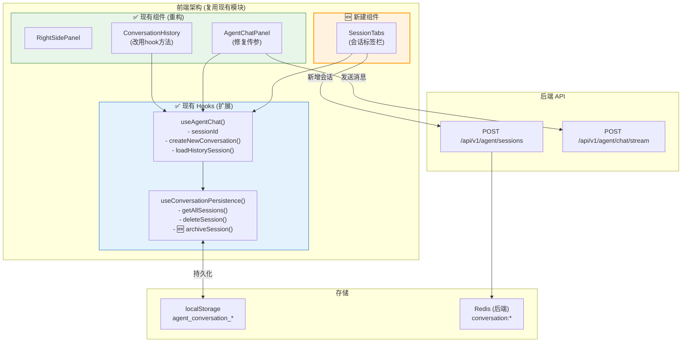
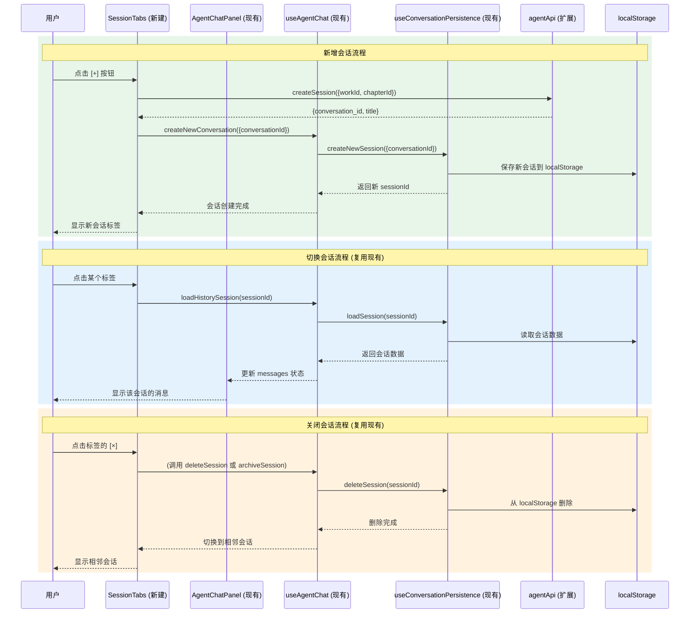
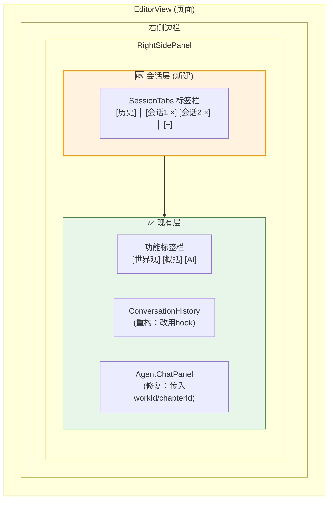
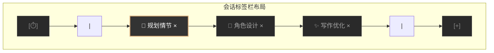
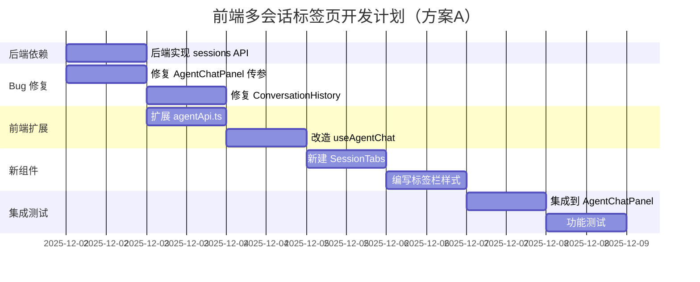

# 前端多会话标签页开发文档

> 文档版本: v3.0
> 创建日期: 2025-12-01
> 更新日期: 2025-12-01
> 负责模块: 前端
> 关联功能: Agent多会话标签页、历史记录
> 依赖文档: [01新增会话接口.md](./01新增会话接口.md)
> **实现方案**: 方案A - 扩展现有架构（复用现有 Hook 和组件）

---

## 0. 方案说明

### 0.1 方案选择：扩展现有架构

**不创建新的 `sessionStore.ts`**，而是复用和扩展现有模块：

| 现有模块 | 操作 | 说明 |
|----------|------|------|
| `useConversationPersistence.ts` | ✅ 扩展 | 添加归档相关方法 |
| `useAgentChat.ts` | ✅ 小改 | 修复传参问题 |
| `ConversationHistory.tsx` | ✅ 重构 | 改用 hook 方法操作 localStorage |
| `agentApi.ts` | ✅ 扩展 | 添加 `createSession()` 方法 |
| `SessionTabs.tsx` | 🆕 新建 | 标签栏组件（调用现有 hook） |

### 0.2 现有架构优势

```
✅ 已有完整的会话持久化机制 (useConversationPersistence)
✅ 已有会话管理方法 (useAgentChat 返回 sessionId, createNewConversation 等)
✅ 已有历史面板组件 (ConversationHistory)
✅ 已有 workId/chapterId 隔离支持
✅ localStorage key 命名规范已确定
```

### 0.3 需要修复的问题

| 问题 | 位置 | 影响 | 修复方式 |
|------|------|------|----------|
| AgentChatPanel 未传 workId/chapterId | `AgentChatPanel.tsx:53` | 无法章节隔离 | 传入 options |
| ConversationHistory 直接操作 localStorage | `ConversationHistory.tsx:90-96` | 数据不一致 | 改用 hook 方法 |

---

## 1. 功能概述

### 1.1 需求背景

用户在编辑器页面使用AI智能助手时，希望能够：
- 点击"新增会话"按钮创建新的对话会话
- 在多个会话之间通过标签页切换
- 每个会话独立，互不干扰
- 刷新页面后会话不丢失

### 1.2 功能目标

实现**浏览器风格的多标签页会话管理**：
- 顶部会话标签栏，位于功能标签栏（世界观/概括/AI）之上
- 支持无限标签（横向滚动）
- 每个标签可关闭（带×按钮）
- 点击标签切换会话
- 左侧历史记录按钮，可查看和恢复已关闭的会话
- 右侧"+"按钮新增会话
- 关闭会话时自动归档到历史记录
- 数据持久化到 localStorage

### 1.3 UI布局说明

```
┌───────────────────────────────────────────────────────────┐
│ [⏱️] │ [会话1 ×] [会话2 ×] [会话3 ×] ...          │ [+] │  ← 会话标签栏（新增）
├───────────────────────────────────────────────────────────┤
│           [世界观]      [概括]      [AI]                   │  ← 功能标签（原有，下移）
├───────────────────────────────────────────────────────────┤
│                                                            │
│              内容区域（根据功能标签切换）                    │
│                                                            │
└───────────────────────────────────────────────────────────┘
```

**数据作用范围：**
- **世界观/概括**：作品级共享数据，不随会话切换
- **AI聊天**：会话级独立数据，每个会话有自己的消息列表

### 1.4 技术方案选型

| 方案 | 说明 | 选择 |
|------|------|------|
| 方案1: 改造头部 | 改动小，但扩展性差 | ❌ |
| 方案2: 外层包装 | 多实例，内存消耗大 | ❌ |
| **方案3: 状态管理** | Zustand管理，性能最优 | ✅ |

---

## 2. 整体架构（方案A：扩展现有架构）

### 2.1 系统架构图



### 2.2 数据流程图（基于现有架构）



### 2.3 组件层级结构



### 2.4 数据作用域说明

| 数据类型 | 作用域 | 说明 |
|---------|--------|------|
| **会话列表** | 全局 | 所有会话的元数据和消息 |
| **当前会话ID** | 全局 | 当前激活的会话标识 |
| **AI聊天消息** | 会话级 | 每个会话独立的消息列表 |
| **功能标签状态** | 会话级 | 每个会话记住自己的activeTab |
| **世界观数据** | 作品级 | 所有会话共享，从作品读取 |
| **概括数据** | 作品级 | 所有会话共享，从作品读取 |
| **历史会话** | 全局 | 已关闭会话的归档列表 |

---

## 3. 数据模型设计（复用现有）

### 3.1 现有 ConversationSession 类型（需扩展）

```typescript
// src/hooks/useConversationPersistence.ts 中已定义（第14-24行）
// 🆕 需要添加 expiresAt 和 isOfflineCreated 字段

interface ConversationSession {
  id: string;                    // 前端会话ID (session_xxx_xxx)
  conversationId: string;        // 后端 conversation_id (UUID)
  messages: Message[];           // 消息列表
  createdAt: string;             // 创建时间
  updatedAt: string;             // 更新时间
  title: string;                 // 对话标题
  mode?: 'planning' | 'react';   // Agent 模式
  workId?: string;               // 关联的作品ID
  chapterId?: string;            // 关联的章节ID
  expiresAt?: string;            // 🆕 过期时间（后端返回，30天后）
  isOfflineCreated?: boolean;    // 🆕 是否离线创建（降级时标记）
}
```

### 3.2 现有 localStorage 存储结构（保持一致）

```typescript
// ✅ 已有 key 命名规范，必须保持一致

STORAGE_KEY_PREFIX = 'agent_conversation_';           // 单个对话存储
SESSIONS_LIST_KEY = 'agent_conversation_sessions';    // 会话ID列表
CONTEXT_SESSION_MAP_KEY = 'agent_context_session_map'; // 上下文映射

// 示例数据
localStorage: {
  'agent_conversation_sessions': '["session_xxx", "session_yyy"]',
  'agent_conversation_session_xxx': '{ id, conversationId, messages, ... }',
  'agent_context_session_map': '{ "chapter_123": "session_xxx" }'
}
```

### 3.3 与后端响应的字段映射

```
后端 CreateSessionResponse      →  前端 ConversationSession
─────────────────────────────────────────────────────────────
session_id                      →  (用于生成 id 或直接使用)
conversation_id                 →  conversationId
title                          →  title
work_id                        →  workId
chapter_id                     →  chapterId
created_at                     →  createdAt
```

---

## 4. 核心实现（方案A：扩展现有代码）

### 4.1 Bug 修复：AgentChatPanel 传参

```tsx
// src/components/agent/AgentChatPanel.tsx

// ❌ 当前代码（第53行）
const { ... } = useAgentChat();

// ✅ 修复后
const { ... } = useAgentChat({ workId, chapterId });
```

### 4.2 Bug 修复：ConversationHistory 使用 hook 方法

```tsx
// src/components/agent/ConversationHistory.tsx

// ❌ 当前代码（第90-96行）- 直接操作 localStorage
const handleDeleteSession = (sessionId: string, e: React.MouseEvent) => {
  e.stopPropagation();
  if (!confirm('确定要删除这个对话吗？')) return;

  // ❌ 绕过了 useConversationPersistence
  localStorage.removeItem(`agent_conversation_${sessionId}`);
  const sessionsList = JSON.parse(localStorage.getItem('agent_conversation_sessions') || '[]');
  const updated = sessionsList.filter((id: string) => id !== sessionId);
  localStorage.setItem('agent_conversation_sessions', JSON.stringify(updated));
};

// ✅ 修复后 - 通过 props 传入的方法操作
interface ConversationHistoryProps {
  currentSessionId: string;
  onLoadSession: (sessionId: string) => void;
  onCreateNew: () => void;
  getAllSessions: () => ConversationSession[];
  onDeleteSession: (sessionId: string) => void;  // 🆕 新增
  className?: string;
}

const handleDeleteSession = (sessionId: string, e: React.MouseEvent) => {
  e.stopPropagation();
  if (!confirm('确定要删除这个对话吗？')) return;

  // ✅ 通过 props 调用，由 useAgentChat 处理
  onDeleteSession(sessionId);
};
```

### 4.3 扩展：agentApi.ts 添加会话管理 API

```typescript
// src/services/agentApi.ts

// ==================== 后端响应类型（下划线命名） ====================

interface CreateSessionResponseRaw {
  session_id: string;
  conversation_id: string;
  title: string;
  work_id: string | null;
  chapter_id: string | null;
  created_at: string;
  expires_at: string;
}

interface HistorySessionItemRaw {
  id: string;
  conversation_id: string;
  title: string;
  message_count: number;
  last_message: string | null;
  work_id: string | null;
  chapter_id: string | null;
  created_at: string;
  archived_at: string;
}

interface HistoryListResponseRaw {
  history: HistorySessionItemRaw[];
}

interface MessageItemRaw {
  role: 'user' | 'assistant';  // 注意：后端统一使用 assistant
  content: string;
  timestamp: string;
}

interface RestoreSessionResponseRaw {
  session_id: string;
  conversation_id: string;
  title: string;
  messages: MessageItemRaw[];
  work_id: string | null;
  chapter_id: string | null;
  created_at: string;
}

// ==================== 前端使用类型（驼峰命名） ====================

export interface CreateSessionResponse {
  sessionId: string;
  conversationId: string;
  title: string;
  workId: string | null;
  chapterId: string | null;
  createdAt: string;
  expiresAt: string;
}

export interface HistorySessionItem {
  id: string;
  conversationId: string;
  title: string;
  messageCount: number;
  lastMessage: string | null;
  workId: string | null;
  chapterId: string | null;
  createdAt: string;
  archivedAt: string;
}

export interface RestoreSessionResponse {
  sessionId: string;
  conversationId: string;
  title: string;
  messages: Array<{
    role: 'user' | 'assistant';
    content: string;
    timestamp: string;
  }>;
  workId: string | null;
  chapterId: string | null;
  createdAt: string;
}

// ==================== 字段转换函数 ====================

/**
 * 🆕 转换创建会话响应（下划线 → 驼峰）
 */
function transformCreateSessionResponse(raw: CreateSessionResponseRaw): CreateSessionResponse {
  return {
    sessionId: raw.session_id,
    conversationId: raw.conversation_id,
    title: raw.title,
    workId: raw.work_id,
    chapterId: raw.chapter_id,
    createdAt: raw.created_at,
    expiresAt: raw.expires_at,
  };
}

/**
 * 🆕 转换历史会话项（下划线 → 驼峰）
 */
function transformHistorySessionItem(raw: HistorySessionItemRaw): HistorySessionItem {
  return {
    id: raw.id,
    conversationId: raw.conversation_id,
    title: raw.title,
    messageCount: raw.message_count,
    lastMessage: raw.last_message,
    workId: raw.work_id,
    chapterId: raw.chapter_id,
    createdAt: raw.created_at,
    archivedAt: raw.archived_at,
  };
}

/**
 * 🆕 转换恢复会话响应（下划线 → 驼峰）
 */
function transformRestoreSessionResponse(raw: RestoreSessionResponseRaw): RestoreSessionResponse {
  return {
    sessionId: raw.session_id,
    conversationId: raw.conversation_id,
    title: raw.title,
    messages: raw.messages,  // role 已统一为 assistant，无需转换
    workId: raw.work_id,
    chapterId: raw.chapter_id,
    createdAt: raw.created_at,
  };
}

// ==================== 通用请求函数 ====================

/**
 * 获取认证请求头
 */
function getAuthHeaders(): Record<string, string> {
  const headers: Record<string, string> = {
    'Content-Type': 'application/json',
  };

  const authStorage = localStorage.getItem('auth-storage');
  if (authStorage) {
    try {
      const { state } = JSON.parse(authStorage);
      if (state?.token) {
        headers['Authorization'] = `Bearer ${state.token}`;
      }
    } catch (e) {
      console.error('Failed to parse auth storage:', e);
    }
  }

  return headers;
}

// ==================== API 方法 ====================

export const agentApi = {
  // ... 现有方法 ...

  /**
   * 🆕 创建新会话
   * @param params 创建参数
   * @param idempotencyKey 幂等性键（可选，防止重复创建）
   */
  createSession: async (
    params: { title?: string; workId?: string; chapterId?: string },
    idempotencyKey?: string
  ): Promise<CreateSessionResponse> => {
    const headers = getAuthHeaders();

    if (idempotencyKey) {
      headers['Idempotency-Key'] = idempotencyKey;
    }

    const response = await fetch('/api/v1/agent/sessions', {
      method: 'POST',
      headers,
      body: JSON.stringify({
        title: params.title,
        work_id: params.workId,
        chapter_id: params.chapterId,
      }),
    });

    if (!response.ok) {
      const error = await response.json().catch(() => ({}));
      throw new Error(error.detail || '创建会话失败');
    }

    const raw: CreateSessionResponseRaw = await response.json();
    return transformCreateSessionResponse(raw);
  },

  /**
   * 🆕 归档会话（关闭标签页时调用）
   * @param sessionId 会话ID
   */
  archiveSession: async (sessionId: string): Promise<{ success: boolean; archivedAt: string }> => {
    const response = await fetch(`/api/v1/agent/sessions/${sessionId}/archive`, {
      method: 'POST',
      headers: getAuthHeaders(),
    });

    if (!response.ok) {
      const error = await response.json().catch(() => ({}));
      throw new Error(error.detail || '归档会话失败');
    }

    const raw = await response.json();
    return {
      success: raw.success,
      archivedAt: raw.archived_at,
    };
  },

  /**
   * 🆕 获取历史会话列表
   * @param workId 可选，按作品ID筛选
   * @param limit 返回数量限制，默认20
   */
  getHistorySessions: async (
    workId?: string,
    limit: number = 20
  ): Promise<HistorySessionItem[]> => {
    const params = new URLSearchParams();
    if (workId) params.append('work_id', workId);
    params.append('limit', String(limit));

    const response = await fetch(`/api/v1/agent/sessions/history?${params}`, {
      method: 'GET',
      headers: getAuthHeaders(),
    });

    if (!response.ok) {
      const error = await response.json().catch(() => ({}));
      throw new Error(error.detail || '获取历史会话失败');
    }

    const raw: HistoryListResponseRaw = await response.json();
    return raw.history.map(transformHistorySessionItem);
  },

  /**
   * 🆕 恢复历史会话
   * @param sessionId 会话ID
   */
  restoreSession: async (sessionId: string): Promise<RestoreSessionResponse> => {
    const response = await fetch(`/api/v1/agent/sessions/${sessionId}/restore`, {
      method: 'POST',
      headers: getAuthHeaders(),
    });

    if (!response.ok) {
      const error = await response.json().catch(() => ({}));
      throw new Error(error.detail || '恢复会话失败');
    }

    const raw: RestoreSessionResponseRaw = await response.json();
    return transformRestoreSessionResponse(raw);
  },
};
```

### 4.4 扩展：useAgentChat 改造

```typescript
// src/hooks/useAgentChat.ts

// 🆕 导入 agentApi
import { agentApi } from '@/services/agentApi';

// ==================== 改造 createNewConversation 方法 ====================

const createNewConversation = useCallback(async (params?: {
  title?: string;
  workId?: string;
  chapterId?: string;
}) => {
  // 1. 清理当前状态
  setMessages([]);
  setSuggestedActions([]);
  setActivities([]);
  setProgressData(null);
  activityStartTimes.clear();

  // 2. 尝试调用后端 API 获取 conversation_id
  try {
    const response = await agentApi.createSession({
      title: params?.title,
      workId: params?.workId || workId,
      chapterId: params?.chapterId || chapterId,
    });

    // 3. 使用后端返回的 conversationId 创建本地会话
    persistence.createNewSession({
      conversationId: response.conversationId,  // ✅ 使用转换后的驼峰命名
      title: response.title,
      workId: response.workId || undefined,
      chapterId: response.chapterId || undefined,
      expiresAt: response.expiresAt,  // 🆕 保存过期时间
    });

    console.log('[useAgentChat] 创建会话成功:', response.conversationId);

  } catch (error: any) {
    console.warn('[useAgentChat] 后端创建会话失败，降级到本地创建:', error);

    // 🆕 区分错误类型
    if (error.message?.includes('会话数量已达上限')) {
      // 会话数量超限，不降级，直接抛出错误
      throw error;
    }

    // 🆕 降级策略：生成本地 UUID 并标记为离线创建
    const localConversationId = crypto.randomUUID();
    persistence.createNewSession({
      conversationId: localConversationId,
      title: params?.title || '新对话',
      workId: params?.workId || workId,
      chapterId: params?.chapterId || chapterId,
      isOfflineCreated: true,  // 🆕 标记为离线创建
    });

    console.log('[useAgentChat] 降级创建本地会话:', localConversationId);
  }
}, [persistence, activityStartTimes, workId, chapterId]);

// ==================== 🆕 新增 deleteSession 方法 ====================

/**
 * 删除会话（从 localStorage 移除）
 * 注意：这是本地删除，归档操作请使用 archiveAndDeleteSession
 */
const deleteSession = useCallback((sessionId: string) => {
  persistence.deleteSession(sessionId);
}, [persistence]);

// ==================== 🆕 新增 archiveAndDeleteSession 方法 ====================

/**
 * 归档并删除会话（先调用后端归档 API，再删除本地数据）
 * 用于关闭标签页时
 */
const archiveAndDeleteSession = useCallback(async (sessionId: string) => {
  try {
    // 1. 调用后端归档 API
    await agentApi.archiveSession(sessionId);
    console.log('[useAgentChat] 会话已归档:', sessionId);
  } catch (error) {
    // 归档失败不阻塞删除，只记录警告
    console.warn('[useAgentChat] 归档会话失败，将直接删除:', error);
  }

  // 2. 删除本地数据
  persistence.deleteSession(sessionId);
}, [persistence]);

// ==================== 返回值需要暴露新方法 ====================

return {
  // ... 现有返回值 ...
  messages,
  sessionId,
  sendMessageStream,
  loadHistorySession,
  getAllHistorySessions,
  createNewConversation,
  deleteSession,              // 🆕 暴露删除方法
  archiveAndDeleteSession,    // 🆕 暴露归档并删除方法
};
```

### 4.5 新建：SessionTabs 标签栏组件

```tsx
// src/components/agent/SessionTabs.tsx

import React, { useRef, useEffect } from 'react';
import { Plus, X, History } from 'lucide-react';

interface SessionTabsProps {
  sessions: ConversationSession[];
  activeSessionId: string;
  isLoading?: boolean;
  onSwitchSession: (sessionId: string) => void;
  onCreateSession: () => void;
  onCloseSession: (sessionId: string) => void;
  onOpenHistory: () => void;
  className?: string;
}

export default function SessionTabs({
  sessions,
  activeSessionId,
  isLoading = false,
  onSwitchSession,
  onCreateSession,
  onCloseSession,
  onOpenHistory,
  className = ''
}: SessionTabsProps) {
  const tabsContainerRef = useRef<HTMLDivElement>(null);

  // 新增会话时自动滚动到最右边
  useEffect(() => {
    if (tabsContainerRef.current) {
      tabsContainerRef.current.scrollLeft = tabsContainerRef.current.scrollWidth;
    }
  }, [sessions.length]);

  const handleCloseSession = (e: React.MouseEvent, sessionId: string) => {
    e.stopPropagation();
    if (sessions.length <= 1) {
      alert('至少保留一个会话');
      return;
    }
    onCloseSession(sessionId);
  };

  return (
    <div className={`session-tabs ${className}`}>
      {/* 左侧：历史记录按钮 */}
      <button onClick={onOpenHistory} className="history-btn" title="历史会话">
        <History className="w-4 h-4" />
      </button>

      <div className="divider" />

      {/* 中间：标签容器 */}
      <div ref={tabsContainerRef} className="tabs-container">
        {sessions.map((session, index) => (
          <div
            key={session.id}
            onClick={() => onSwitchSession(session.id)}
            className={`session-tab ${session.id === activeSessionId ? 'active' : ''}`}
          >
            <span className="tab-title">
              {session.title || `会话 ${index + 1}`}
            </span>
            <button
              onClick={(e) => handleCloseSession(e, session.id)}
              className={`close-btn ${sessions.length <= 1 ? 'disabled' : ''}`}
            >
              <X className="w-3.5 h-3.5" />
            </button>
          </div>
        ))}
      </div>

      <div className="divider" />

      {/* 右侧：新增按钮 */}
      <button
        onClick={onCreateSession}
        disabled={isLoading}
        className="add-btn"
        title="新增会话"
      >
        {isLoading ? <span className="loading-spinner" /> : <Plus className="w-4 h-4" />}
      </button>
    </div>
  );
}
```

### 4.6 集成：在 AgentChatPanel 中使用 SessionTabs

```tsx
// src/components/agent/AgentChatPanel.tsx

import SessionTabs from './SessionTabs';
import { agentApi } from '@/services/agentApi';
import { toast } from 'react-hot-toast';  // 或项目使用的 toast 组件

export default function AgentChatPanel({ workId, chapterId, className }: AgentChatPanelProps) {
  const {
    messages,
    sessionId,
    sendMessageStream,
    loadHistorySession,
    getAllHistorySessions,
    createNewConversation,
    archiveAndDeleteSession,  // 🆕 使用归档并删除方法
  } = useAgentChat({ workId, chapterId });  // ✅ 传入 options

  const [showHistory, setShowHistory] = useState(false);
  const [isCreating, setIsCreating] = useState(false);

  // 获取所有会话列表
  const sessions = getAllHistorySessions();

  // 🆕 新增会话（带错误处理）
  const handleCreateSession = async () => {
    setIsCreating(true);
    try {
      await createNewConversation({ workId, chapterId });
    } catch (error: any) {
      // 🆕 处理会话数量超限错误
      if (error.message?.includes('会话数量已达上限')) {
        toast.error('最多只能创建50个会话，请关闭一些旧会话');
      } else {
        toast.error('创建会话失败，请稍后重试');
      }
    } finally {
      setIsCreating(false);
    }
  };

  // 🆕 关闭会话（先归档到后端，再删除本地）
  const handleCloseSession = async (targetSessionId: string) => {
    if (sessions.length <= 1) {
      toast.error('至少保留一个会话');
      return;
    }

    // 🆕 调用归档并删除方法（先归档后端，再删除本地）
    await archiveAndDeleteSession(targetSessionId);

    // 如果关闭的是当前会话，切换到第一个
    if (targetSessionId === sessionId && sessions.length > 1) {
      const nextSession = sessions.find(s => s.id !== targetSessionId);
      if (nextSession) {
        loadHistorySession(nextSession.id);
      }
    }
  };

  return (
    <div className={`agent-chat-panel ${className}`}>
      {/* 🆕 会话标签栏 */}
      <SessionTabs
        sessions={sessions}
        activeSessionId={sessionId}
        isLoading={isCreating}
        onSwitchSession={loadHistorySession}
        onCreateSession={handleCreateSession}
        onCloseSession={handleCloseSession}
        onOpenHistory={() => setShowHistory(true)}
      />

      {/* 🆕 历史面板（条件渲染） */}
      {showHistory && (
        <HistoryPanel
          workId={workId}
          onClose={() => setShowHistory(false)}
          onRestore={async (historySessionId) => {
            // 从后端恢复会话
            const restored = await agentApi.restoreSession(historySessionId);
            // 保存到本地并切换
            persistence.createNewSession({
              conversationId: restored.conversationId,
              title: restored.title,
              messages: restored.messages,
              workId: restored.workId || undefined,
              chapterId: restored.chapterId || undefined,
            });
            loadHistorySession(restored.sessionId);
            setShowHistory(false);
          }}
        />
      )}

      {/* 现有内容... */}
    </div>
  );
}
```

### 4.7 新建：HistoryPanel 历史面板组件

> 🆕 **注意**：此组件独立于现有 ConversationHistory，专门用于显示已归档的历史会话

```tsx
// src/components/agent/HistoryPanel.tsx

import React, { useState, useEffect } from 'react';
import { X, Clock, MessageSquare, RotateCcw } from 'lucide-react';
import { agentApi, HistorySessionItem } from '@/services/agentApi';

interface HistoryPanelProps {
  workId?: string;
  onClose: () => void;
  onRestore: (sessionId: string) => Promise<void>;
}

export default function HistoryPanel({ workId, onClose, onRestore }: HistoryPanelProps) {
  const [history, setHistory] = useState<HistorySessionItem[]>([]);
  const [isLoading, setIsLoading] = useState(true);
  const [isRestoring, setIsRestoring] = useState<string | null>(null);
  const [error, setError] = useState<string | null>(null);

  // 加载历史会话列表
  useEffect(() => {
    const loadHistory = async () => {
      setIsLoading(true);
      setError(null);
      try {
        const data = await agentApi.getHistorySessions(workId);
        setHistory(data);
      } catch (err: any) {
        setError(err.message || '加载历史会话失败');
      } finally {
        setIsLoading(false);
      }
    };

    loadHistory();
  }, [workId]);

  // 恢复会话
  const handleRestore = async (sessionId: string) => {
    setIsRestoring(sessionId);
    try {
      await onRestore(sessionId);
    } catch (err: any) {
      setError(err.message || '恢复会话失败');
    } finally {
      setIsRestoring(null);
    }
  };

  // 格式化时间
  const formatTime = (timestamp: string) => {
    const date = new Date(timestamp);
    const now = new Date();
    const diff = now.getTime() - date.getTime();

    if (diff < 60000) return '刚刚';
    if (diff < 3600000) return `${Math.floor(diff / 60000)} 分钟前`;
    if (diff < 86400000) return `${Math.floor(diff / 3600000)} 小时前`;
    if (diff < 604800000) return `${Math.floor(diff / 86400000)} 天前`;

    return date.toLocaleDateString('zh-CN');
  };

  return (
    <>
      {/* 遮罩层 */}
      <div className="history-overlay" onClick={onClose} />

      {/* 面板 */}
      <div className="history-panel">
        {/* 头部 */}
        <div className="history-header">
          <h3>历史会话</h3>
          <button className="close-btn" onClick={onClose}>
            <X className="w-4 h-4" />
          </button>
        </div>

        {/* 内容 */}
        <div className="history-content">
          {isLoading ? (
            <div className="history-loading">
              <div className="loading-spinner" />
              <p>加载中...</p>
            </div>
          ) : error ? (
            <div className="history-error">
              <p>{error}</p>
              <button onClick={() => window.location.reload()}>重试</button>
            </div>
          ) : history.length === 0 ? (
            <div className="history-empty">
              <Clock className="w-8 h-8 text-gray-500" />
              <p>暂无历史会话</p>
            </div>
          ) : (
            <div className="history-list">
              {history.map((item) => (
                <div
                  key={item.id}
                  className="history-item"
                  onClick={() => handleRestore(item.id)}
                >
                  <div className="history-item-header">
                    <span className="history-title">{item.title}</span>
                    <span className="history-time">
                      <Clock className="w-3 h-3" />
                      {formatTime(item.archivedAt)}
                    </span>
                  </div>
                  <div className="history-meta">
                    <MessageSquare className="w-3 h-3" />
                    <span>{item.messageCount} 条消息</span>
                  </div>
                  {item.lastMessage && (
                    <div className="history-preview">
                      {item.lastMessage}
                    </div>
                  )}
                  {isRestoring === item.id && (
                    <div className="restoring-indicator">
                      <RotateCcw className="w-4 h-4 animate-spin" />
                    </div>
                  )}
                </div>
              ))}
            </div>
          )}
        </div>
      </div>
    </>
  );
}
```

### 4.8 数据源优先级策略

> 🆕 解决 localStorage 和后端数据不一致的问题

```typescript
// src/utils/sessionDataStrategy.ts

import { agentApi } from '@/services/agentApi';

/**
 * 数据源优先级策略
 *
 * 场景1: 恢复历史会话
 *   优先级: 后端 restore API > localStorage
 *   原因: 后端数据更完整（可能包含多设备同步的消息）
 *
 * 场景2: 加载当前会话
 *   优先级: localStorage > 后端
 *   原因: localStorage 是主要存储，后端只做备份
 *
 * 场景3: localStorage 被清理后恢复
 *   从后端 restore API 获取数据，写入 localStorage
 */

interface SessionData {
  conversationId: string;
  title: string;
  messages: Message[];
  workId?: string;
  chapterId?: string;
}

/**
 * 恢复会话数据（带优先级策略）
 */
export async function recoverSessionData(
  sessionId: string,
  localData: SessionData | null
): Promise<SessionData | null> {
  // 1. 尝试从后端恢复
  try {
    const remoteData = await agentApi.restoreSession(sessionId);

    // 2. 如果后端有数据且消息更多，使用后端数据
    if (remoteData.messages.length > 0) {
      const localMessageCount = localData?.messages?.length || 0;

      if (remoteData.messages.length >= localMessageCount) {
        console.log('[SessionStrategy] 使用后端数据，消息数:', remoteData.messages.length);
        return {
          conversationId: remoteData.conversationId,
          title: remoteData.title,
          messages: remoteData.messages as Message[],
          workId: remoteData.workId || undefined,
          chapterId: remoteData.chapterId || undefined,
        };
      }
    }
  } catch (error) {
    console.warn('[SessionStrategy] 后端恢复失败，尝试使用本地数据:', error);
  }

  // 3. 降级使用本地数据
  if (localData) {
    console.log('[SessionStrategy] 使用本地数据，消息数:', localData.messages?.length || 0);
    return localData;
  }

  // 4. 都没有数据
  console.warn('[SessionStrategy] 无法恢复会话数据');
  return null;
}

/**
 * 检查会话是否即将过期
 */
export function checkSessionExpiry(expiresAt?: string): {
  isExpiringSoon: boolean;
  daysRemaining: number;
} {
  if (!expiresAt) {
    return { isExpiringSoon: false, daysRemaining: -1 };
  }

  const expiry = new Date(expiresAt);
  const now = new Date();
  const diff = expiry.getTime() - now.getTime();
  const daysRemaining = Math.floor(diff / (1000 * 60 * 60 * 24));

  return {
    isExpiringSoon: daysRemaining <= 7,  // 7天内过期视为即将过期
    daysRemaining,
  };
}
```

---

## 5. 样式设计

### 5.1 标签栏样式（v2.0 新布局）



### 5.2 CSS 样式代码（深色主题）

```css
/* src/styles/session-tabs.css */

/* ============ 标签栏容器 ============ */
.session-tabs {
  display: flex;
  align-items: center;
  height: 44px;
  background: #1a1a1a;
  border-bottom: 1px solid #333;
  padding: 0 8px;
  position: relative;
}

/* ============ 历史按钮 ============ */
.session-tabs .history-btn {
  display: flex;
  align-items: center;
  justify-content: center;
  width: 32px;
  height: 32px;
  border-radius: 6px;
  color: #888;
  background: transparent;
  border: none;
  cursor: pointer;
  transition: all 0.15s ease;
}

.session-tabs .history-btn:hover {
  background: #333;
  color: #fff;
}

/* ============ 分割线 ============ */
.session-tabs .divider {
  width: 1px;
  height: 20px;
  background: #333;
  margin: 0 8px;
}

/* ============ 标签容器（可滚动） ============ */
.session-tabs .tabs-container {
  flex: 1;
  display: flex;
  gap: 4px;
  overflow-x: auto;
  scrollbar-width: none;
  scroll-behavior: smooth;
}

.session-tabs .tabs-container::-webkit-scrollbar {
  display: none;
}

/* ============ 单个标签 ============ */
.session-tab {
  display: flex;
  align-items: center;
  gap: 6px;
  padding: 6px 12px;
  background: #2a2a2a;
  border-radius: 6px;
  color: #aaa;
  font-size: 13px;
  cursor: pointer;
  white-space: nowrap;
  transition: all 0.15s ease;
  border: none;
}

.session-tab:hover {
  background: #333;
  color: #ccc;
}

/* 标签 - 激活状态 */
.session-tab.active {
  background: #333;
  color: #fff;
  border-bottom: 2px solid #d4a574;  /* 金色底边 */
}

/* 标签标题 */
.session-tab .tab-title {
  flex: 1;
  overflow: hidden;
  text-overflow: ellipsis;
  white-space: nowrap;
  font-size: 13px;
  font-weight: 500;
  max-width: 150px;
}

/* 关闭按钮 */
.session-tab .close-btn {
  display: flex;
  align-items: center;
  justify-content: center;
  padding: 2px;
  border-radius: 4px;
  opacity: 0.6;
  background: transparent;
  border: none;
  color: inherit;
  cursor: pointer;
  transition: all 0.15s ease;
}

.session-tab:hover .close-btn {
  opacity: 1;
}

.session-tab .close-btn:hover {
  background: rgba(255, 255, 255, 0.1);
}

.session-tab .close-btn.disabled {
  opacity: 0.3;
  cursor: not-allowed;
}

/* ============ 新增按钮 ============ */
.session-tabs .add-btn {
  display: flex;
  align-items: center;
  justify-content: center;
  width: 32px;
  height: 32px;
  border-radius: 6px;
  color: #888;
  background: transparent;
  border: none;
  cursor: pointer;
  transition: all 0.15s ease;
}

.session-tabs .add-btn:hover {
  background: #333;
  color: #fff;
}

.session-tabs .add-btn:disabled {
  opacity: 0.5;
  cursor: not-allowed;
}

/* 加载动画 */
.session-tabs .loading-spinner {
  width: 14px;
  height: 14px;
  border: 2px solid #555;
  border-top-color: #888;
  border-radius: 50%;
  animation: spin 0.8s linear infinite;
}

@keyframes spin {
  to { transform: rotate(360deg); }
}
```

### 5.3 历史面板样式（v2.0 新增）

```css
/* src/styles/history-panel.css */

/* ============ 遮罩层 ============ */
.history-overlay {
  position: fixed;
  inset: 0;
  background: rgba(0, 0, 0, 0.3);
  z-index: 99;
}

/* ============ 历史面板 ============ */
.history-panel {
  position: absolute;
  top: 48px;
  left: 8px;
  width: 320px;
  max-height: 450px;
  background: #1a1a1a;
  border: 1px solid #333;
  border-radius: 8px;
  box-shadow: 0 4px 20px rgba(0, 0, 0, 0.4);
  z-index: 100;
  display: flex;
  flex-direction: column;
  overflow: hidden;
}

/* 面板头部 */
.history-panel .history-header {
  display: flex;
  align-items: center;
  justify-content: space-between;
  padding: 12px 16px;
  border-bottom: 1px solid #333;
}

.history-panel .history-header h3 {
  font-size: 14px;
  font-weight: 600;
  color: #fff;
  margin: 0;
}

.history-panel .history-header .close-btn {
  display: flex;
  align-items: center;
  justify-content: center;
  width: 24px;
  height: 24px;
  border-radius: 4px;
  color: #888;
  background: transparent;
  border: none;
  cursor: pointer;
  transition: all 0.15s ease;
}

.history-panel .history-header .close-btn:hover {
  background: #333;
  color: #fff;
}

/* 面板内容 */
.history-panel .history-content {
  flex: 1;
  overflow-y: auto;
}

/* 加载状态 */
.history-panel .history-loading {
  display: flex;
  flex-direction: column;
  align-items: center;
  justify-content: center;
  padding: 40px 20px;
  color: #888;
  gap: 8px;
}

/* 空状态 */
.history-panel .history-empty {
  display: flex;
  flex-direction: column;
  align-items: center;
  justify-content: center;
  padding: 40px 20px;
  color: #666;
  gap: 8px;
}

.history-panel .history-empty p {
  font-size: 13px;
  margin: 0;
}

/* 历史列表 */
.history-panel .history-list {
  padding: 8px;
}

/* 历史项 */
.history-panel .history-item {
  padding: 12px;
  border-radius: 6px;
  cursor: pointer;
  transition: background 0.15s ease;
  margin-bottom: 4px;
}

.history-panel .history-item:hover {
  background: #2a2a2a;
}

.history-panel .history-item:last-child {
  margin-bottom: 0;
}

/* 历史项头部 */
.history-panel .history-item-header {
  display: flex;
  align-items: center;
  justify-content: space-between;
  margin-bottom: 4px;
}

.history-panel .history-title {
  font-size: 14px;
  font-weight: 500;
  color: #fff;
  overflow: hidden;
  text-overflow: ellipsis;
  white-space: nowrap;
  max-width: 180px;
}

.history-panel .history-time {
  display: flex;
  align-items: center;
  gap: 4px;
  font-size: 11px;
  color: #666;
}

/* 历史项元信息 */
.history-panel .history-meta {
  font-size: 12px;
  color: #888;
  margin-bottom: 4px;
}

/* 历史项预览 */
.history-panel .history-preview {
  font-size: 12px;
  color: #666;
  overflow: hidden;
  text-overflow: ellipsis;
  white-space: nowrap;
}
```

---

## 6. 文件清单（方案A：最小改动）

### 6.1 新增文件

| 文件路径 | 说明 |
|----------|------|
| `src/components/agent/SessionTabs.tsx` | 🆕 会话标签栏组件 |
| `src/components/agent/HistoryPanel.tsx` | 🆕 历史会话面板组件 |
| `src/utils/sessionDataStrategy.ts` | 🆕 数据源优先级策略 |
| `src/styles/session-tabs.css` | 🆕 标签栏样式 |

### 6.2 修改文件

| 文件路径 | 修改内容 | 改动量 |
|----------|----------|--------|
| `src/services/agentApi.ts` | 添加 `createSession()`、`archiveSession()`、`getHistorySessions()`、`restoreSession()` 方法 | 中 |
| `src/hooks/useAgentChat.ts` | 改造 `createNewConversation()`，添加 `deleteSession()`、`archiveAndDeleteSession()` | 中 |
| `src/hooks/useConversationPersistence.ts` | 添加 `expiresAt`、`isOfflineCreated` 字段支持 | 小 |
| `src/components/agent/AgentChatPanel.tsx` | 传入 `{workId, chapterId}`，集成 SessionTabs、HistoryPanel | 中 |
| `src/components/agent/ConversationHistory.tsx` | 改用 hook 方法删除会话 | 小 |

### 6.3 保留不变的文件

| 文件路径 | 说明 |
|----------|------|
| `src/hooks/useConversationPersistence.ts` | ✅ 现有逻辑完全满足需求 |
| `src/types/agent.ts` | ✅ Message 类型已定义 |

### 6.4 ~~不再需要~~（与原文档对比）

| 原计划文件 | 状态 | 原因 |
|------------|------|------|
| `src/store/sessionStore.ts` | ❌ 不创建 | 复用 useConversationPersistence |
| `src/types/session.ts` | ❌ 不创建 | 类型已在 hook 中定义 |
| `src/components/agent/HistoryPanel.tsx` | ❌ 不创建 | 复用 ConversationHistory |

---

## 7. 开发步骤（方案A：精简版）

### 7.1 开发顺序图



### 7.2 详细步骤

| 步骤 | 任务 | 文件 | 说明 |
|------|------|------|------|
| **1** | 🔧 修复 AgentChatPanel 传参 | `AgentChatPanel.tsx:53` | 添加 `{ workId, chapterId }` |
| **2** | 🔧 修复 ConversationHistory | `ConversationHistory.tsx:90-96` | 改用 `onDeleteSession` prop |
| **3** | ➕ 扩展 agentApi | `agentApi.ts` | 添加 `createSession()` 方法 |
| **4** | 🔄 改造 useAgentChat | `useAgentChat.ts` | 改造 `createNewConversation()` |
| **5** | 🆕 新建 SessionTabs | `SessionTabs.tsx` | 标签栏组件 |
| **6** | 🎨 编写样式 | `session-tabs.css` | 深色主题样式 |
| **7** | 🔗 集成到 AgentChatPanel | `AgentChatPanel.tsx` | 引入 SessionTabs |
| **8** | ✅ 功能测试 | - | 全流程测试 |

### 7.3 预估工作量

| 类别 | 工作量 | 说明 |
|------|--------|------|
| Bug 修复 | 0.5h | 两处小改动 |
| API 扩展 | 0.5h | 添加一个方法 |
| Hook 改造 | 1h | 改造一个方法 |
| 新组件开发 | 2h | SessionTabs + 样式 |
| 集成测试 | 1h | 全流程验证 |
| **总计** | **~5h** | 相比原方案减少 ~60% |

---

## 8. 测试用例

### 8.1 功能测试清单

```markdown
## 新增会话
- [ ] 点击 [+] 按钮，调用后端API成功
- [ ] 新标签出现在最右边
- [ ] 自动切换到新会话
- [ ] 新会话标题默认为"新对话"
- [ ] 新会话消息列表为空
- [ ] 新会话 activeTab 默认为 'ai'

## 切换会话
- [ ] 点击非激活标签，切换成功
- [ ] 切换后显示对应会话的消息
- [ ] 切换后恢复该会话的功能标签状态
- [ ] 激活标签样式正确（金色底边）
- [ ] 非激活标签样式正确（深色背景）

## 关闭会话
- [ ] 点击 [×] 关闭会话
- [ ] 关闭当前会话时自动切换到相邻会话
- [ ] 只剩一个会话时不能关闭（提示用户）
- [ ] 关闭非当前会话不影响当前显示
- [ ] 关闭的会话自动归档到历史记录

## 历史记录功能（v2.0 新增）
- [ ] 点击 [⏱️] 按钮打开历史面板
- [ ] 历史面板正确显示已关闭的会话列表
- [ ] 历史项显示标题、消息数、归档时间
- [ ] 历史项显示最后一条消息预览
- [ ] 点击历史项恢复会话到标签栏
- [ ] 恢复后自动切换到该会话
- [ ] 恢复后从历史列表中移除
- [ ] 点击遮罩层或×按钮关闭历史面板

## 发送消息
- [ ] 在当前会话发送消息成功
- [ ] 消息显示在正确的会话中
- [ ] 流式响应正常更新
- [ ] 第一条消息自动更新会话标题

## 持久化
- [ ] 刷新页面后会话列表恢复
- [ ] 刷新页面后消息历史恢复
- [ ] 刷新页面后激活状态恢复
- [ ] 刷新页面后历史记录恢复

## 边界情况
- [ ] 网络错误时显示错误提示
- [ ] 标签过多时可横向滚动
- [ ] 新增会话时自动滚动到最右边
- [ ] 历史列表为空时显示空状态
- [ ] 加载历史时显示loading状态
```

### 8.2 单元测试示例

> 🆕 **注意**：方案A 复用现有 Hook，测试对象为 `useAgentChat` 而非 `sessionStore`

```typescript
// src/hooks/__tests__/useAgentChat.test.ts

import { renderHook, act, waitFor } from '@testing-library/react';
import { useAgentChat } from '../useAgentChat';
import { agentApi } from '@/services/agentApi';

// Mock agentApi
jest.mock('@/services/agentApi', () => ({
  agentApi: {
    createSession: jest.fn(),
    archiveSession: jest.fn(),
    getHistorySessions: jest.fn(),
    restoreSession: jest.fn(),
  },
}));

describe('useAgentChat - 会话管理', () => {
  beforeEach(() => {
    // 清空 localStorage
    localStorage.clear();
    // 重置所有 mock
    jest.clearAllMocks();
  });

  it('应该能创建新会话（调用后端API）', async () => {
    // Mock 后端返回
    (agentApi.createSession as jest.Mock).mockResolvedValue({
      sessionId: 'test-session-id',
      conversationId: 'test-conversation-id',
      title: '测试会话',
      workId: null,
      chapterId: null,
      createdAt: new Date().toISOString(),
      expiresAt: new Date(Date.now() + 30 * 24 * 60 * 60 * 1000).toISOString(),
    });

    const { result } = renderHook(() => useAgentChat({ workId: 'work-1' }));

    await act(async () => {
      await result.current.createNewConversation({ title: '测试会话' });
    });

    // 验证 API 被调用
    expect(agentApi.createSession).toHaveBeenCalledWith({
      title: '测试会话',
      workId: 'work-1',
      chapterId: undefined,
    });

    // 验证会话创建成功
    expect(result.current.sessionId).toBeTruthy();
  });

  it('后端创建失败时应该降级到本地创建', async () => {
    // Mock 后端失败
    (agentApi.createSession as jest.Mock).mockRejectedValue(new Error('网络错误'));

    const { result } = renderHook(() => useAgentChat({}));

    await act(async () => {
      await result.current.createNewConversation({ title: '测试会话' });
    });

    // 验证会话仍然创建成功（本地降级）
    expect(result.current.sessionId).toBeTruthy();
  });

  it('会话数量超限时不应该降级', async () => {
    // Mock 超限错误
    (agentApi.createSession as jest.Mock).mockRejectedValue(
      new Error('会话数量已达上限(50个)')
    );

    const { result } = renderHook(() => useAgentChat({}));

    // 应该抛出错误，不降级
    await expect(
      act(async () => {
        await result.current.createNewConversation({ title: '测试会话' });
      })
    ).rejects.toThrow('会话数量已达上限');
  });

  it('关闭会话时应该先归档再删除', async () => {
    // Mock 归档成功
    (agentApi.archiveSession as jest.Mock).mockResolvedValue({
      success: true,
      archivedAt: new Date().toISOString(),
    });

    // 先创建一个会话
    (agentApi.createSession as jest.Mock).mockResolvedValue({
      sessionId: 'session-to-close',
      conversationId: 'conv-to-close',
      title: '待关闭会话',
      workId: null,
      chapterId: null,
      createdAt: new Date().toISOString(),
      expiresAt: new Date().toISOString(),
    });

    const { result } = renderHook(() => useAgentChat({}));

    // 创建会话
    await act(async () => {
      await result.current.createNewConversation({ title: '待关闭会话' });
    });

    const sessionId = result.current.sessionId;

    // 归档并删除
    await act(async () => {
      await result.current.archiveAndDeleteSession(sessionId);
    });

    // 验证归档 API 被调用
    expect(agentApi.archiveSession).toHaveBeenCalledWith(sessionId);
  });

  it('切换会话应该正确加载消息', async () => {
    const { result } = renderHook(() => useAgentChat({}));

    // 假设已有两个会话在 localStorage
    // ... 测试切换逻辑
  });
});
```

---

## 9. 与后端对接

### 9.1 接口对接清单

| 后端接口 | 前端调用位置 | 说明 |
|----------|-------------|------|
| `POST /api/v1/agent/sessions` | `sessionStore.createSession()` | 创建新会话 |
| `POST /api/v1/agent/chat/stream` | `AgentChatPanel.handleSendMessage()` | 发送消息 |
| `GET /api/v1/agent/sessions/history` | `sessionStore.loadHistorySessions()` | 获取历史会话列表（v2.0 新增） |
| `POST /api/v1/agent/sessions/{id}/restore` | `sessionStore.restoreSession()` | 恢复历史会话（v2.0 新增） |

### 9.2 错误处理

```typescript
// 创建会话失败处理
try {
  await createSession({ workId, chapterId });
} catch (error) {
  if (error.message.includes('401')) {
    // Token过期，跳转登录
    router.push('/login');
  } else {
    // 显示错误提示
    toast.error('创建会话失败，请稍后重试');
  }
}

// v2.0 新增：恢复会话失败处理
try {
  await restoreSession(sessionId);
} catch (error) {
  toast.error('恢复会话失败，请稍后重试');
}
```

---

## 10. 注意事项

### 10.1 性能优化

1. **单实例渲染**: 只渲染当前激活会话的消息，避免多实例
2. **虚拟滚动**: 如果消息过多，考虑使用虚拟滚动
3. **防抖保存**: localStorage保存使用防抖，避免频繁写入
4. **历史列表分页**: 历史会话过多时考虑分页加载（v2.0）

### 10.2 用户体验

1. **自动标题**: 根据第一条用户消息自动生成标题
2. **加载状态**: 创建会话、恢复会话时显示loading指示器
3. **归档而非删除**: 关闭会话自动归档到历史，可随时恢复
4. **时间友好显示**: 历史记录显示"刚刚"、"5分钟前"等友好格式

### 10.3 兼容性

1. **localStorage容量**: 注意localStorage 5MB限制，消息过多时考虑清理
2. **现有Hook兼容**: 保持与现有 `useAgentChat` 的兼容性
3. **数据版本迁移**: v1到v2的数据结构需要兼容迁移

---

## 11. 变更记录

| 版本 | 日期 | 作者 | 变更内容 |
|------|------|------|----------|
| v1.0 | 2025-12-01 | - | 初始版本 |
| v2.0 | 2025-12-01 | - | 新增历史记录功能、两侧按钮布局、深色主题 |
| **v3.0** | 2025-12-01 | - | **方案A重构**：<br/>1. 新增"方案说明"章节，明确复用现有架构<br/>2. **不创建 sessionStore.ts**，复用 useConversationPersistence<br/>3. **不创建 HistoryPanel.tsx**，复用 ConversationHistory<br/>4. 更新架构图，展示现有模块关系<br/>5. 重写"核心实现"章节，改为扩展现有代码<br/>6. 明确 Bug 修复项（传参问题、直接操作localStorage）<br/>7. 精简文件清单，减少 ~60% 工作量<br/>8. 添加字段映射和降级策略 |
| **v3.1** | 2025-12-01 | - | **前后端协调修复**：<br/>1. 完善 agentApi.ts：添加 `archiveSession()`、`getHistorySessions()`、`restoreSession()` 方法（4.3节）<br/>2. 添加字段转换函数 `transformXxxResponse()`，统一下划线→驼峰转换<br/>3. 完善 useAgentChat：添加 `deleteSession()`、`archiveAndDeleteSession()` 方法（4.4节）<br/>4. 修复关闭会话逻辑：先调用归档API再删除本地（4.6节）<br/>5. 新增 HistoryPanel 组件实现（4.7节）<br/>6. 新增数据源优先级策略 `sessionDataStrategy.ts`（4.8节）<br/>7. 扩展 ConversationSession 类型：添加 `expiresAt`、`isOfflineCreated` 字段（3.1节）<br/>8. 完善降级策略：生成本地UUID并标记离线创建<br/>9. 添加会话数量超限(50个)的错误处理<br/>10. 修正单元测试代码，测试 useAgentChat（8.2节） |

---

## 附录

### A. 相关文档

- [01新增会话接口.md](./01新增会话接口.md) - 后端接口文档
- [conversation-persistence-feature.md](../../conversation-persistence-feature.md) - 会话持久化设计

### B. 参考资源

- [Zustand 官方文档](https://github.com/pmndrs/zustand)
- [React 状态管理最佳实践](https://react.dev/learn/managing-state)
