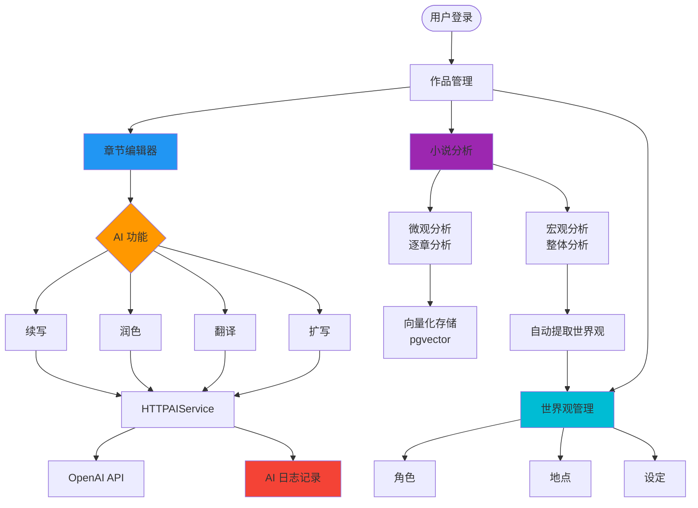
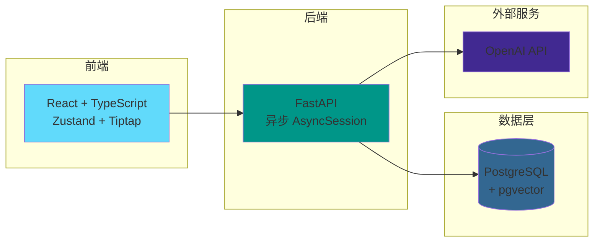
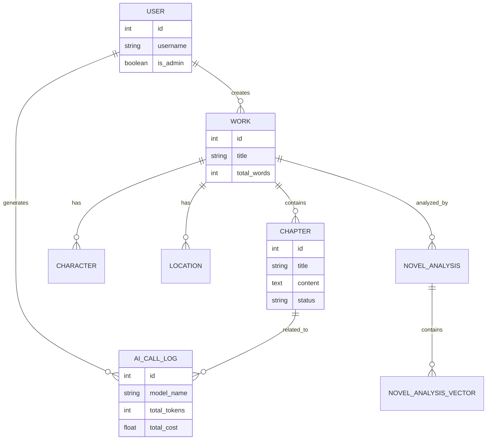

# NovelAIde 核心流程图

## 核心业务流程



## 技术架构



## 核心数据模型



## 核心流程说明

### 1. 用户创作流程
```
登录 → 作品列表 → 编辑章节 → AI 辅助 → 保存
```

### 2. AI 调用链路
```
前端编辑器 → AIService → FastAPI /ai/complete
→ HTTPAIService → OpenAI API
→ AILogMiddleware 自动记录日志 → 返回流式响应
```

### 3. 小说分析流程
```
启动分析 → 后台异步任务 → 微观分析（逐章）+ 宏观分析（整体）
→ 向量化存储 → 自动提取世界观 → 更新角色/地点/设定
```

### 4. 关键技术特性
- ✅ 异步数据库操作 (AsyncSession)
- ✅ SSE 流式 AI 响应
- ✅ AI 调用自动日志记录
- ✅ 向量化语义搜索 (pgvector)
- ✅ JWT 认证 + 多设备会话管理
