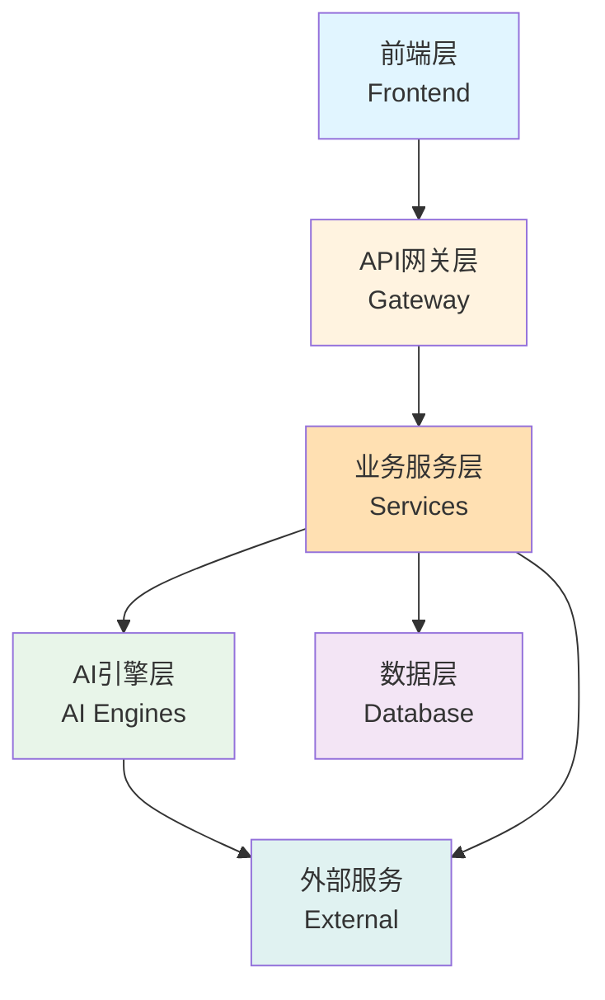
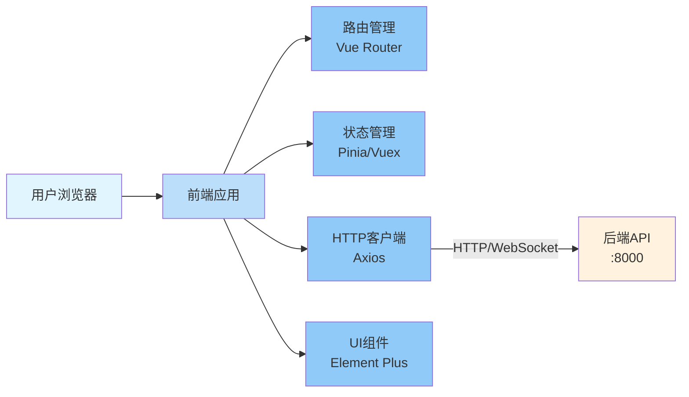
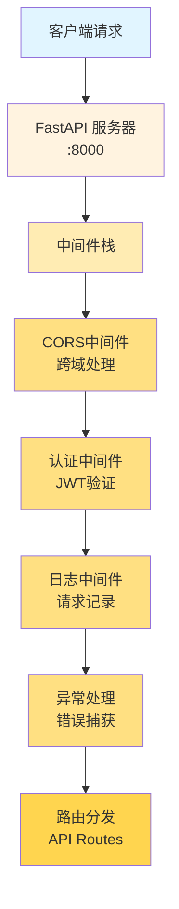
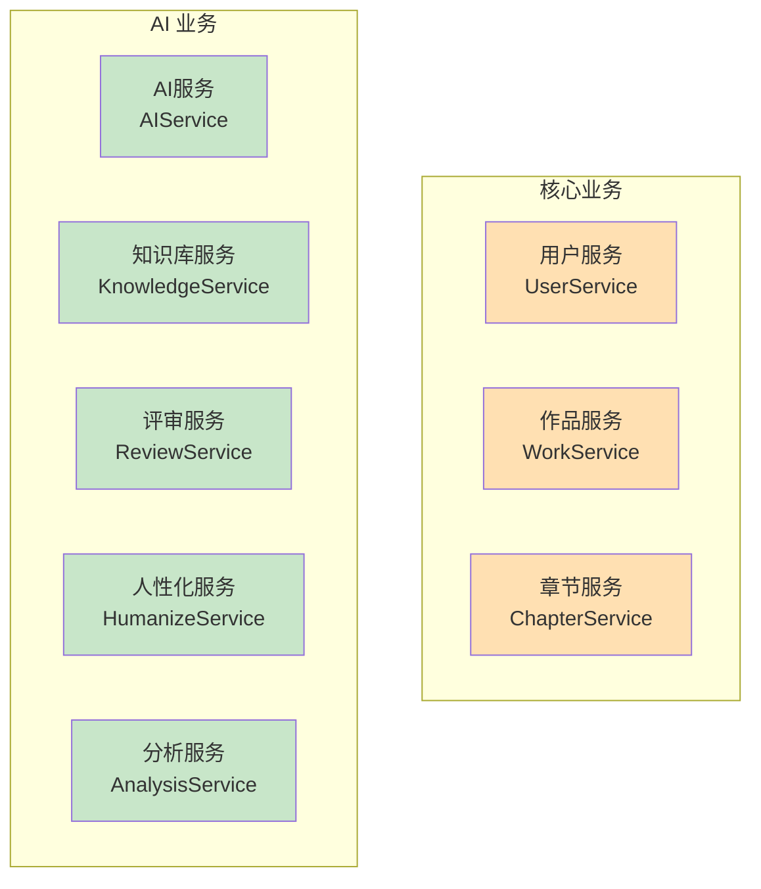
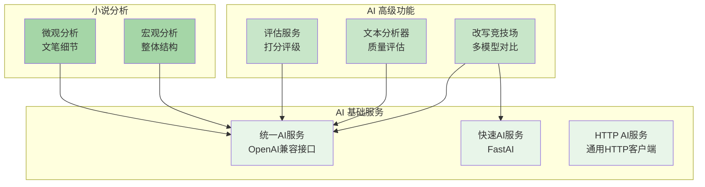
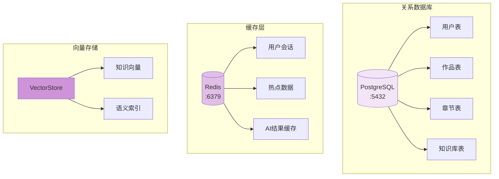
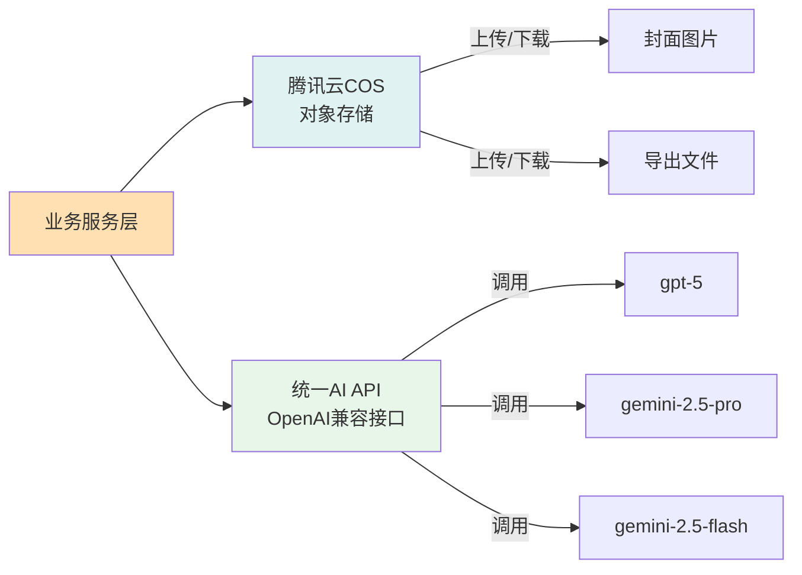
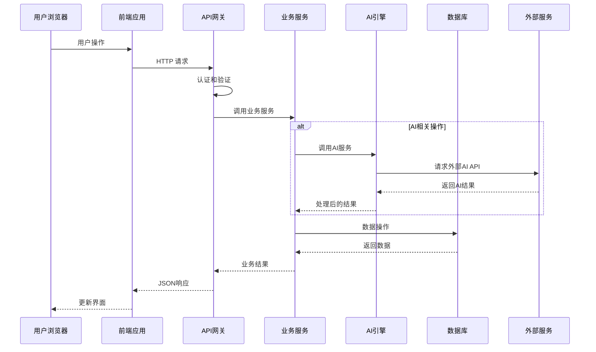
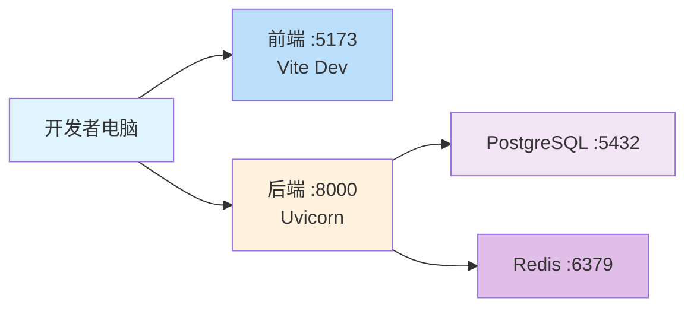
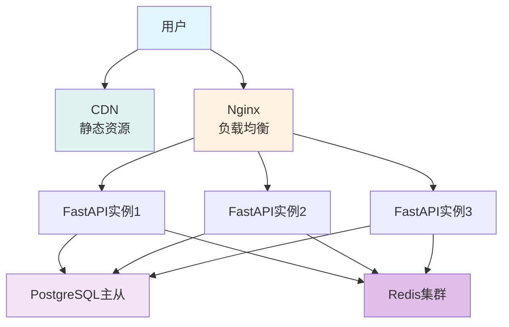

# AI Writer 系统整体架构

> 本文档展示 AI Writer 项目的整体系统架构

## 架构概览

AI Writer 是一个**前后端分离**的 Web 应用,采用现代化的技术栈:
- **前端**: Vue.js/React + Vite
- **后端**: FastAPI (Python)
- **数据库**: PostgreSQL + Redis
- **AI 引擎**: OpenAI/Google Gemini
- **对象存储**: 腾讯云 COS

---

## 1. 系统分层架构



**架构说明**:
- **前端层**: 用户界面,运行在浏览器
- **API 网关层**: FastAPI 服务器,统一入口
- **业务服务层**: 核心业务逻辑
- **AI 引擎层**: AI 智能功能
- **数据层**: 数据持久化和缓存
- **外部服务**: 第三方服务集成

---

## 2. 前端架构



**前端技术栈**:
- **框架**: Vue.js 3.x / React
- **构建工具**: Vite (开发服务器 :5173)
- **HTTP 客户端**: Axios
- **状态管理**: Pinia / Redux
- **UI 框架**: Element Plus / Ant Design
- **路由**: Vue Router / React Router

---

## 3. API 网关层架构



**网关功能**:
- **CORS 处理**: 允许前端跨域访问
- **JWT 认证**: Token 验证和用户身份识别
- **请求日志**: 记录所有 API 调用
- **异常处理**: 统一错误响应格式
- **路由分发**: 将请求分发到对应的处理器

---

## 4. 业务服务层架构



**服务说明**:
- **用户服务**: 用户注册、登录、信息管理
- **作品服务**: 作品的 CRUD 操作
- **章节服务**: 章节的 CRUD 操作
- **AI 服务**: AI 改写、文本生成
- **知识库服务**: 知识库管理、语义搜索
- **评审服务**: 文本质量评审
- **人性化服务**: 文本人性化改写
- **分析服务**: 小说质量分析

---

## 5. AI 引擎层架构



**AI 引擎说明**:

- **统一 AI 服务**: 通过单一 baseURL 访问所有模型(遵循 OpenAI 规范)
  - 支持模型: `gpt-5`、`gemini-2.5-pro`、`gemini-2.5-flash`
- **快速 AI 服务**: 优化的快速响应服务
- **改写竞技场**: 多个 AI 模型同时改写,供用户选择
- **文本分析器**: 分析文本质量和问题
- **宏观分析**: 分析小说结构、人物、情节
- **微观分析**: 分析文笔、节奏、细节

---

## 6. 数据层架构



**数据层说明**:
- **PostgreSQL**: 主数据库,存储业务数据
  - 用户、作品、章节、知识库等
- **Redis**: 缓存数据库,提升性能
  - 用户会话、热点数据、AI 结果缓存
- **VectorStore**: 向量数据库,支持语义搜索
  - 知识库向量化、语义相似度检索

---

## 7. 外部服务集成



**外部服务说明**:

- **腾讯云 COS**: 对象存储
  - 作品封面图片
  - 导出的文件 (TXT/DOCX/PDF)
- **统一 AI API**: 所有 AI 模型通过单一 baseURL 访问(遵循 OpenAI 规范)
  - `gpt-5`: 高质量 AI 服务
  - `gemini-2.5-pro`: 创意写作、复杂任务
  - `gemini-2.5-flash`: 快速响应、日常改写

---

## 8. 完整数据流向



---

## 9. 系统部署架构

### 开发环境


### 生产环境


---

## 技术栈详细说明

### 前端技术栈
- **框架**: Vue.js 3.x / React
- **构建工具**: Vite
- **HTTP 客户端**: Axios
- **状态管理**: Pinia / Redux
- **UI 框架**: Element Plus / Ant Design
- **路由**: Vue Router / React Router

### 后端技术栈
- **Web 框架**: FastAPI (Python 3.11+)
- **异步支持**: asyncio, aiohttp
- **ORM**: SQLAlchemy (async)
- **认证**: JWT (JSON Web Token)
- **数据验证**: Pydantic
- **定时任务**: APScheduler

### 数据库技术栈
- **关系数据库**: PostgreSQL 15+
- **缓存数据库**: Redis 7+ (Memurai on Windows)
- **向量数据库**: 本地向量存储 (Sentence Transformers)

### AI 技术栈
- **统一 AI 服务**: OpenAI 兼容接口(单一 baseURL)
  - 模型: `gpt-5`、`gemini-2.5-pro`、`gemini-2.5-flash`
- **Embedding 模型**: Sentence Transformers
- **向量化**: 自定义向量存储

### 基础设施
- **对象存储**: 腾讯云 COS
- **日志**: Python logging
- **环境管理**: dotenv
- **API 文档**: Swagger UI (FastAPI 自带)

---

## 系统特点

### 1. 前后端分离
- 前端和后端独立开发、部署
- 通过 RESTful API 通信
- 支持 WebSocket 实时通信

### 2. 微服务设计
- 业务层服务化,职责清晰
- 服务间松耦合,易于扩展
- 支持独立测试和部署

### 3. 异步优化
- 全异步 I/O 操作
- 异步数据库访问 (asyncpg)
- 异步 HTTP 请求 (aiohttp)
- 提升并发性能

### 4. AI 驱动
- 多个 AI 引擎支持
- 智能改写、分析、评估
- 多模型对比选择

### 5. 缓存优化
- Redis 缓存热点数据
- AI 结果缓存
- 提升响应速度

### 6. 向量检索
- 支持语义搜索
- 知识库智能检索
- 上下文相关推荐

---

## 端口和地址说明

### 开发环境
- **前端**: http://localhost:5173 (Vite 开发服务器)
- **后端**: http://localhost:8000 (FastAPI 服务器)
- **API 文档**: http://localhost:8000/docs (Swagger UI)
- **PostgreSQL**: localhost:5432
- **Redis**: localhost:6379

### API 路径规范
- **API 基础路径**: `/api/v1`
- **完整示例**: `http://localhost:8000/api/v1/auth/login`
- **WebSocket**: `ws://localhost:8000/ws`

---

## 数据流向示例

### 1. 用户请求流程
```
浏览器 → 前端应用 → FastAPI → 中间件 → 业务服务 → 数据库 → 返回
```

### 2. AI 处理流程
```
前端 → API → AI服务 → AI引擎 → 外部AI API → 处理 → 缓存 → 返回
```

### 3. 知识库查询流程
```
前端 → API → 知识库服务 → 向量化 → 向量检索 → PostgreSQL → 返回
```

### 4. 文件上传流程
```
前端 → API → 作品服务 → 腾讯云COS → 返回URL → 保存到数据库
```

---

## 性能指标

### 目标性能
- **API 响应时间**: < 200ms (不含 AI 调用)
- **AI 改写时间**: 1-3 秒 (单模型)
- **并发用户**: 支持 1000+ 并发
- **数据库连接池**: 20-50 连接

### 性能优化措施
1. **数据库连接池**: 复用连接
2. **Redis 缓存**: 缓存热点数据
3. **异步 I/O**: 提升并发
4. **CDN 加速**: 静态资源加速
5. **负载均衡**: 水平扩展

---

## 安全措施

### 认证和授权
- **JWT Token**: 无状态认证
- **密码加密**: bcrypt 哈希
- **Token 刷新**: refresh_token 机制

### 数据安全
- **SQL 注入防护**: ORM 参数化查询
- **XSS 防护**: 输入验证和转义
- **CSRF 防护**: CSRF Token
- **CORS 配置**: 跨域白名单

### API 安全
- **请求限流**: 防止 DDoS
- **参数验证**: Pydantic 数据验证
- **错误处理**: 不暴露敏感信息
- **日志审计**: 记录所有操作

---

## 系统扩展性

### 水平扩展
- FastAPI 无状态设计,支持多实例
- 使用 Nginx 做负载均衡
- Redis 集群支持
- PostgreSQL 主从复制

### 功能扩展
- 模块化设计,易于添加新功能
- 插件化 AI 模型,支持更多 AI 服务
- RESTful API 版本控制

### 性能扩展
- 数据库读写分离
- 缓存层扩展 (Redis Cluster)
- CDN 静态资源加速
- 消息队列异步处理

---

**这就是 AI Writer 的完整系统架构!** 🚀
