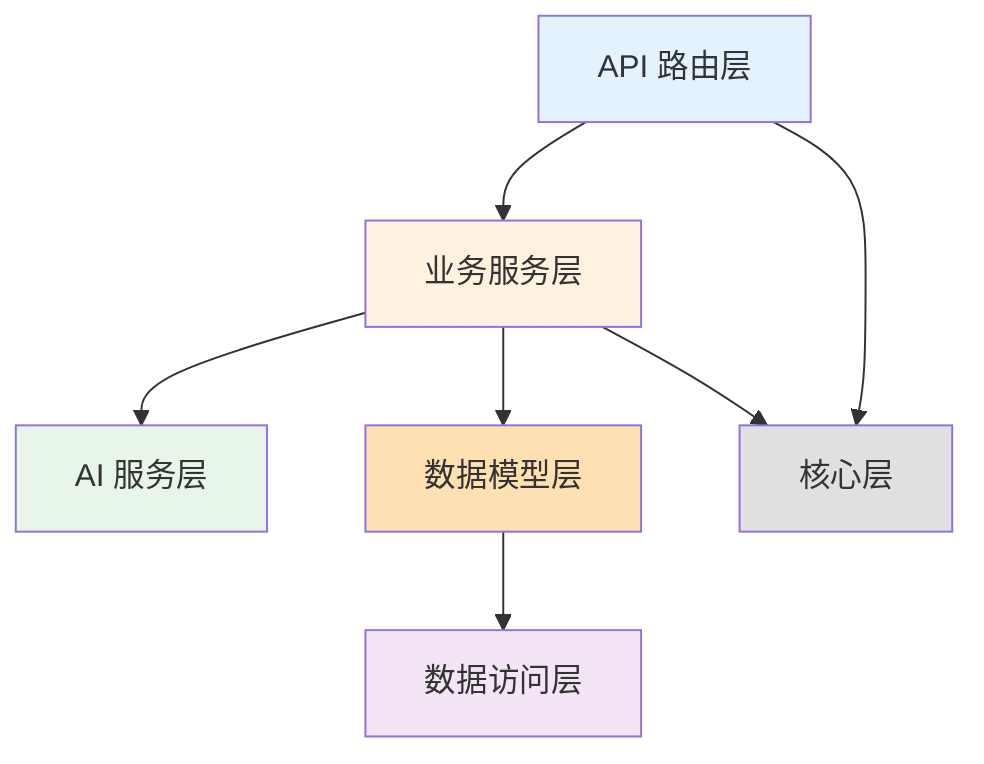
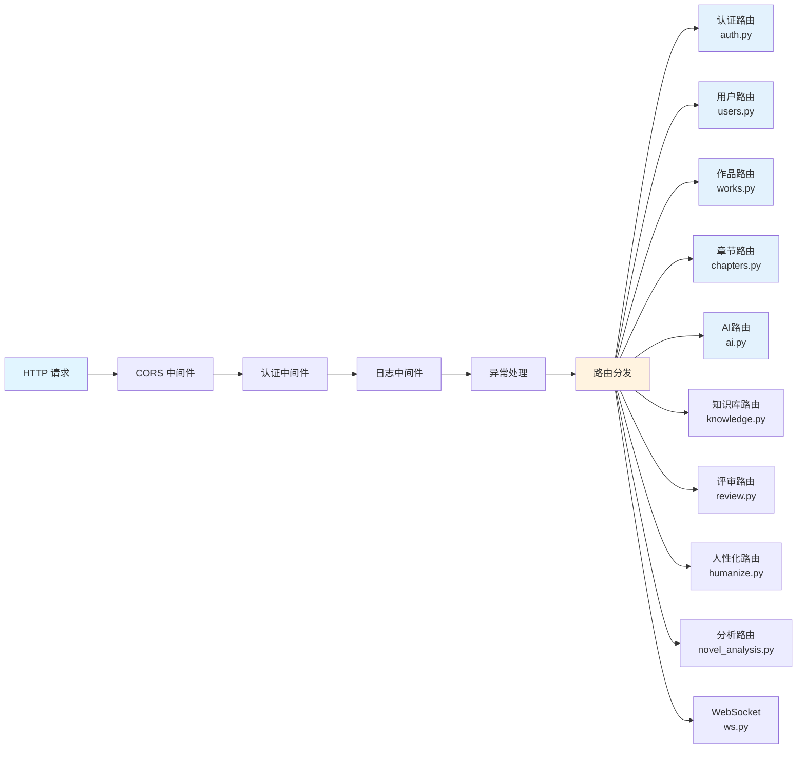
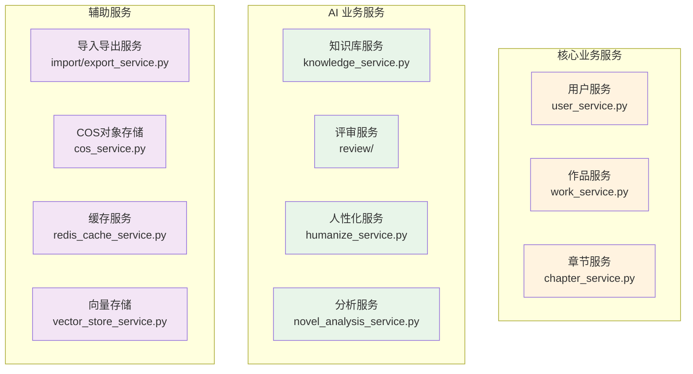
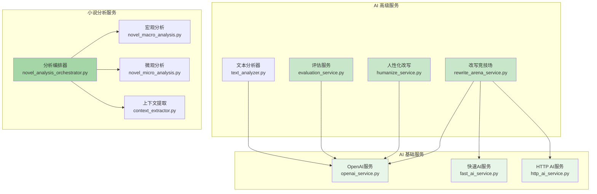
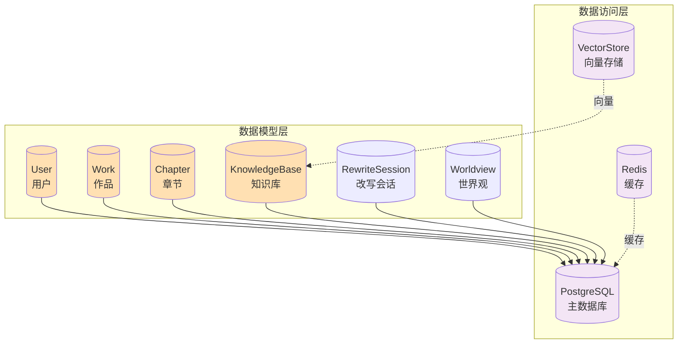
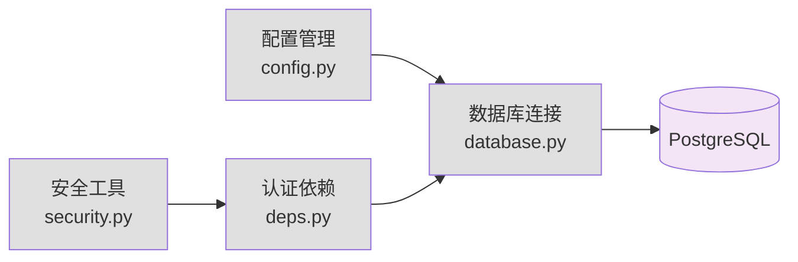
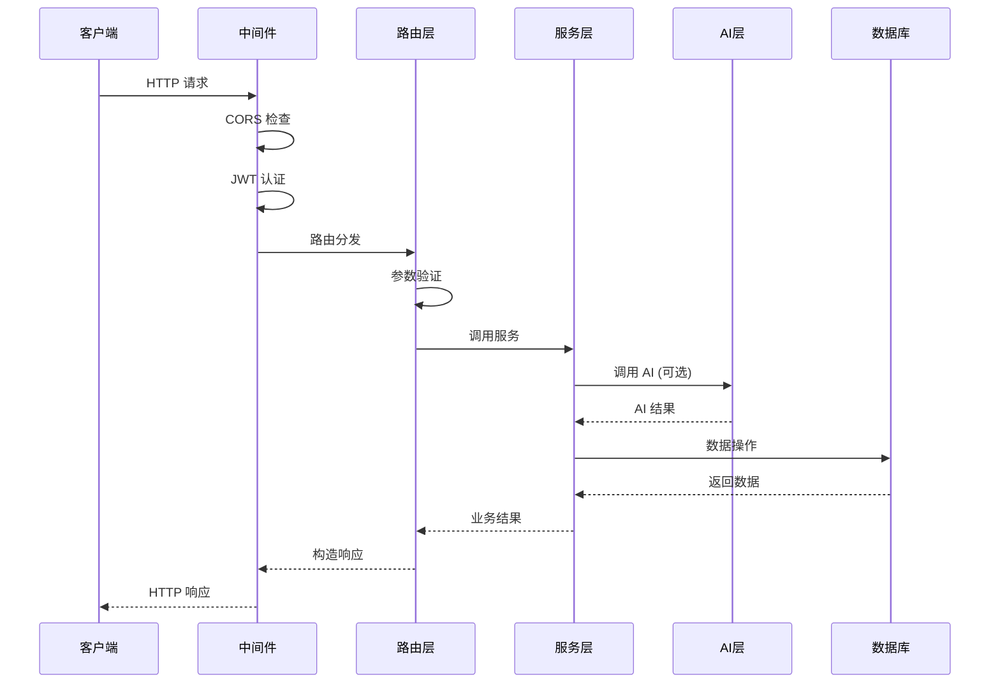
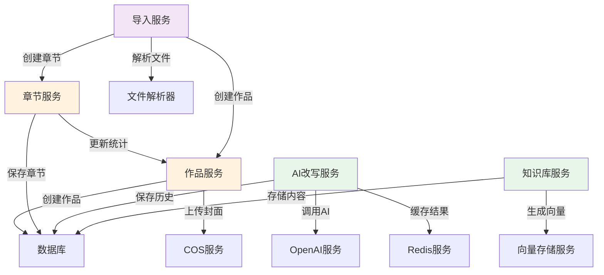

# AI Writer 后端架构详解

> 后端基于 FastAPI 构建,采用分层架构设计

## 架构概览

后端采用**分层架构**设计,从上到下分为:
- **API 路由层**: 处理 HTTP 请求
- **业务服务层**: 实现业务逻辑
- **AI 服务层**: AI 智能功能
- **数据模型层**: 数据库模型
- **数据访问层**: 数据库和缓存
- **核心层**: 配置和工具

---

## 1. 整体架构分层



**分层职责**:
- **API 层**: 接收请求,参数验证,返回响应
- **服务层**: 业务逻辑,数据处理,服务编排
- **AI 层**: AI 模型调用,智能分析
- **模型层**: 数据模型定义,ORM 映射
- **数据层**: 数据持久化,缓存管理
- **核心层**: 配置管理,通用工具

---

## 2. API 路由层架构



**路由说明**:
- **认证路由** (`auth.py`): 注册、登录、Token 刷新
- **用户路由** (`users.py`): 用户信息管理
- **作品路由** (`works.py`): 作品 CRUD
- **章节路由** (`chapters.py`): 章节 CRUD
- **AI 路由** (`ai.py`): AI 改写、分析
- **知识库路由** (`knowledge.py`): 知识库管理
- **评审路由** (`review.py`): 文本评审
- **人性化路由** (`humanize.py`): 人性化改写
- **分析路由** (`novel_analysis.py`): 小说分析
- **WebSocket** (`ws.py`): 实时通信

---

## 3. 业务服务层架构



**服务分类**:
- **核心业务**: 用户、作品、章节管理
- **AI 业务**: 知识库、评审、分析、改写
- **辅助服务**: 导入导出、存储、缓存

---

## 4. AI 服务层架构



**AI 服务分类**:
- **基础服务**: 与 AI API 交互的底层服务
- **高级服务**: 封装复杂 AI 功能
- **分析服务**: 专门的小说分析服务

---

## 5. 数据访问层架构



**数据层说明**:
- **PostgreSQL**: 主数据库,存储所有业务数据
- **Redis**: 缓存层,缓存热点数据
- **VectorStore**: 向量存储,支持语义搜索

---

## 6. 核心层架构



**核心模块**:
- **config.py**: 环境变量、应用配置
- **database.py**: 数据库连接池、会话管理
- **deps.py**: 依赖注入、认证依赖
- **security.py**: JWT、密码加密

---

## 7. 请求处理流程



---

## 8. 服务间调用关系



---

## 目录结构

```
backend/
├── app/
│   ├── main.py                 # FastAPI 应用入口
│   │
│   ├── api/                    # API 路由层
│   │   ├── __init__.py
│   │   └── v1/                 # API v1 版本
│   │       ├── auth.py         # 认证接口
│   │       ├── users.py        # 用户接口
│   │       ├── works.py        # 作品接口
│   │       ├── chapters.py     # 章节接口
│   │       ├── ai.py           # AI 接口
│   │       ├── knowledge.py    # 知识库接口
│   │       ├── review.py       # 评审接口
│   │       ├── humanize.py     # 人性化接口
│   │       ├── novel_analysis.py  # 小说分析接口
│   │       └── ws.py           # WebSocket 接口
│   │
│   ├── core/                   # 核心模块
│   │   ├── config.py           # 配置管理
│   │   ├── database.py         # 数据库连接
│   │   ├── redis.py            # Redis 连接
│   │   ├── deps.py             # 依赖注入
│   │   └── security.py         # 安全工具
│   │
│   ├── models/                 # 数据模型 (SQLAlchemy)
│   │   ├── user.py
│   │   ├── work.py
│   │   ├── chapter.py
│   │   ├── knowledge.py
│   │   ├── rewrite_session.py
│   │   └── worldview.py
│   │
│   ├── schemas/                # 数据验证模型 (Pydantic)
│   │   ├── user.py
│   │   ├── work.py
│   │   ├── chapter.py
│   │   └── ...
│   │
│   ├── services/               # 业务服务层
│   │   ├── user_service.py
│   │   ├── work_service.py
│   │   ├── chapter_service.py
│   │   ├── knowledge_service.py
│   │   ├── redis_cache_service.py
│   │   ├── vector_store_service.py
│   │   ├── cos_service.py
│   │   ├── import_service.py
│   │   ├── export_service.py
│   │   │
│   │   ├── ai/                 # AI 服务子模块
│   │   │   ├── openai_service.py
│   │   │   ├── fast_ai_service.py
│   │   │   ├── http_ai_service.py
│   │   │   ├── rewrite_arena_service.py
│   │   │   ├── humanize_service.py
│   │   │   ├── evaluation_service.py
│   │   │   ├── text_analyzer.py
│   │   │   ├── novel_macro_analysis.py
│   │   │   ├── novel_micro_analysis.py
│   │   │   ├── context_extractor.py
│   │   │   └── novel_analysis_orchestrator.py
│   │   │
│   │   ├── review/             # 评审服务子模块
│   │   │   ├── paragraph_review_service.py
│   │   │   ├── book_review_service.py
│   │   │   ├── novel_review_service.py
│   │   │   └── version_manager_service.py
│   │   │
│   │   └── book_analysis/      # 书籍分析子模块
│   │       ├── strategy.py
│   │       ├── smart_sampling.py
│   │       └── suggestion_generator.py
│   │
│   ├── prompts/                # AI Prompt 模板
│   │   └── ...
│   │
│   └── tasks/                  # 定时任务
│       └── ...
│
├── alembic/                    # 数据库迁移
│   └── versions/
│
├── tests/                      # 测试代码
├── logs/                       # 日志文件
├── .env                        # 环境变量
└── requirements.txt            # 依赖包
```

---

## 核心模块说明

### 1. API 路由层 (Routes)
- **职责**: 处理 HTTP 请求,参数验证,调用业务服务
- **特点**: RESTful API 设计,支持 WebSocket
- **技术**: FastAPI Router, Pydantic 数据验证

### 2. 业务服务层 (Services)
- **职责**: 实现核心业务逻辑,协调各个模块
- **特点**: 无状态服务,可复用
- **技术**: 异步服务,依赖注入

### 3. AI 服务层
- **职责**: 与 AI 模型交互,提供智能功能
- **特点**: 支持多模型,异步并发
- **技术**: asyncio, aiohttp, OpenAI API

### 4. 数据模型层 (Models)
- **职责**: 定义数据库表结构和关系
- **技术**: SQLAlchemy (ORM), 异步支持

### 5. 数据访问层
- **PostgreSQL**: 主数据库,存储结构化数据
- **Redis**: 缓存层,提升性能
- **VectorStore**: 向量存储,支持语义搜索

### 6. 核心层 (Core)
- **config.py**: 环境变量管理,应用配置
- **database.py**: 数据库连接池,异步会话管理
- **deps.py**: 依赖注入,认证依赖
- **security.py**: JWT 令牌,密码加密

---

## 关键特性

### 异步架构
- 全异步 I/O 操作
- 异步数据库访问 (asyncpg)
- 异步 HTTP 请求 (aiohttp)
- 提升并发性能

### 依赖注入
```python
async def get_current_user(
    db: AsyncSession = Depends(get_db),
    token: str = Depends(oauth2_scheme)
) -> User:
    # 认证逻辑
    pass
```

### 中间件
- **CORS 中间件**: 跨域支持
- **认证中间件**: JWT 验证
- **日志中间件**: 请求日志
- **异常处理中间件**: 统一错误处理

### 生命周期管理
```python
@asynccontextmanager
async def lifespan(app: FastAPI):
    # 启动时
    await init_db()
    start_scheduler()

    yield

    # 关闭时
    await close_db()
    stop_scheduler()
```

---

## API 设计规范

### RESTful 风格
- **GET**: 查询资源
- **POST**: 创建资源
- **PUT**: 更新资源
- **DELETE**: 删除资源

### 统一响应格式
```json
{
  "data": {},
  "message": "success"
}
```

### 错误处理
```json
{
  "detail": "错误信息"
}
```

### 版本控制
- 路径: `/api/v1/...`
- 向后兼容

---

## 性能优化

1. **数据库连接池**: 复用连接,减少开销
2. **Redis 缓存**: 缓存热点数据
3. **异步 I/O**: 提升并发性能
4. **索引优化**: 数据库查询优化
5. **模型预加载**: Embedding 模型启动时加载

---

## 安全措施

1. **JWT 认证**: 无状态认证
2. **密码加密**: bcrypt 哈希
3. **CORS 配置**: 跨域白名单
4. **SQL 注入防护**: ORM 参数化查询
5. **XSS 防护**: 输入验证和转义
