# AI Writer 数据库 ER 图

> 数据库采用 PostgreSQL,使用 SQLAlchemy ORM

## 数据库概览

数据库共有 **8 个核心表**,分为 4 大模块:
- **用户模块**: users (用户表)
- **作品模块**: works (作品), chapters (章节), worldviews (世界观)
- **AI 模块**: rewrite_sessions (改写会话), rewrite_results (改写结果)
- **知识库模块**: knowledge_bases (知识库), knowledge_items (知识条目)

---

## 1. 数据库整体关系

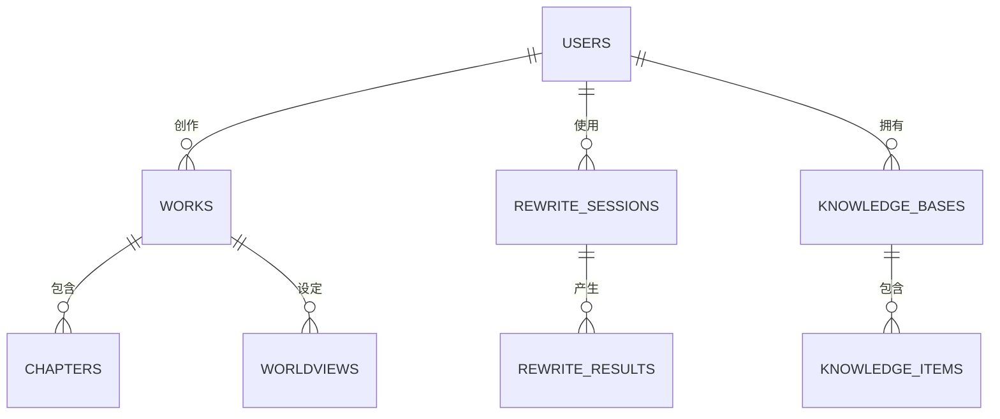

**关系说明**:
- **用户 → 作品**: 一对多 (一个用户可以创作多个作品)
- **用户 → 改写会话**: 一对多 (一个用户有多次改写历史)
- **用户 → 知识库**: 一对多 (一个用户可以有多个知识库)
- **作品 → 章节**: 一对多 (一个作品包含多个章节)
- **作品 → 世界观**: 一对多 (一个作品有多个世界观设定)
- **改写会话 → 改写结果**: 一对多 (一次会话产生多个模型结果)
- **知识库 → 知识条目**: 一对多 (一个知识库包含多个条目)

---

## 2. 用户模块 - users 表

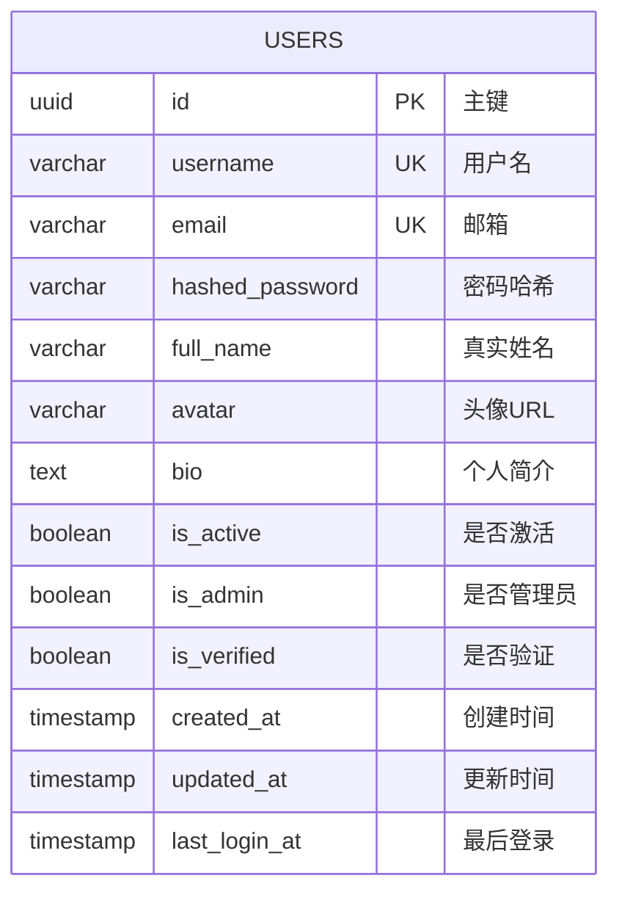

**表说明**:
- **用途**: 存储用户账号和个人信息
- **主键**: UUID,自动生成
- **唯一约束**: username, email

**关键字段**:
- `username`: 用户名,3-50 字符,唯一
- `email`: 邮箱,可选,唯一
- `hashed_password`: bcrypt 加密的密码
- `is_active`: 账号是否激活 (默认 true)
- `is_admin`: 是否管理员 (默认 false)
- `is_verified`: 邮箱是否验证 (默认 false)

**索引**:
- PRIMARY KEY (id)
- UNIQUE INDEX (username)
- UNIQUE INDEX (email)

**关系**:
- 一对多: users → works
- 一对多: users → rewrite_sessions
- 一对多: users → knowledge_bases

---

## 3. 作品模块 - works 表

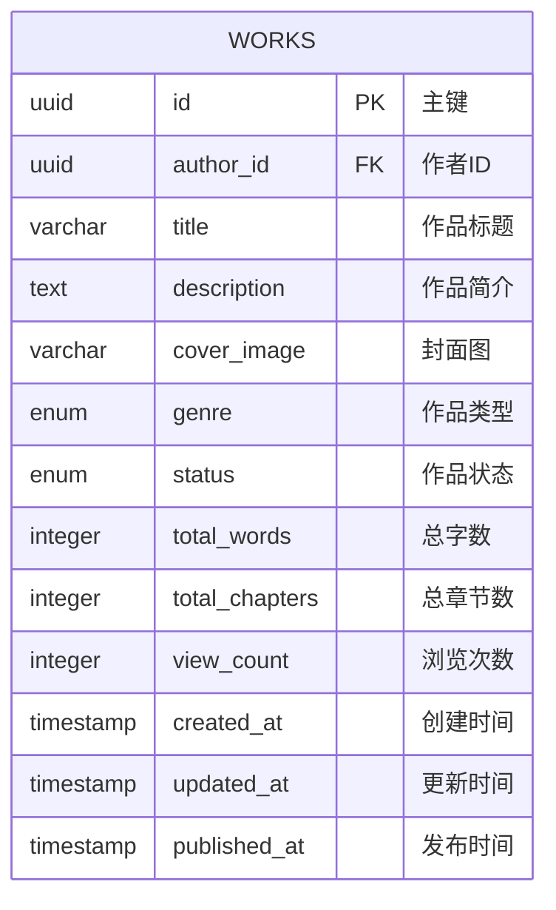

**表说明**:
- **用途**: 存储小说作品基本信息
- **外键**: author_id → users(id)

**关键字段**:
- `title`: 作品标题,1-200 字符
- `genre`: 作品类型枚举
- `status`: 作品状态枚举
- `total_words`: 总字数,自动统计
- `total_chapters`: 总章节数,自动统计
- `view_count`: 浏览次数

**枚举类型**:

### genre (作品类型)
- `fantasy` - 玄幻
- `urban` - 都市
- `romance` - 言情
- `scifi` - 科幻
- `wuxia` - 武侠
- `history` - 历史
- `game` - 游戏
- `other` - 其他

### status (作品状态)
- `draft` - 草稿
- `writing` - 连载中
- `completed` - 已完结
- `abandoned` - 已弃坑

**索引**:
- PRIMARY KEY (id)
- INDEX (author_id)
- INDEX (title)

**级联删除**: 删除作品时自动删除所有章节和世界观

---

## 4. 作品模块 - chapters 表

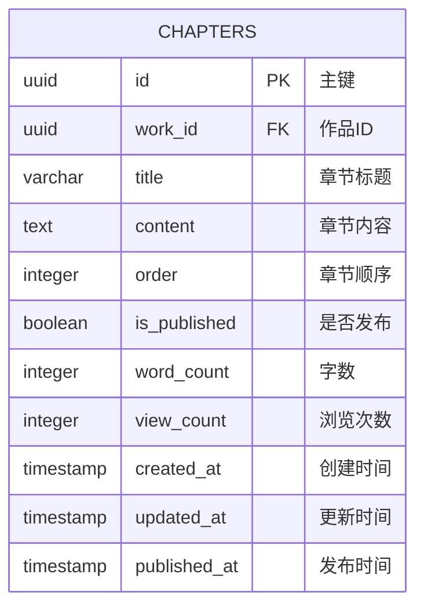

**表说明**:
- **用途**: 存储作品的章节内容
- **外键**: work_id → works(id)

**关键字段**:
- `title`: 章节标题,1-200 字符
- `content`: 章节正文内容
- `order`: 章节排序号
- `is_published`: 是否发布 (默认 false)
- `word_count`: 字数,自动计算

**索引**:
- PRIMARY KEY (id)
- INDEX (work_id)
- INDEX (order)

**触发器**:
- 创建/更新/删除章节时自动更新 works 表的 total_words 和 total_chapters

---

## 5. 作品模块 - worldviews 表

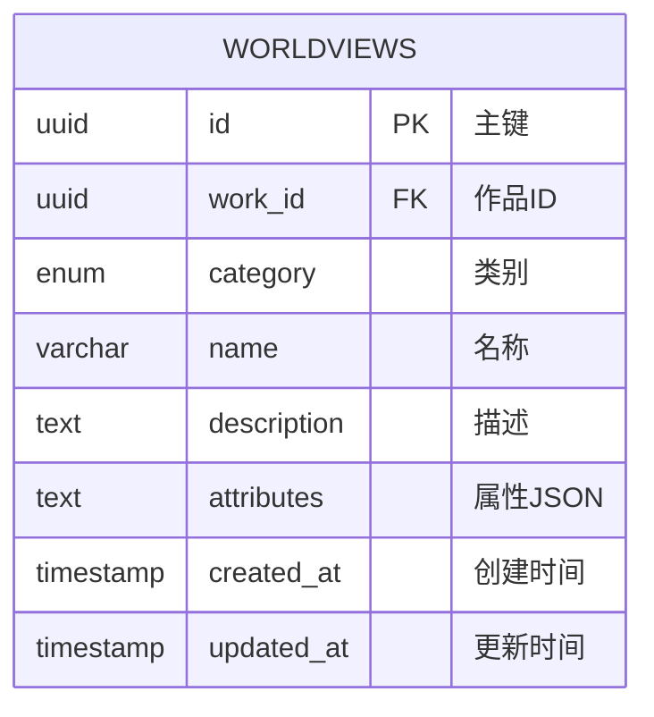

**表说明**:
- **用途**: 存储作品的世界观设定 (人物/地点/道具等)
- **外键**: work_id → works(id)

**关键字段**:
- `category`: 类别枚举 (人物/地点/道具/势力/技能/事件)
- `name`: 设定名称
- `description`: 详细描述
- `attributes`: JSON 格式的属性数据

**category 枚举**:
- `character` - 人物
- `location` - 地点
- `item` - 道具
- `faction` - 势力
- `skill` - 技能
- `event` - 事件

**索引**:
- PRIMARY KEY (id)
- INDEX (work_id)
- INDEX (category)

---

## 6. AI 模块 - rewrite_sessions 表

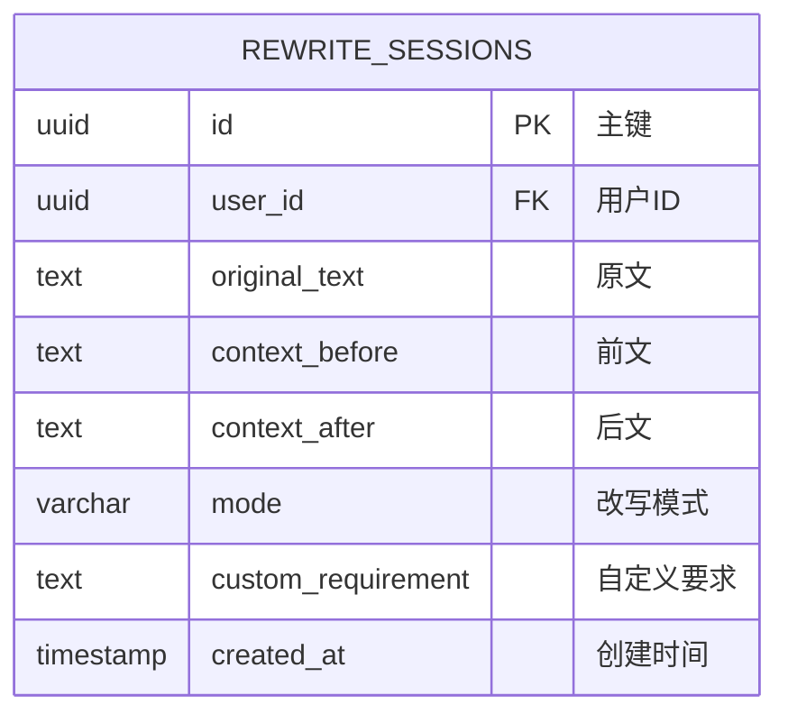

**表说明**:
- **用途**: 记录 AI 改写助手的使用历史
- **外键**: user_id → users(id)

**关键字段**:
- `original_text`: 待改写的原文
- `context_before`: 前文上下文
- `context_after`: 后文上下文
- `mode`: 改写模式 (optimize/expand/compress/custom)
- `custom_requirement`: 自定义改写要求

**mode 枚举**:
- `optimize` - 优化提升
- `expand` - 扩写丰富
- `compress` - 精简压缩
- `custom` - 自定义

**索引**:
- PRIMARY KEY (id)
- INDEX (user_id)
- INDEX (created_at)

**级联删除**: 删除会话时自动删除所有改写结果

---

## 7. AI 模块 - rewrite_results 表

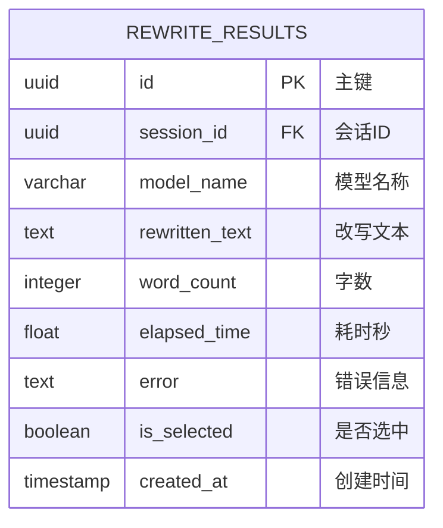

**表说明**:
- **用途**: 存储每个 AI 模型的改写结果
- **外键**: session_id → rewrite_sessions(id)

**关键字段**:
- `model_name`: AI 模型名称 (gemini-2.5-pro, gpt-4 等)
- `rewritten_text`: 改写后的文本
- `word_count`: 改写后字数
- `elapsed_time`: AI 处理耗时(秒)
- `error`: 错误信息 (失败时记录)
- `is_selected`: 用户是否选择此结果

**索引**:
- PRIMARY KEY (id)
- INDEX (session_id)
- INDEX (created_at)

---

## 8. 知识库模块 - knowledge_bases 表

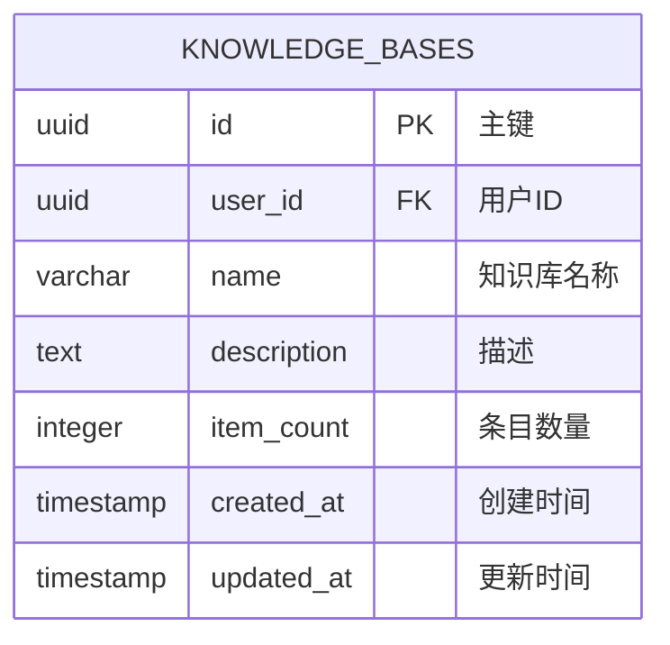

**表说明**:
- **用途**: 存储用户的知识库
- **外键**: user_id → users(id)

**关键字段**:
- `name`: 知识库名称
- `description`: 知识库描述
- `item_count`: 条目数量,自动统计

**索引**:
- PRIMARY KEY (id)
- INDEX (user_id)

**级联删除**: 删除知识库时自动删除所有知识条目

---

## 9. 知识库模块 - knowledge_items 表

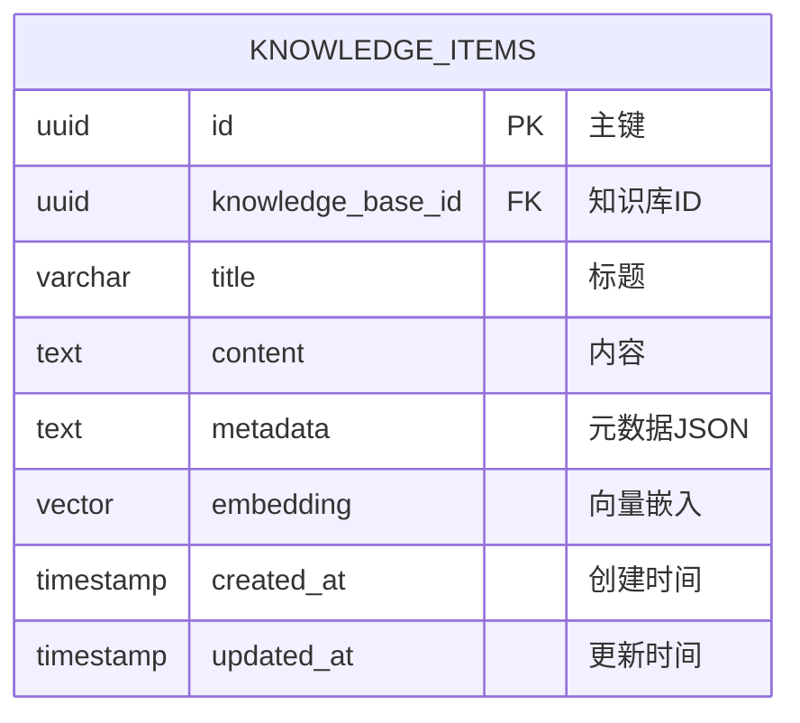

**表说明**:
- **用途**: 存储知识库的具体内容,支持向量检索
- **外键**: knowledge_base_id → knowledge_bases(id)

**关键字段**:
- `title`: 条目标题
- `content`: 条目内容
- `metadata`: JSON 格式的元数据
- `embedding`: 向量嵌入 (用于语义搜索)

**索引**:
- PRIMARY KEY (id)
- INDEX (knowledge_base_id)
- VECTOR INDEX (embedding) - 向量相似度搜索

---

## 10. 用户与作品关系图

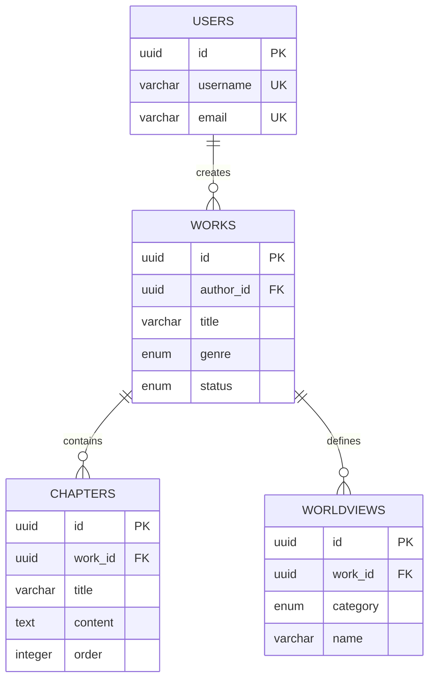

**业务逻辑**:
1. 用户创建作品
2. 作品包含多个章节
3. 作品定义世界观设定
4. 删除作品时级联删除章节和世界观

---

## 11. AI 改写模块关系图

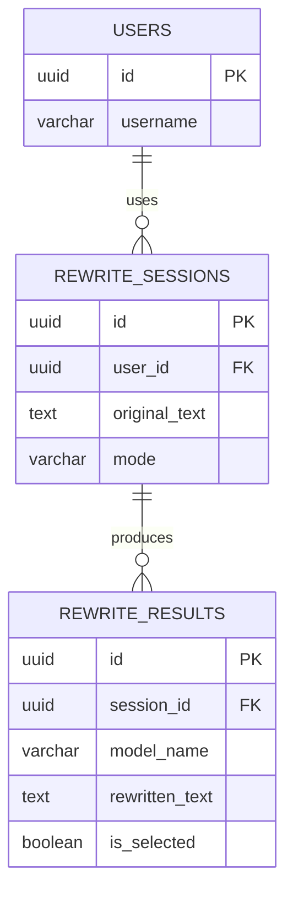

**业务逻辑**:
1. 用户发起改写请求,创建会话
2. 多个 AI 模型并发改写,产生多个结果
3. 用户选择最佳结果,标记 is_selected
4. 保存历史记录供后续分析

---

## 12. 知识库模块关系图

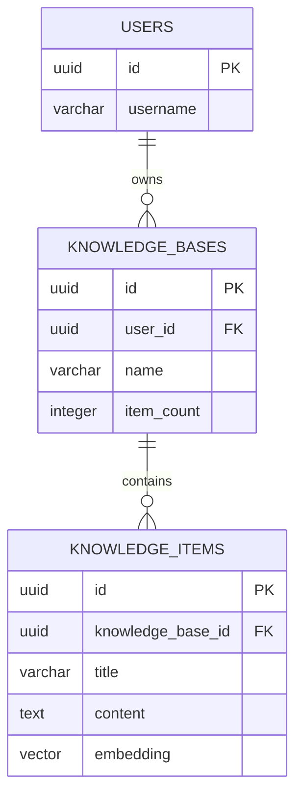

**业务逻辑**:
1. 用户创建知识库
2. 知识库包含多个知识条目
3. 条目自动向量化,支持语义搜索
4. 更新条目时自动更新 item_count

---

## 13. 数据完整性约束

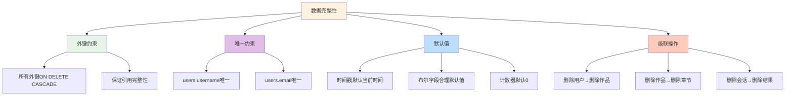

**约束说明**:

### 外键约束
- 所有外键都设置 `ON DELETE CASCADE`
- 删除父记录时自动删除子记录

### 唯一约束
- `users.username`: 用户名唯一
- `users.email`: 邮箱唯一 (可选)

### 默认值
- 时间戳字段默认为当前时间
- 布尔字段设置合理默认值
- 计数器字段默认为 0

### 自动更新
- `updated_at` 字段在记录更新时自动更新
- 作品统计字段通过触发器自动维护

---

## 14. 索引策略

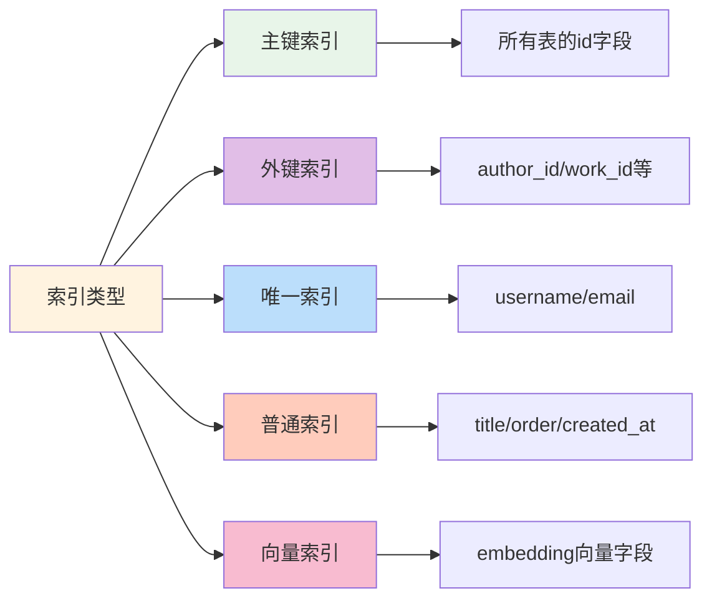

**索引说明**:

### 主键索引
- 所有表都使用 UUID 主键
- 自动创建聚集索引

### 外键索引
- `works.author_id`
- `chapters.work_id`
- `rewrite_sessions.user_id`
- `rewrite_results.session_id`
- 等等

### 唯一索引
- `users.username`
- `users.email`

### 普通索引
- `works.title` - 搜索作品
- `chapters.order` - 章节排序
- `rewrite_sessions.created_at` - 时间查询

### 向量索引
- `knowledge_items.embedding` - 向量相似度搜索

---

## 15. 数据库迁移历史


**迁移记录**:

### 1. initial_migration (c02326821f1e)
- 创建初始表结构 (users, works, chapters)
- 日期: 2025-10-15 23:03

### 2. make_email_optional (dfef30e5f344)
- 将 users.email 改为可选
- 日期: 2025-10-16 09:23

### 3. add_rewrite_history_tables (f1g2h3i4j5k6)
- 创建 rewrite_sessions 表
- 创建 rewrite_results 表
- 添加外键和索引
- 日期: 2025-10-25 22:00

### 待开发
- 知识库表 (knowledge_bases, knowledge_items)
- 世界观表 (worldviews)
- 评论表 (comments)
- 标签表 (tags)

---

## 16. 查询优化建议

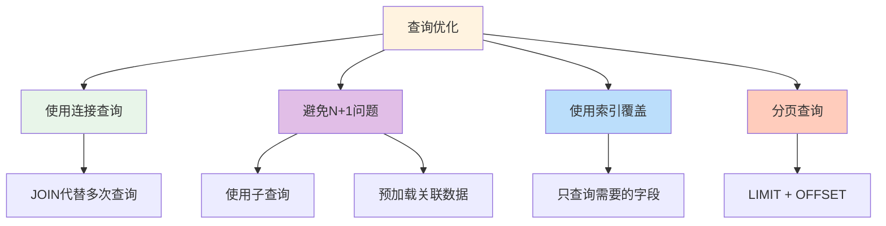

**优化技巧**:

### 1. 使用连接查询
```sql
-- 好: 一次查询
SELECT w.*, u.username
FROM works w
JOIN users u ON w.author_id = u.id;

-- 差: 多次查询
SELECT * FROM works;
-- 然后对每个 work 查询 user
```

### 2. 避免 N+1 问题
```python
# SQLAlchemy 使用 joinedload
works = db.query(Work).options(
    joinedload(Work.author),
    joinedload(Work.chapters)
).all()
```

### 3. 使用索引覆盖
```sql
-- 好: 只查询需要的字段
SELECT id, title FROM works WHERE author_id = '...';

-- 差: 查询所有字段
SELECT * FROM works WHERE author_id = '...';
```

### 4. 分页查询
```sql
SELECT * FROM works
ORDER BY created_at DESC
LIMIT 20 OFFSET 0;
```

---

## 17. 数据库备份和恢复

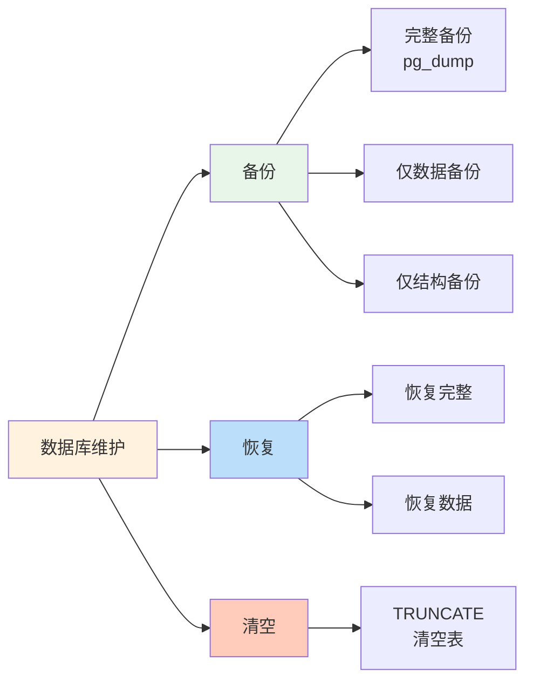

**备份命令**:
```bash
# 完整备份
pg_dump -U novelaide -d novelaide > backup_$(date +%Y%m%d).sql

# 仅备份数据
pg_dump -U novelaide -d novelaide --data-only > data_backup.sql

# 仅备份结构
pg_dump -U novelaide -d novelaide --schema-only > schema_backup.sql
```

**恢复命令**:
```bash
# 恢复完整备份
psql -U novelaide -d novelaide < backup.sql

# 恢复数据
psql -U novelaide -d novelaide < data_backup.sql
```

**清空数据**:
```sql
-- 清空所有表 (保留结构)
TRUNCATE TABLE rewrite_results CASCADE;
TRUNCATE TABLE rewrite_sessions CASCADE;
TRUNCATE TABLE knowledge_items CASCADE;
TRUNCATE TABLE knowledge_bases CASCADE;
TRUNCATE TABLE worldviews CASCADE;
TRUNCATE TABLE chapters CASCADE;
TRUNCATE TABLE works CASCADE;
TRUNCATE TABLE users CASCADE;
```

---

## 技术栈

### 数据库
- **关系数据库**: PostgreSQL 15+
- **ORM**: SQLAlchemy (异步)
- **迁移工具**: Alembic
- **连接驱动**: asyncpg

### 向量支持
- **Embedding 模型**: Sentence Transformers
- **向量存储**: 自定义实现 (可扩展 pgvector)

---

## 相关文档

- `backend/docs/POSTGRESQL_SETUP.md` - PostgreSQL 安装指南
- `backend/docs/数据库配置说明.md` - 数据库配置
- `backend/app/models/` - 数据模型定义
- `backend/alembic/` - 数据库迁移文件

---

**数据库是系统的基石!** 🗄️
