# AI Writer AI 服务架构

> AI 服务是系统的核心,提供多种智能写作辅助功能

## 架构概览

AI 服务采用**分层设计**:
- **API 层**: 接收用户请求
- **服务编排层**: 协调多个 AI 服务
- **核心服务层**: 与 AI API 交互
- **专业分析层**: 专门的分析服务
- **Prompt 管理**: 提示词模板管理

---

## 1. AI 服务分层架构

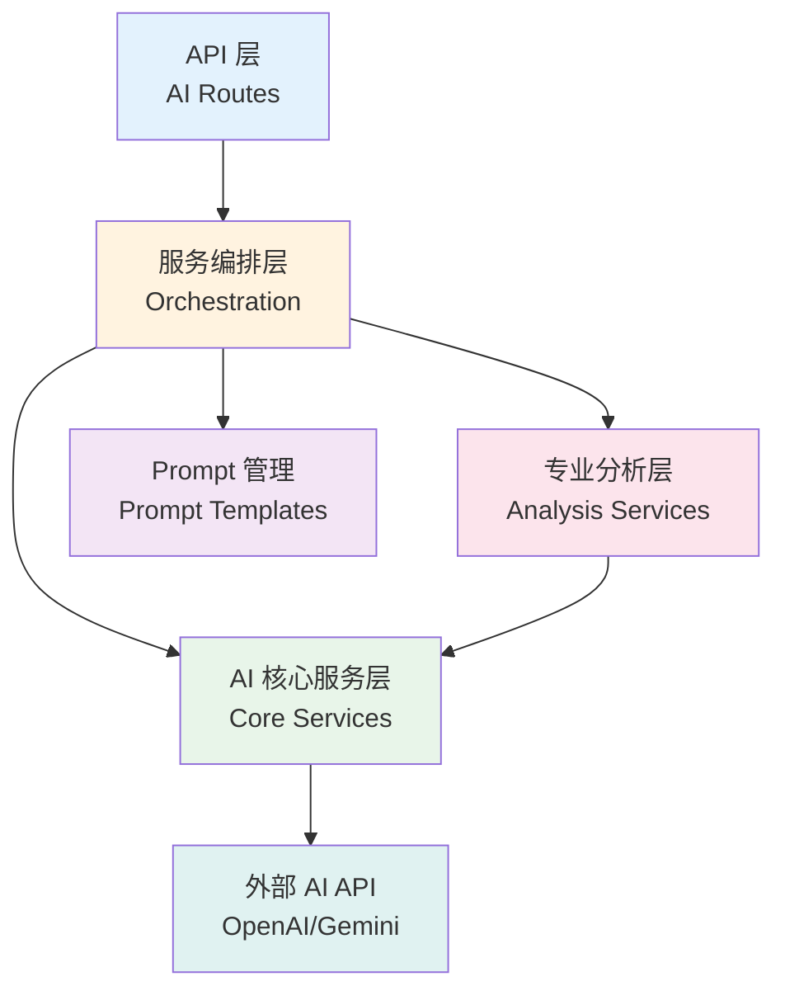

**分层说明**:
- **API 层**: 暴露 RESTful API 接口
- **编排层**: 协调复杂的 AI 调用流程
- **核心层**: 封装 AI API 调用逻辑
- **分析层**: 提供专业的文本分析
- **Prompt 层**: 管理各种提示词模板

---

## 2. API 路由层

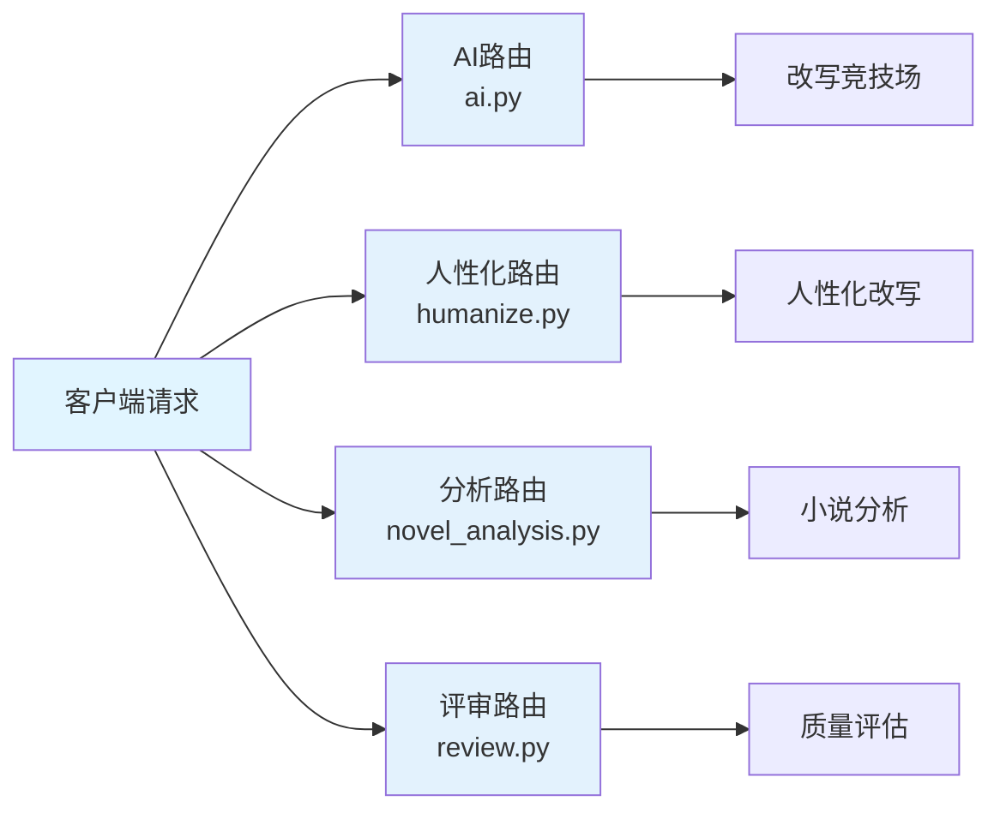

**路由功能**:
- **ai.py**: AI 改写、文本生成
- **humanize.py**: 人性化文本改写
- **novel_analysis.py**: 小说质量分析
- **review.py**: 文本质量评审

---

## 3. 服务编排层架构

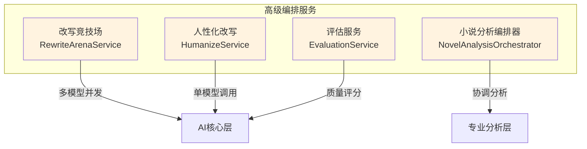

**编排服务说明**:
- **改写竞技场**: 并发调用多个 AI 模型对比
- **人性化改写**: 智能识别问题并改写
- **小说分析编排器**: 协调宏观和微观分析
- **评估服务**: 文本质量打分和评级

---

## 4. AI 核心服务层

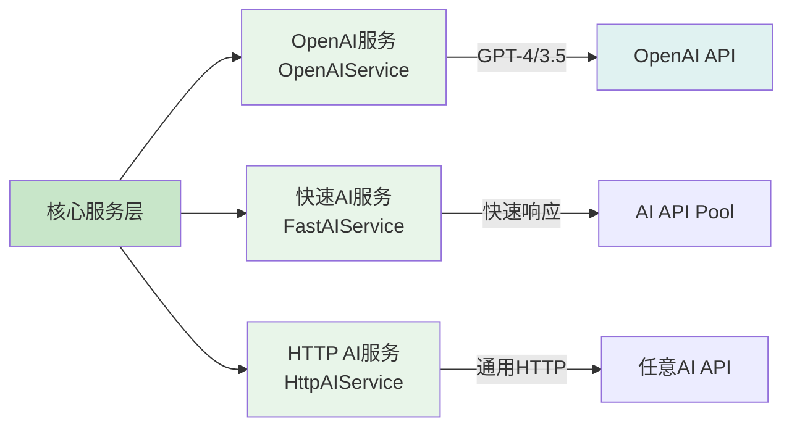

**核心服务功能**:
- **OpenAI 服务**: 封装 OpenAI API 调用
  - 支持 GPT-4, GPT-3.5
  - 流式和非流式输出
  - 错误重试机制
- **快速 AI 服务**: 优化的快速响应
  - 多 API Key 轮询
  - 智能降级策略
- **HTTP AI 服务**: 通用 HTTP 客户端
  - 支持任意 AI API
  - 统一的错误处理

---

## 5. 专业分析服务层

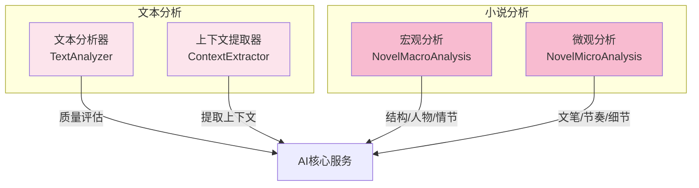

**分析服务说明**:
- **文本分析器**: 通用文本质量分析
  - 流畅度、逻辑性、创意性
- **上下文提取器**: 提取相关上下文
  - 前文、后文提取
- **宏观分析**: 小说整体分析
  - 结构、人物、世界观
- **微观分析**: 小说细节分析
  - 文笔、节奏、描写

---

## 6. 改写竞技场工作流程

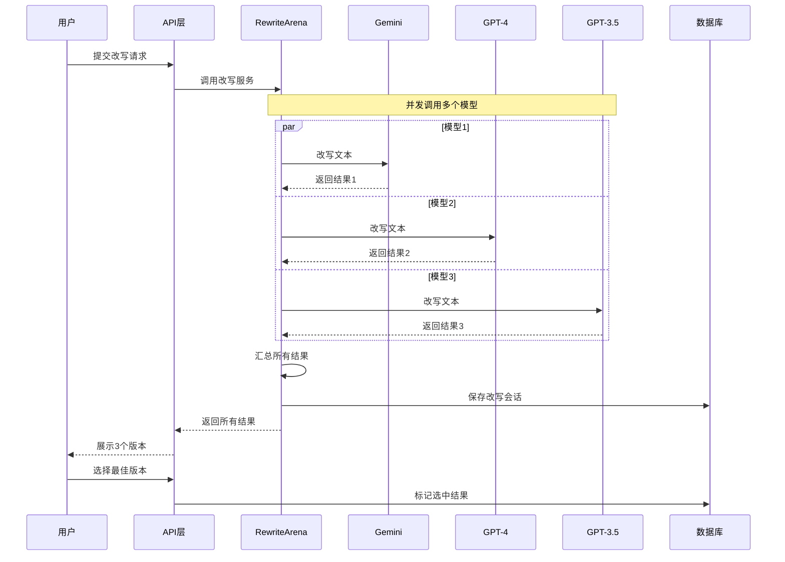

**改写竞技场特点**:
- ✅ **并发执行**: asyncio.gather() 同时调用
- ✅ **容错处理**: 部分失败不影响其他
- ✅ **性能追踪**: 记录每个模型耗时
- ✅ **用户反馈**: 保存用户选择供分析

---

## 7. 人性化改写工作流程

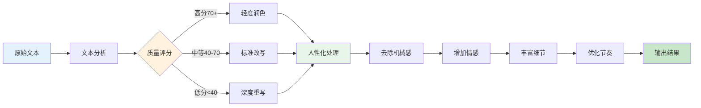

**人性化改写策略**:
1. **质量评估**: 先分析文本质量
2. **策略选择**: 根据质量选择改写力度
3. **人性化处理**:
   - 去除 AI 的机械感
   - 增加情感色彩
   - 丰富细节描写
   - 优化语言节奏

---

## 8. 小说分析工作流程

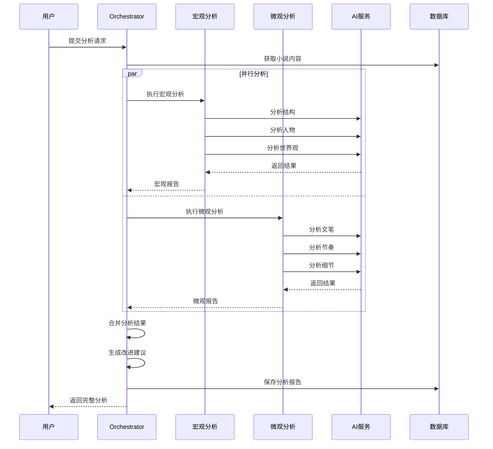

**小说分析维度**:

### 宏观分析
- **整体结构**: 开头、发展、高潮、结尾
- **人物塑造**: 主角、配角、人物关系
- **世界观**: 设定完整性、逻辑自洽

### 微观分析
- **文笔质量**: 词汇、句式、修辞
- **节奏把控**: 叙事节奏、对话节奏
- **细节描写**: 环境、动作、心理

---

## 9. Prompt 管理架构

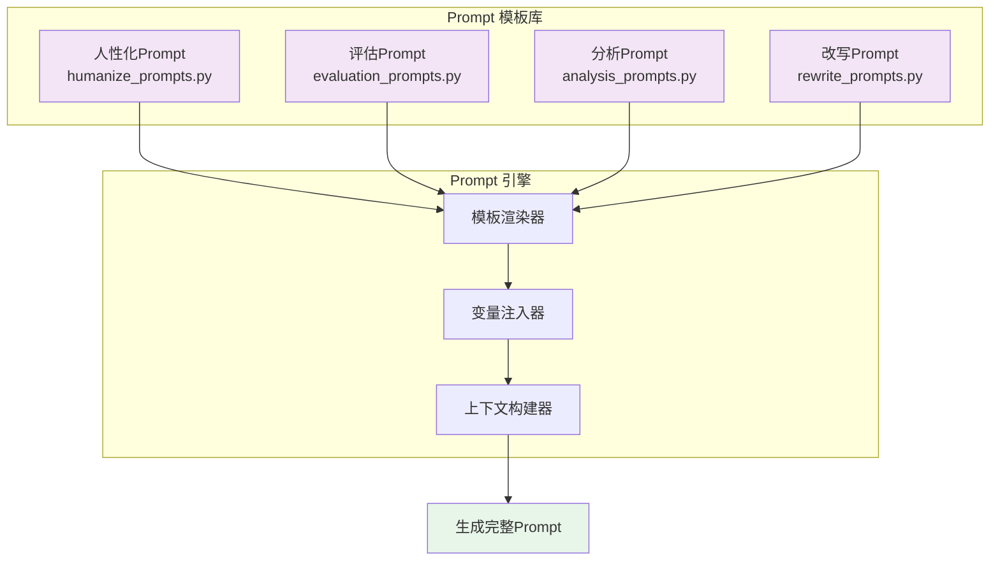

**Prompt 设计原则**:
1. **明确指令**: 清晰描述任务目标
2. **上下文提供**: 提供足够背景信息
3. **格式要求**: 指定输出格式
4. **示例展示**: Few-shot 学习
5. **约束限制**: 明确边界条件

**Prompt 模板示例**:
```python
HUMANIZE_PROMPT = """
你是专业文学编辑,擅长将AI文本改写得更自然。

任务: 改写以下文本,使其更有人情味

原文:
{original_text}

上下文:
前文: {context_before}
后文: {context_after}

要求:
1. 保持核心信息不变
2. 增加情感色彩
3. 优化语言节奏
4. 去除机械感

请直接输出改写结果:
"""
```

---

## 10. AI 模型配置

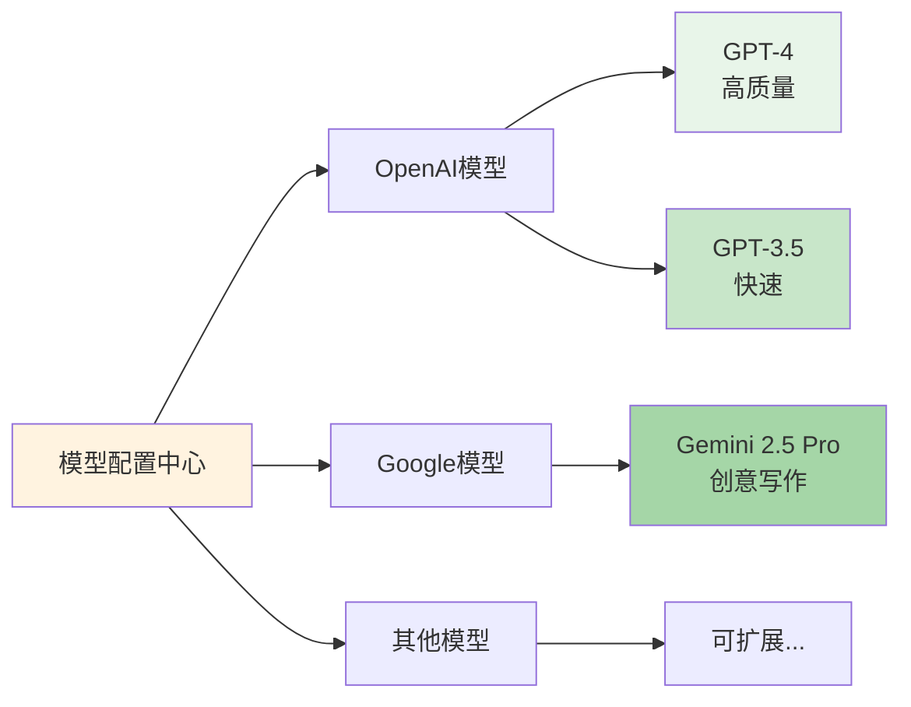

**模型配置表**:

| 模型 | 提供商 | 优势 | 使用场景 |
|------|--------|------|----------|
| GPT-4 | OpenAI | 高质量,理解力强 | 复杂分析、创意写作 |
| GPT-3.5 | OpenAI | 快速,成本低 | 简单改写、快速生成 |
| Gemini 2.5 Pro | Google | 创意好,细节丰富 | 扩写、细节描写 |

**模型选择策略**:
```python
def select_model(task_type, quality_required):
    if task_type == "analysis" or quality_required == "high":
        return "gpt-4"
    elif task_type == "quick_rewrite":
        return "gpt-3.5-turbo"
    elif task_type == "creative_writing":
        return "gemini-2.5-pro"
    else:
        return "gpt-3.5-turbo"  # 默认
```

---

## 11. 性能优化策略

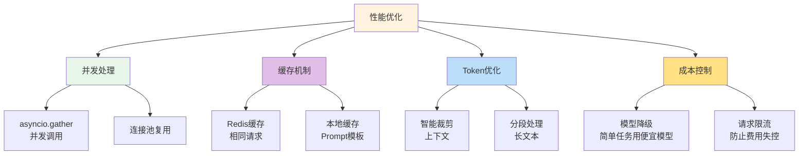

**优化措施详解**:

### 1. 并发处理
```python
# 并发调用多个模型
results = await asyncio.gather(
    model1.rewrite(text),
    model2.rewrite(text),
    model3.rewrite(text),
    return_exceptions=True  # 容错
)
```

### 2. 缓存机制
- **Redis 缓存**: 缓存相同请求的结果
- **TTL 设置**: 24 小时过期
- **缓存键**: `ai:rewrite:{hash(text+mode)}`

### 3. Token 优化
- **上下文裁剪**: 只保留关键信息
- **分段处理**: 长文本拆分处理
- **增量更新**: 只处理变化部分

### 4. 成本控制
- **模型降级**: 简单任务使用 GPT-3.5
- **请求限流**: 每用户每分钟限制
- **预算告警**: 费用超标自动通知

---

## 12. 错误处理流程

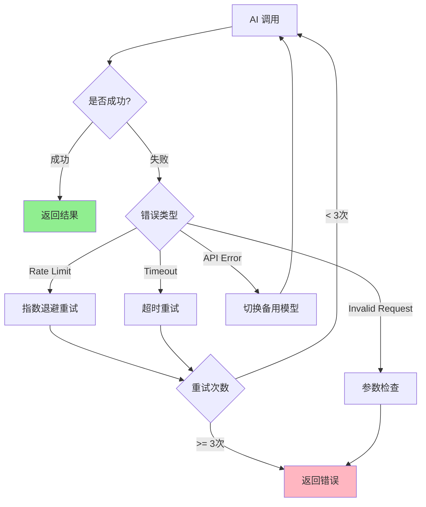

**错误处理策略**:
- **限流错误**: 指数退避 (1s, 2s, 4s)
- **超时错误**: 最多重试 3 次
- **参数错误**: 记录日志,返回错误
- **API 错误**: 切换备用模型

---

## 13. 监控和日志

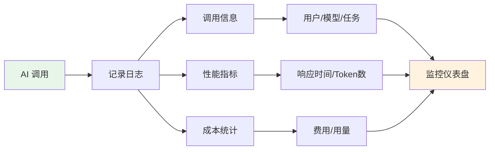

**监控指标**:

### 调用日志
```json
{
  "timestamp": "2025-10-28T10:30:00",
  "user_id": "user-123",
  "model": "gpt-4",
  "task": "rewrite",
  "input_tokens": 150,
  "output_tokens": 300,
  "elapsed_time": 2.5,
  "cost": 0.015,
  "success": true
}
```

### 性能指标
- **平均响应时间**: 各模型平均耗时
- **成功率**: API 调用成功率
- **Token 消耗**: 总使用量
- **费用统计**: 每日/每月费用

### 质量监控
- **用户满意度**: 用户选择哪个结果
- **重试率**: 用户重新生成比例
- **问题反馈**: 用户报告的问题

---

## 14. 未来规划

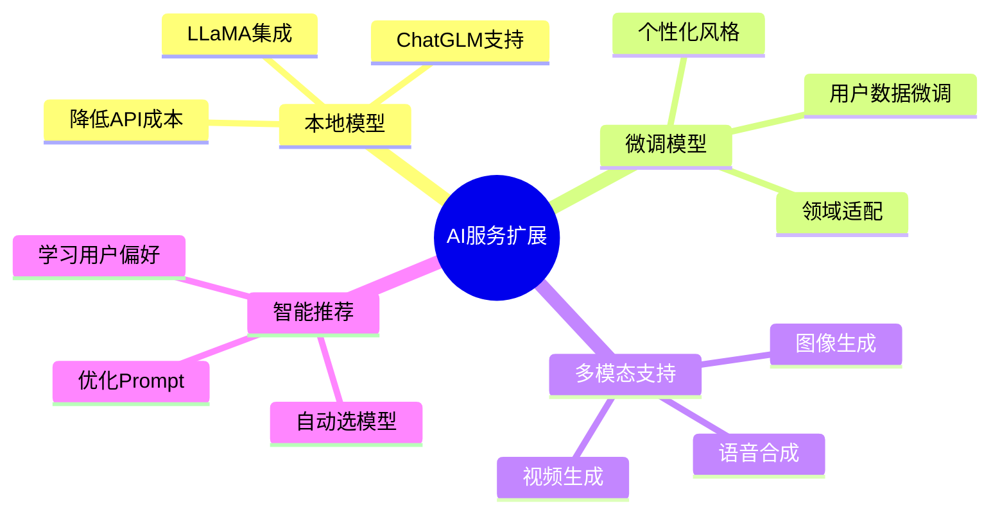

### 1. 本地模型支持
- 集成开源 LLM (LLaMA, ChatGLM)
- 降低 API 成本
- 提升响应速度

### 2. 模型微调
- 基于用户数据微调
- 提升特定领域效果
- 个性化写作风格

### 3. 多模态支持
- **图像生成**: 作品配图
- **语音合成**: 有声书
- **视频生成**: 预告片

### 4. 智能推荐
- 根据任务类型自动选模型
- 学习用户偏好
- 动态优化 Prompt

---

## 技术栈

### AI 相关
- **OpenAI SDK**: openai-python
- **HTTP 客户端**: aiohttp, httpx
- **异步框架**: asyncio
- **并发控制**: asyncio.gather, asyncio.Semaphore

### Prompt 管理
- **模板引擎**: Jinja2
- **配置管理**: YAML/JSON

### 监控日志
- **日志框架**: Python logging
- **监控工具**: 自研仪表盘
- **数据存储**: PostgreSQL

---

**AI 服务是 AI Writer 的核心竞争力!** 🚀
