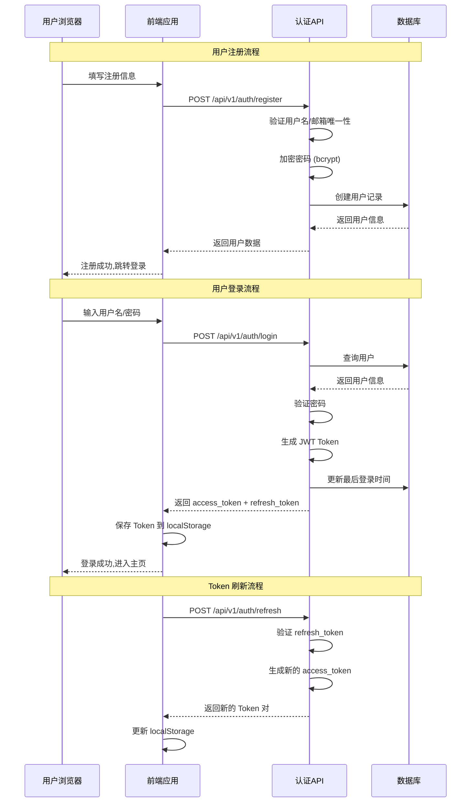
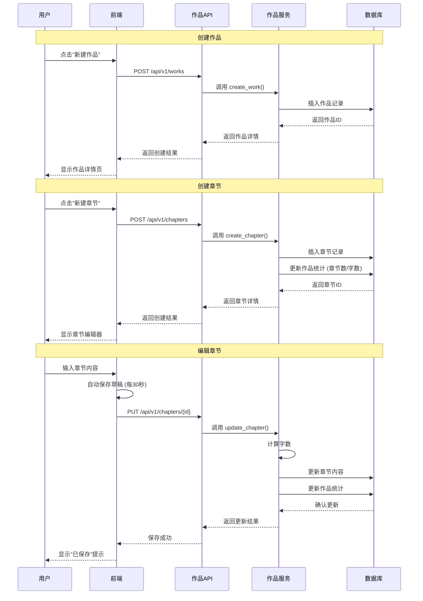
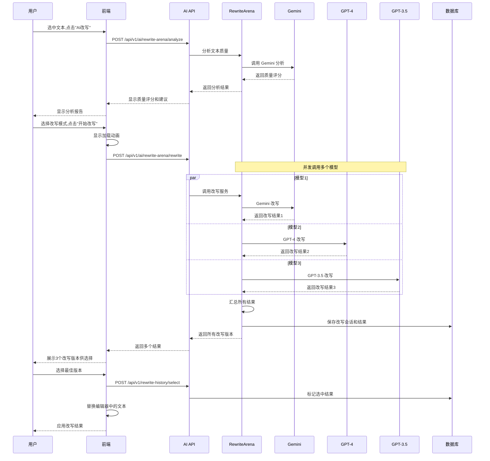
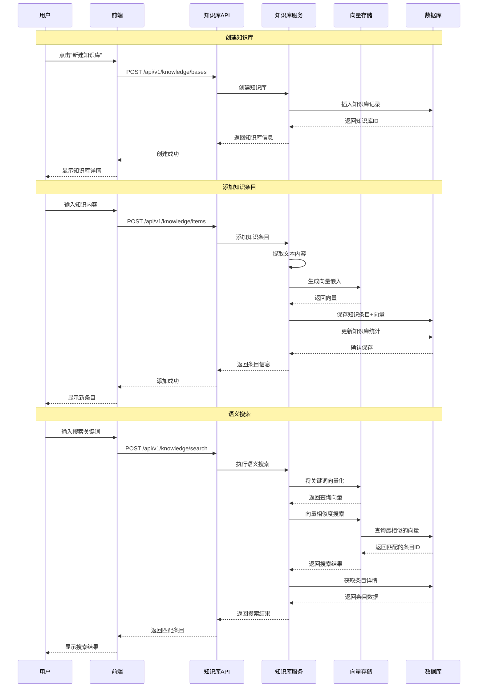
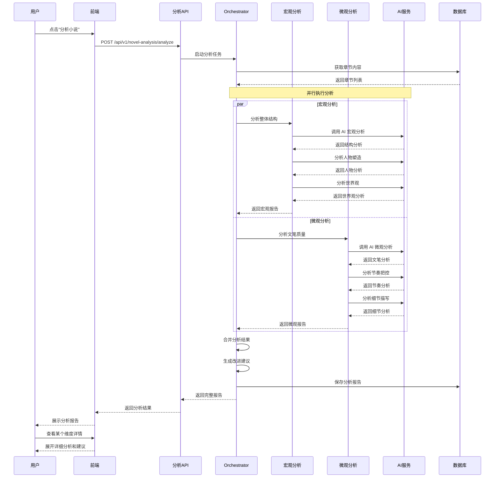
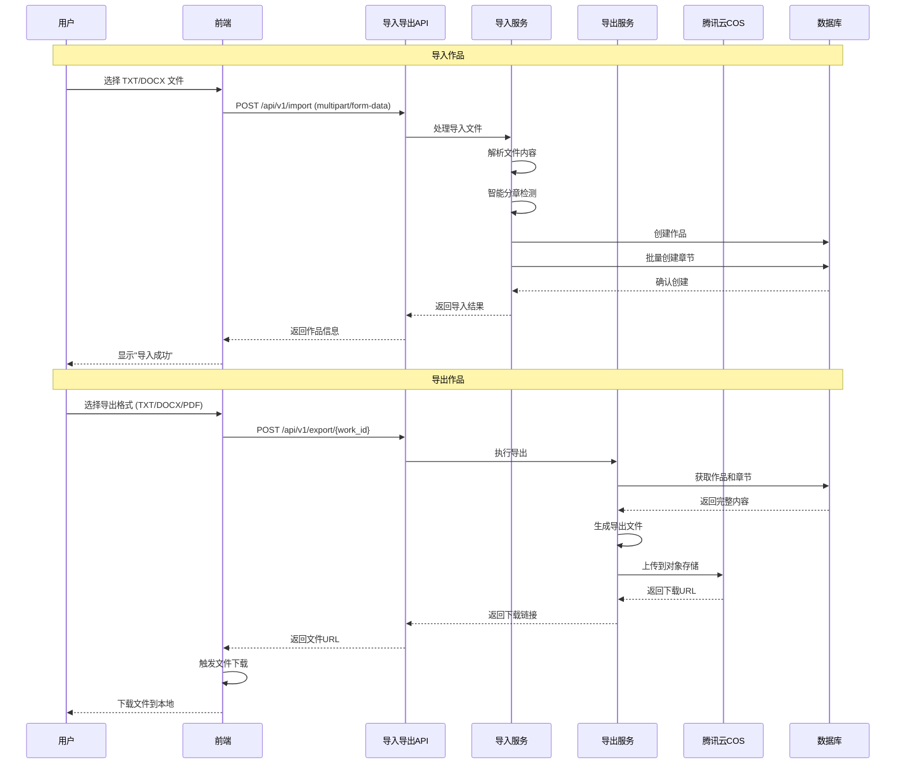
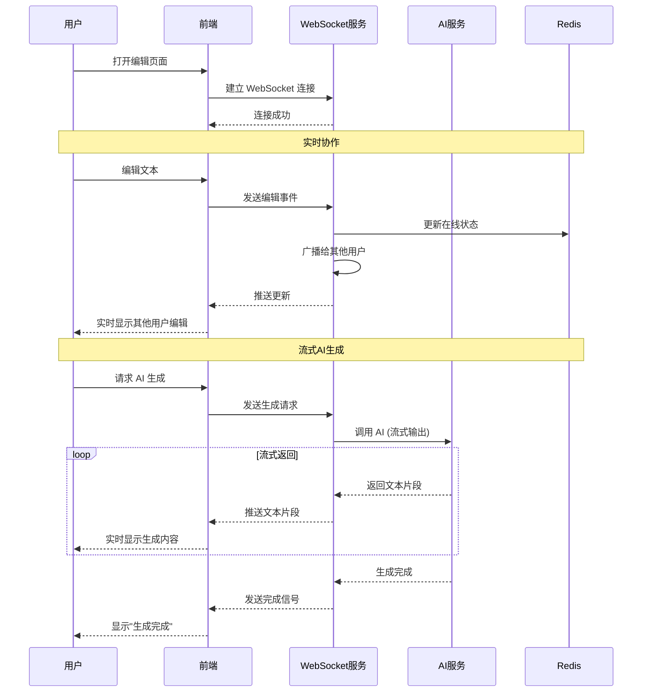
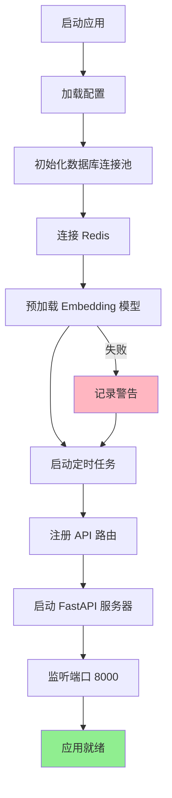
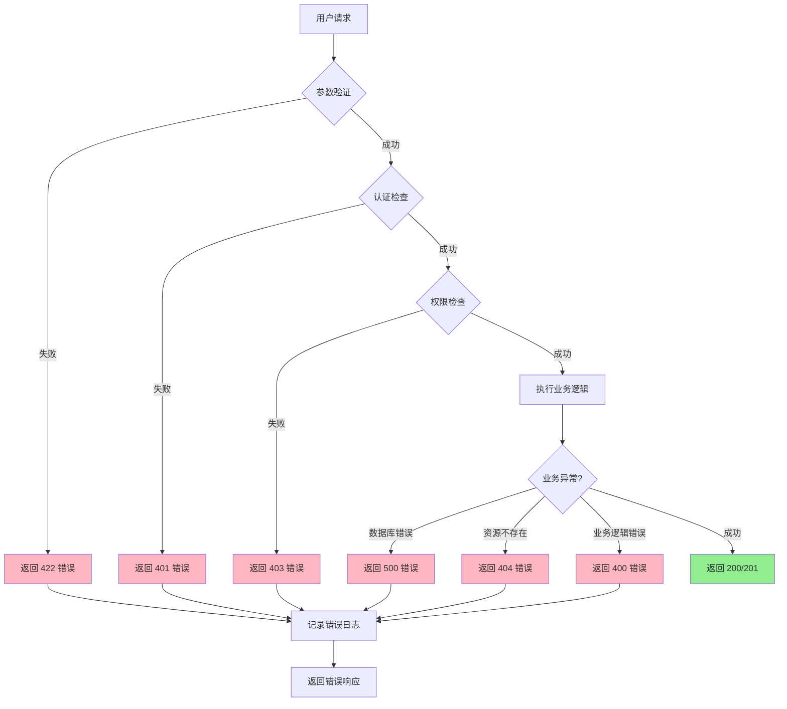
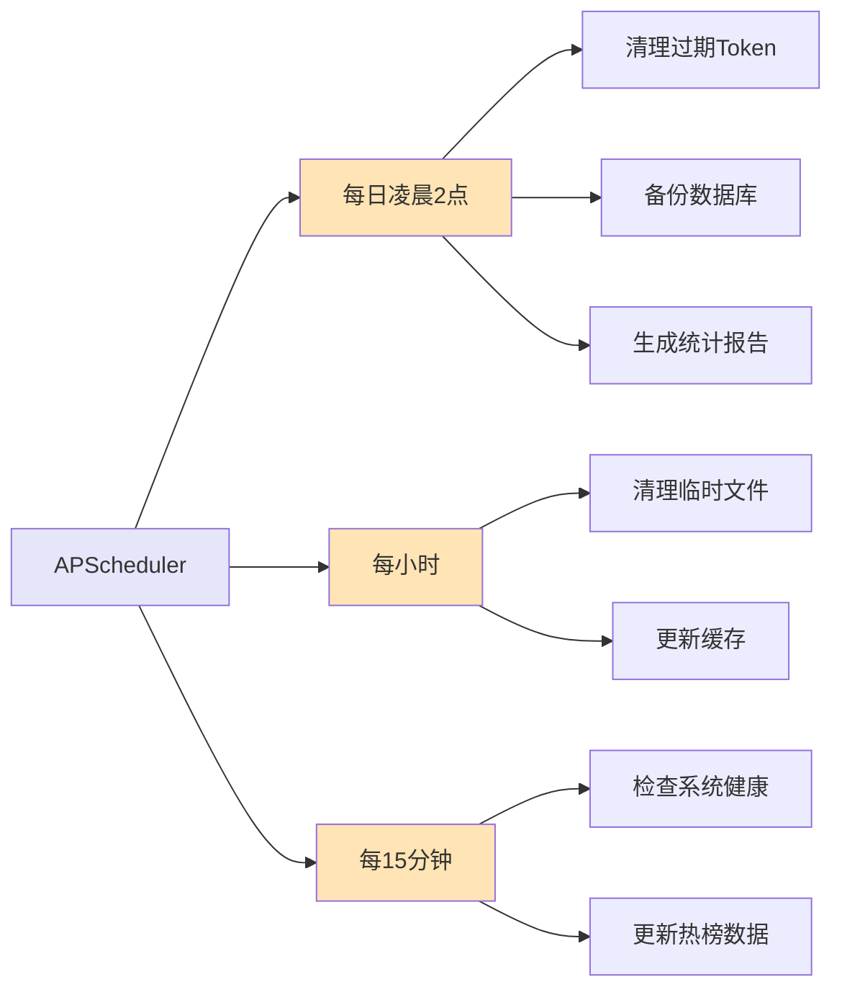

# AI Writer 核心业务流程

> 本文档展示系统的核心业务流程

## 1. 用户认证流程

## 2. 作品创作流程

## 3. AI 改写竞技场流程

## 4. 知识库管理流程

## 5. 小说分析流程

## 6. 导入导出流程

## 7. WebSocket 实时通信

## 8. 系统启动流程

## 9. 错误处理流程

## 10. 定时任务流程

## 业务规则说明

### 权限规则
1. **用户只能操作自己的资源** (作品/章节/知识库)
2. **管理员可以查看所有资源** (待实现)
3. **未登录用户只能访问公开接口** (注册/登录)

### 数据规则
1. **作品删除**: 级联删除所有章节
2. **章节更新**: 自动更新作品统计 (总字数/章节数)
3. **知识库删除**: 级联删除所有知识条目

### 业务规则
1. **章节字数**: 自动计算,不需手动输入
2. **改写历史**: 保留最近 30 天
3. **导出文件**: 临时文件保留 24 小时

---

这些流程图展示了系统的核心业务逻辑,帮助理解各个模块如何协同工作。
